# SafeHome 3D AI — Living System Architecture Specification

> **System Architecture Specification (Synchronized with Repository State)**  
> **Repository:** [SafeHome3DAI](https://github.com/NguyenTriBaoThang/SafeHome3DAI) · **Last Synchronized:** November 2026 · **Branch:** `main`

---

## 1. Executive Summary & Vision

**SafeHome 3D AI** (*Nhà an toàn, tuổi già an tâm*) is an integrated multimodal AI, 3D WebGL digital twin, and clinical decision-support platform dedicated to identifying, visualizing, explaining, and remediating environmental fall hazards in elderly living spaces.

According to the World Health Organization (WHO) and the US Centers for Disease Control and Prevention (CDC STEADI), **environmental hazards cause more than 50% of falls in older adults**, leading to fractures, hospitalizations, and severe loss of independence. SafeHome 3D AI transforms traditional static paper checklists into a **closed-loop 7-step digital workflow**:

```text
1. Khảo sát thông minh (AI Guided Survey)
   └── 2. Thị giác máy tính & Thẩm định vật dụng (Multimodal Vision & Item Hazard Assessment)
         └── 3. Bản sao số 3D (Photorealistic Digital Twin)
               └── 4. Đánh giá nguy cơ y khoa (Deterministic Clinical Risk Engine)
                     └── 5. Mô phỏng kịch bản (Interactive What-If Simulation)
                           └── 6. Phân tích Trước/Sau (Comparative Analytics)
                                 └── 7. Báo cáo & Lộ trình (Action Plan & Export)
```

---

## 2. Monorepo & Directory Structure

```text
SafeHome3DAI/
├── .github/
│   └── workflows/
│       ├── ci.yml                 # CI test & build pipeline (Node 20, Vitest, tsc, Next.js build)
│       ├── deploy-pages.yml       # GitHub Pages deployment pipeline for technical documentation
│       └── commitlint.yml         # Conventional commits enforcement
├── docs/                          # 50+ Technical markdown specifications & audit reports
│   ├── architecture/              # End-to-end data flow & system design
│   └── audit/                     # Verification audits, test suites, and frontend reviews
├── docs-site/                     # Static documentation & showcase portal (React + Vite + GitHub Pages)
├── prisma/
│   ├── schema.prisma              # 16 Relational models (SQLite dev, PostgreSQL production)
│   └── dev.db                     # Local SQLite database
├── src/
│   ├── app/                       # Next.js 14 App Router
│   │   ├── (auth)/                # Authentication & user profile
│   │   ├── ai-assistant/          # Grounded RAG Copilot with 4-tab Evidence & Item Inspector
│   │   ├── ai-guided-survey/      # Dynamic adaptive survey engine with Vietnamese NLP
│   │   ├── ai-vision/             # SafeHome Vision Intelligence Studio (Full Room Scanner)
│   │   ├── analytics/             # Comparative Before/After radar analytics
│   │   ├── api/                   # RESTful API endpoints (vision, rag, simulation, assessment)
│   │   │   ├── ai/                # Chat, conversations, citations
│   │   │   ├── rag/               # RAG benchmark evaluation
│   │   │   ├── vision/            # Vision analyze, scan-photo, assess-item
│   │   │   └── simulations/       # Simulation save/restore
│   │   ├── dashboard/             # Executive KPI overview & mini 3D twin viewer
│   │   ├── digital-twin/          # 3D spatial digital twin workspace & Photorealistic Dollhouse
│   │   ├── explainability/        # Explainable AI (XAI) ReactFlow decision graph & audit trail
│   │   ├── reports/               # Printable clinical action plan & PDF exporter
│   │   ├── risk-assessment/       # Clinical risk scoring & finding matrix
│   │   ├── scenario-simulator/    # Interactive remediation simulator & What-If engine
│   │   ├── simulations/           # 3D saved simulation archive
│   │   ├── vision/                # AiRoomScannerWizard 3D camera interface
│   │   └── workflow/              # End-to-end 7-step guided journey
│   ├── components/                # Modular React UI components
│   │   ├── chat/                  # SafeHomeMarkdown, ItemAssessmentModal, ItemHazardCard
│   │   ├── layout/                # AppSidebar, AppHeader, AppLayout
│   │   ├── risk/                  # Risk card, score meter, remediation badge
│   │   ├── scanner/               # AiRoomScannerWizard
│   │   ├── survey/                # Question renderers, audio input, progress tracking
│   │   ├── three/                 # RoomCanvas, RoomScene, PhotorealisticDollhouse, smart clustering
│   │   └── xai/                   # DecisionTreeGraph, AuditTrailDrawer
│   ├── data/                      # Preset rooms, dollhouse scenes, curated knowledge whitelist
│   ├── features/                  # Domain feature modules
│   ├── lib/                       # Core domain engines & utility logic
│   │   ├── rag/                   # Hybrid retrieval, query analysis, evidence sufficiency, evaluator
│   │   ├── reconstruction/        # Spatial validation engine & 3D mesh reconstruction
│   │   ├── risk/                  # Deterministic 8-rule clinical fall engine & explanation engine
│   │   ├── survey/                # Survey state machine & Vietnamese NLP parser
│   │   └── vision/                # Magic bytes, EXIF strip, Item Hazard Analyzer, Gemini Vision adapter
│   ├── stores/                    # Zustand state management (useSimulationStore, useSurveyStore)
│   └── types/                     # Shared TypeScript interfaces & Zod schemas
└── tests/                         # Vitest automated test suite (109/109 passed, 20 suites)
```

---

## 3. High-Level System Architecture

```mermaid
flowchart TB
    subgraph Client["Presentation Layer (Next.js 14 App Router · React 18 · Three.js)"]
        UI_Survey["AI Guided Survey\n(/ai-guided-survey)"]
        UI_Vision["AI Vision Studio\n(/ai-vision, /vision)"]
        UI_ItemModal["Item Hazard Assessment Modal\n(Hotspots H1..H4 · CDC STEADI)"]
        UI_3D["3D Digital Twin\n(/digital-twin)"]
        UI_Sim["Saved 3D Simulations\n(/simulations)"]
        UI_Risk["Risk Assessment\n(/risk-assessment)"]
        UI_Simulator["Scenario Simulator\n(/scenario-simulator)"]
        UI_XAI["Explainable AI Decision Graph\n(/explainability)"]
        UI_RAG["AI RAG Copilot\n(/ai-assistant)"]
        UI_Workflow["7-Step Unified Flow\n(/workflow)"]
        UI_Docs["Technical Docs Portal\n(docs-site : GitHub Pages)"]
    end

    subgraph Security["Security & Input Hardening Layer"]
        MagicBytes["Magic Bytes Validator\n(JPEG: FFD8FF, PNG: 89504E47, WebP: RIFF)"]
        ExifStrip["EXIF & Metadata Stripper\n(Zero GPS/Device Leakage)"]
        ZodGate["Strict Zod Schema Gate\n(Type-safe API Payloads)"]
    end

    subgraph CoreEngines["Core Domain Engines Layer (TypeScript)"]
        SurveyEngine["Survey Flow Engine\n(Dynamic Pruning & Vietnamese NLP)"]
        VisionEngine["Vision Inference Adapter\n(18-Class Taxonomy + SVG/HTML Overlay)"]
        ItemHazardEngine["Item Hazard Analyzer\n(3 Questions · Hotspots H1..H4 · Biomechanics)"]
        RiskEngine["Deterministic Clinical Risk Engine\n(8 Rules · WHO 2021 & CDC STEADI)"]
        SpatialEngine["Spatial Validation Engine\n(Boundary, Clearance, Collision Detection)"]
        TwinClustering["3D Spatial Clustering\n(<0.95m Euclidean Marker Clustering)"]
        RAGEngine["Evidence-Grounded RAG\n(Field-Boosted Retrieval + Whitelist Verification)"]
    end

    subgraph Persistence["Persistence & Audit Layer (Prisma ORM)"]
        DB[("Relational Database\nSQLite (dev) / PostgreSQL (prod)\n16 Data Models")]
        AuditLog[("AuditEvent Store\nMedical State & Override History")]
    end

    Client --> Security
    Security --> CoreEngines
    CoreEngines --> Persistence
```



---

## 4. Subsystem Architectural Deep Dives

### 4.1. Phân Hệ Thẩm Định Nguy Cơ Vật Dụng Qua Ảnh (Item Fall Hazard Assessment Engine)
- **API Endpoint:** `POST /api/vision/assess-item` (supports multipart upload & base64 JSON).
- **Domain Logic:** `src/lib/vision/itemHazardAnalyzer.ts` and `src/lib/vision/itemHazardTypes.ts`.
- **UI Components:** `ItemAssessmentModal.tsx` & `ItemHazardCard.tsx`.
- **Clinical Alignment:** Evaluates environmental risk according to **CDC STEADI Standard & WHO 2021**:
  1. **Mức độ nguy hiểm bao nhiêu?** Deterministic scoring ($0 - 100$) mapped into Urgency Levels (`KHẨN CẤP`, `ƯU TIÊN CAO`, `TRUNG BÌNH`, `THẤP`) and Severity Tiers (`CRITICAL`, `HIGH`, `MEDIUM`, `LOW`).
  2. **Tại sao nguy hiểm đối với người già?** Formulates biomechanical rationale: Focal blunt impact at 90° corners, reduced friction coefficient ($\mu < 0.4$), visual depth perception impairment with transparent glass, and pathway narrowing ($< 90\text{ cm}$).
  3. **Nguy hiểm ở chỗ nào?** Dynamically generates numbered visual hotspots (**H1, H2, H3, H4...**) with normalized coordinates $\{x\%, y\%\}$, specific injury mechanisms, and an interactive **click-to-reposition** tool directly on the image container.
  4. **Biện pháp cải thiện:** Step-by-step remediation guide, bill of materials, estimated costs (VND), and completion time.
- **Cross-module Bridge:** Direct seamless transition to `/ai-vision` for full room digital twin integration or to `/ai-assistant` for follow-up conversational consultation.

### 4.2. Phân Hệ Thị Giác Máy Tính AI (Multimodal AI Vision Studio — `/ai-vision`)
- **Dual-tier Architecture:**
  - **Tier 1 (Room-Level):** Full-room object detection, multi-viewpoint ingestion (Entrance, Bedside, Bathroom Door), and 3D bounding box projection.
  - **Tier 2 (Item-Level):** Single-item deep hazard diagnosis via `assess-item`.
- **Chromium SVG Defect Resolution:** Solved the browser bug where `<foreignObject>` inside an SVG with `viewBox="0 0 100 100"` magnified text to 50px letters. The rendering pipeline now decouples SVG bounding boxes (`rect` with `rx="0.8"`) from CSS HTML Overlay pills (`text-[10px] font-bold`), ensuring crisp typography and smart repositioning when items are near the top border (`top < 7%`).
- **Human-in-the-Loop Hub:** Allows users to confirm (`CONFIRMED`), correct (`CORRECTED`), or reject (`REJECTED`) detected objects before persisting into the digital twin fact store.

### 4.3. Bản Sao Số 3D & Không Gian Kiến Trúc Photorealistic (`/digital-twin`)
- **Photorealistic Reference Scene:** Architecturally accurate master bedroom and en-suite bathroom dollhouse (`src/data/dollhouseReferenceScene.ts`).
- **Interactive Lighting Studio:** Real-time illumination presets:
  - Sunset (Hoàng hôn)
  - Daylight (Ban ngày — 250 Lux)
  - Night (Ban đêm — 40 Lux, fall hazard threshold)
  - Studio (320 Lux)
  - Continuous lux slider ($0 - 520\text{ Lux}$).
- **Surface Friction & Assistive Safety Controls:**
  - Dynamic floor state: Dry (Khô ráo) vs Wet (Sàn ướt — $\mu < 0.3$).
  - One-click assistive hardware toggles: Toilet grab bar, shower grab bar, suction non-slip mat.
- **Camera Viewports:** Dollhouse, Eye-level (Tầm mắt người cao tuổi), Top-down floorplan (Mặt bằng 2D), First-person Walkthrough, Fit to screen, and Snapshot export.
- **Smart Marker Clustering (<0.95m):** Euclidean distance clustering groups adjacent hazards into a single interactive cluster badge, preventing 3D label visual overlap.

### 4.4. Động Cơ Đánh Giá Nguy Cơ Lâm Sàng Tất Định (Deterministic Risk Engine)
- **Zero Hallucination Guarantee:** Risk scores and hazard findings are computed strictly via deterministic mathematical formulas based on WHO 2021 & CDC STEADI clinical guidelines:
  $$S = \max\left(0, 100 - \sum \text{Penalties}\right)$$
- **8 Core Clinical Rules:**
  1. `RUG_NO_GRIP` (Penalty: 20 pts)
  2. `BED_HEIGHT_UNSAFE` (Penalty: 15 pts)
  3. `NIGHT_PATH_DARK` (Penalty: 20 pts)
  4. `NO_BATH_GRAB_BAR` (Penalty: 25 pts)
  5. `CLUTTER_ON_FLOOR` (Penalty: 15 pts)
  6. `SLIPPERY_FLOOR` (Penalty: 25 pts)
  7. `NO_NIGHT_LIGHT` (Penalty: 10 pts)
  8. `HIGH_THRESHOLD` (Penalty: 10 pts)

### 4.5. Trợ Lý AI RAG & Ngăn Tra Cứu Bằng Chứng Y Khoa (`/ai-assistant`)
- **SafeHomeMarkdown Renderer:** Custom typography featuring structured clinical headings, contextual 3D room pills (`📌`), callout alerts (`* ⚠️`), and interactive numbered citation badges (`[1]`, `[2]`, `[3]`, `[4]`).
- **4-Tab Right Evidence Drawer:**
  - **Tab 1 — Bằng chứng (Evidence):** Document title, publisher, section, page number, verbatim excerpt, and direct external link to official healthcare guidelines.
  - **Tab 2 — Vật dụng (Items):** History of evaluated items, danger scores, and direct link to AI Vision.
  - **Tab 3 — Kho nguồn (Sources):** Curated whitelist of accredited authorities (WHO, CDC STEADI, Bộ Y Tế Việt Nam, NCOA).
  - **Tab 4 — Thẩm định RAG (Eval):** Live execution of the 8-metric RAG benchmark (Faithfulness, Relevance, Grounding).
- **Anti-Hallucination Fallback:** When external LLM APIs are unavailable or lack verified medical grounding, the engine activates `Evidence Fallback Active` to ensure complete accuracy without hallucinated statistics.

### 4.6. Giải Trình Quyết Định & Truy Vết Nguồn Gốc (XAI & Audit Trail — `/explainability`)
- **Causal Graph Visualization:** Powered by `@xyflow/react`, linking:
  $$\text{Phòng khảo sát} \longrightarrow \text{Vật thể 3D} \longrightarrow \text{Số đo hình học} \longrightarrow \text{Quy chuẩn y tế} \longrightarrow \text{Nguy cơ cảnh báo} \longrightarrow \text{Biện pháp can thiệp}$$
- **Audit Trail:** Immutable log recording all state transitions, user overrides, timestamps, and clinical rationale.

---

## 5. Đảm Bảo Chất Lượng & Kết Quả Kiểm Thử (QA & Tests)

SafeHome 3D AI enforces rigorous continuous testing. All **20 test suites and 109 automated tests pass with a 100% pass rate**:

| STT | Tập Tin Kiểm Thử | Số Lượng Tests | Loại Kiểm Thử | Trạng Thái |
| :---: | :--- | :---: | :---: | :---: |
| 1 | `tests/spatialValidationEngine.test.ts` | 8 | Unit Test | PASS |
| 2 | `tests/surveyEngine.test.ts` | 9 | Unit Test | PASS |
| 3 | `tests/riskIntelligence.test.ts` | 10 | Unit Test | PASS |
| 4 | `tests/realisticReconstruction.test.ts` | 6 | Unit Test | PASS |
| 5 | `tests/visionEngine.test.ts` | 14 | Unit Test | PASS |
| 6 | `tests/riskEngine.test.ts` | 11 | Unit Test | PASS |
| 7 | `tests/copilotEngine.test.ts` | 10 | Unit Test | PASS |
| 8 | `tests/visionIntegration.test.ts` | 2 | Integration Test | PASS |
| 9 | `tests/riskIntegration.test.ts` | 3 | Integration Test | PASS |
| 10 | `tests/dollhouseReferenceScene.test.ts` | 5 | Unit Test | PASS |
| 11 | `tests/copilotIntegration.test.ts` | 4 | Integration Test | PASS |
| 12 | `tests/surveyIntegration.test.ts` | 4 | Integration Test | PASS |
| 13 | `tests/simulationUndoRedo.test.ts` | 3 | Unit Test | PASS |
| 14 | `tests/workflowEngine.test.ts` | 4 | Unit Test | PASS |
| 15 | `tests/itemHazardAssessment.test.ts` | 4 | Unit Test | PASS |
| 16 | `tests/geminiVision.test.ts` | 3 | Integration Test | PASS |
| 17 | `tests/integration.test.ts` | 3 | Integration Test | PASS |
| 18 | `tests/ragEngine.test.ts` | 4 | Unit Test | PASS |
| 19 | `tests/ragEvaluation.test.ts` | 1 | Benchmark Test | PASS |
| 20 | `tests/workflowIntegration.test.ts` | 1 | Integration Test | PASS |
| **Tổng** | **20 Test Files** | **109 Tests** | **Full Suite** | **100% PASS** |

- **Type Safety:** `npx tsc --noEmit` verified with **0 errors**.
- **Production Build:** `npm run build` succeeds cleanly across all 33 Next.js routes.
