# SafeHome 3D AI — Living System Architecture Specification

> **System Architecture Specification (Synchronized with Current Codebase)**  
> **Repository:** [SafeHome3DAI](https://github.com/NguyenTriBaoThang/SafeHome3DAI) · **Updated:** November 2026 · **Runtime:** Next.js 15.5.29 · React 19.1.0 · Node.js `>= 22.12.0`

---

## 1. Executive Summary & Scope

**SafeHome 3D AI** (*Nhà an toàn, tuổi già an tâm*) là nền tảng hỗ trợ sàng lọc yếu tố nguy cơ môi trường nhà ở cho người cao tuổi, kết hợp Khảo sát thích ứng, Thị giác máy tính đa tầng + Camera trực tiếp, Bản sao số 3D WebGL, Động cơ quy tắc tất định (`RISK-001..008`), Truy vết quyết định theo quy tắc (**Decision Provenance**), và Trợ lý RAG có căn cứ tài liệu WHO/CDC/BYT/NCOA.

**Phạm vi trung thực:** Ứng dụng hỗ trợ sàng lọc yếu tố môi trường và hoạch định cải tạo không gian sống; **không thay thế chẩn đoán y khoa**, không dự báo xác suất ngã cá nhân và các ngưỡng biên `THRESHOLD_CONFIG_V2026_1` hiện mang trạng thái `PENDING_CLINICAL_REVIEW`.

```text
0. Đăng nhập hộ gia đình (/sign-in — tách SQLite riêng trong SAFEHOME_PRIVATE_DIR)
   └── 1. Khảo sát thông minh (/ai-guided-survey)
         └── 2. Thị giác AI & Camera trực tiếp (/ai-vision, /vision)
               └── 3. Bản sao số 3D & Tour Cinematic (/digital-twin, /experience, /simulations)
                     └── 4. Đánh giá yếu tố môi trường (/risk-assessment)
                           └── 5. Mô phỏng kịch bản What-If (/scenario-simulator)
                                 └── 6. Đối chiếu Trước/Sau (/analytics) & Truy vết (/explainability, /risk-assessment/traceability)
                                       └── 7. Kế hoạch cải tạo & Báo cáo (/reports)
```

---

## 2. Repository & Module Structure

```text
SafeHome3DAI/
├── .github/workflows/             # CI gates, unit/build checks, GitHub Pages deploy, commitlint
├── docs/                          # Technical documentation, A01-A12 & B01-B12 reports
├── docs-site/                     # Technical Documentation Portal (Vite + React, deployed to GitHub Pages)
├── prisma/
│   ├── schema.prisma              # 31 Relational models (per-household isolated SQLite runtime)
│   └── migrations/                # Verified non-destructive SQLite migrations
├── reports/full-system-audit/     # Full System Audit, Security, E2E & Readiness deliverables (10 reports)
├── scripts/
│   ├── accounts/archive.cjs       # Offline SQLite household backup & restore CLI
│   ├── ci/quality-gates.cjs       # Secrets, migrations, shared contracts, withAccount() & docs checks
│   ├── completion/                # Production http-smoke.cjs & multi-tenant Chromium browser.cjs
│   ├── evaluation/                # B11 field study analysis runner
│   ├── ml/                        # Stage 1-6 dataset/exploration/RT-DETR preparation & 81 unit tests
│   └── run-rag-benchmark-a09.cjs  # 40-question Vietnamese RAG benchmark
├── src/
│   ├── app/                       # 17 App Router UI pages + 63 API routes (59 protected via withAccount)
│   │   ├── sign-in/               # Account registration & login
│   │   ├── dashboard/             # Household safety overview & Recharts analytics
│   │   ├── workflow/              # 7-step unified guided journey
│   │   ├── ai-guided-survey/      # Adaptive DAG survey, Vietnamese NLP & photo evidence upload
│   │   ├── ai-vision/             # Vision Studio (upload, LiveCameraCaptureModal, 18-class HITL, Draft 3D)
│   │   ├── vision/                # AiRoomScannerWizard (Image / Multi-angle / Video / Camera -> 3D)
│   │   ├── digital-twin/          # Interactive 3D Dollhouse & Photo Draft Workspace
│   │   ├── experience/            # 6-chapter cinematic WebGL home exploration tour
│   │   ├── simulations/           # Multi-room 3D workspace archive
│   │   ├── scenario-simulator/    # What-If intervention simulator with Undo/Redo
│   │   ├── risk-assessment/       # Canonical RISK-001..008 matrix + /traceability
│   │   ├── explainability/        # Rule-Based Decision Provenance graph (@xyflow/react)
│   │   ├── ai-assistant/          # Evidence-grounded RAG Copilot with 4-tab drawer & item assessment
│   │   ├── analytics/             # Before/After comparison matrix & charts
│   │   └── reports/               # Printable clinical action plan & JSON export
│   ├── components/
│   │   ├── camera/                # LiveCameraCaptureModal (getUserMedia, low-light check, capture)
│   │   ├── chat/                  # SafeHomeMarkdown, ItemAssessmentModal, ItemHazardCard
│   │   ├── experience/            # CinematicScene, ChapterOverlay, experienceData
│   │   ├── layout/                # AccountShell, AppHeader, AppSidebar
│   │   ├── scanner/               # AiRoomScannerWizard
│   │   ├── simulator/             # ComparisonPanel, HazardFindingList, ObjectInspector
│   │   ├── three/                 # RoomCanvas, RoomEnvironment, RoomViewer, ModelRenderer, WebGLBoundary
│   │   └── workflow/              # StepNav, AssessmentStep, SimulationStep, ReportStep
│   ├── lib/                       # 19 domain modules (ai, auth, contracts, persistence, privacy, rag, reconstruction, risk, security, three, vision, ...)
│   ├── stores/
│   │   └── useSimulationStore.ts  # Client 3D room, intervention & snapshot state store
│   └── types/
└── tests/                         # 57 Vitest unit/integration/regression test files
```

---

## 3. High-Level System Architecture

```mermaid
flowchart TB
    subgraph Client["Presentation Layer (17 App Router Pages · React 19.1 · R3F 9 · Three.js)"]
        UI_Auth["Sign-In (/sign-in)"]
        UI_Survey["Guided Survey (/ai-guided-survey)"]
        UI_Vision["Vision Studio & Camera (/ai-vision, /vision)"]
        UI_3D["3D Workspace & Tour (/digital-twin, /experience, /simulations)"]
        UI_Risk["Risk & Simulator (/risk-assessment, /scenario-simulator, /analytics, /reports)"]
        UI_RAG["Copilot & Decision Provenance (/ai-assistant, /explainability)"]
        UI_Workflow["7-Step Workflow (/workflow)"]
    end

    subgraph Security["AuthN, Privacy & Boundary Layer"]
        AccountGuard["withAccount() on 59 Business APIs\n(4 Public /api/auth/* routes)"]
        ConsentGate["Versioned ConsentRecord\n(Default-Deny thirdPartyAI)"]
        MediaPrivacy["Magic Bytes, APP1/EXIF Strip\nHMAC Signed Media URLs (15MB cap)"]
        SafeErrors["buildSafeErrorPayload & Secret/PII Redaction"]
    end

    subgraph CoreEngines["Core Domain Engines"]
        SurveyEngine["Survey Flow Engine (DAG Pruning + NLP)"]
        VisionEngine["GeminiProvider / LocalDetectorProvider\n(18-Class Taxonomy + Retractable HITL)"]
        RiskEngine["Canonical Risk Engine\n(RISK-001..008 · PENDING_CLINICAL_REVIEW)"]
        SpatialEngine["Spatial Reconstructor & Placement\n(lightingModel.ts simulated vs lux)"]
        RAGEngine["Curated Evidence RAG + Guardrails\n(WHO, CDC, BYT, NCOA)"]
    end

    subgraph Persistence["Multi-Tenant SQLite Persistence (Prisma 5.22 · 31 Models)"]
        AccountsDB[("accounts.db (.private)\nSalted Hash AuthN & Quotas")]
        FamilyDB[("Isolated Per-Family SQLite\n31 Models · RoomSnapshot v1")]
        PrivateMedia[("Private Family Disk Store\nCascade Delete + Offline Backup")]
    end

    Client --> Security
    Security --> CoreEngines
    CoreEngines --> Persistence
```



---

## 4. Key Architecture Invariants

### 4.1. Multi-Tenant SQLite Isolation & Privacy (`A05`–`A07`)
- **Account & Tenant Boundary:** Mỗi tài khoản gia đình đăng ký qua `/sign-in` sở hữu file SQLite riêng và thư mục ảnh riêng dưới `SAFEHOME_PRIVATE_DIR` (mặc định `.private/`). Các request nghiệp vụ bắt buộc đi qua `withAccount()` (`59/59` protected routes).
- **Private Media & Consent:** Ảnh không lưu vào thư mục public tĩnh; trình duyệt truy xuất ảnh riêng qua `/api/vision/images/[imageId]/file` kèm kiểm tra session/chủ sở hữu/HMAC token ngắn hạn. Gửi ảnh cho Gemini bị chặn theo chế độ mặc định từ chối (`default-deny`) nếu thiếu `ConsentRecord` hợp lệ.
- **No Fake Clinical Measurements:** Endpoint `/api/risk-assessment/evaluate` từ chối HTTP `422` (`NEEDS_VERIFICATION`) nếu đầu vào ở trạng thái `PHOTO_DRAFT`. Tương tự, `/api/workflow/save-state` trả `410 DEMO_WORKFLOW` để giữ ranh giới DEMO vs REAL.

### 4.2. Computer Vision, Live Camera & HITL (`B02`–`B05`)
- **Input Channels:** Tải file nhị phân (`JPG/PNG/WebP <= 10MB`), hoặc chụp trực tiếp từ camera thiết bị thông qua `LiveCameraCaptureModal` (`navigator.mediaDevices.getUserMedia`, chuyển camera trước/sau, cảnh báo độ sáng khung hình thấp `< 50 Lux`).
- **18-Class Taxonomy:** `bed`, `chair`, `table`, `cabinet`, `nightstand`, `door`, `toilet`, `sink`, `bathtub`, `sofa`, `rug`, `electrical_cable`, `grab_bar`, `obstacle_route`, `threshold_step`, `lamp`, `light_switch`, `other`.
- **Stage 5 Local Detector Status:** Mô hình mục tiêu `PekingU/rtdetr_r18vd` (Apache-2.0) hiện giữ trạng thái `not_ready` (`0` ảnh train/val verified, không có file ONNX, không fallback ngầm).

### 4.3. 3D Reconstruction, Lighting Separation & Experience (`B06`–`B08`)
- **Approximate Photo Draft:** `unprojectBboxTo3D()` dựng bố cục ước lượng từ bbox 2D và giữ kích thước mẫu đối với `TEMPLATE_SIZED_KINDS`. `placeOne()` & `assignSupportParents()` đảm bảo vật thể tựa đúng mặt nâng đỡ, bám tường hoặc nâng nhẹ `0.005 m` với thảm phẳng tránh z-fighting.
- **Lighting & LOD:** `lightingModel.ts` tách biệt cường độ hiển thị Three.js mô phỏng khỏi số đo lux vật lý; `QUALITY_PRESET_CONFIG` cung cấp preset `LOW`/`MEDIUM`/`HIGH`; `WebGLBoundary` + `WebGLFallback` duy trì giao diện dữ liệu nếu GPU/WebGL lỗi.

### 4.4. Canonical Risk Engine, Immutable Snapshots & Decision Provenance (`A03`–`A11`)
- **8 Versioned Rules:** `RISK-001` (Thảm), `RISK-002` (Dây điện), `RISK-003` (Thông thủy lối đi), `RISK-004` (Ánh sáng ban đêm), `RISK-005` (Độ trơn sàn), `RISK-006` (Thanh vịn), `RISK-007` (Gờ bậc / chiều cao nệm `bedSurfaceHeightCm`), `RISK-008` (Công tắc đầu giường). Giá trị ngưỡng chuẩn hóa trong `thresholdConfig.ts` (`2026.1`) đang mang cờ `PENDING_CLINICAL_REVIEW`.
- **Before/After Snapshots (`v1`) & Provenance:** `RoomSnapshotRecord` bất biến hỗ trợ so sánh, optimistic concurrency và rollback; đồ thị ReactFlow tại `/explainability` và `/risk-assessment/traceability` truy vết **Decision Provenance** theo luật tất định.

---

## 5. Verification Summary

| Check Suite | Latest Observed Result |
| :--- | :--- |
| TypeScript & Quality Gates | `npm run typecheck`: `0` errors · `npm run qa:gates`: `301` files scanned, `59` protected APIs, `0` failures |
| Automated Unit & Integration Tests | **57/57 Vitest files passed** (**486 passed**, `1` live-key test skipped by default) |
| 3D Experience Suite | `npm run test:experience`: **9/9 files passed** (`64/64` tests) |
| RAG 40Q Benchmark | `npm run eval:rag:a09`: **40/40 (100%)** `OFFLINE_DETERMINISTIC` (`PRELIMINARY`) |
| Python & Node ML Contract Suites | `.venv-ml` `unittest`: **81/81 tests OK** · Node ML bridge: **14/14 passed** |
| Production HTTP & Edge Chromium E2E | `http-smoke.cjs`: **10/10** + offline restore · `browser.cjs`: **25/25** · Full 17-route Edge sweep: `0` errors |
| ML & Clinical Evaluation Gates | **BLOCKED** (`0` human-verified train/val/test images; `PENDING_CLINICAL_REVIEW`; `0` B11 field/SUS samples) |
