# SafeHome 3D AI — Living System Architecture Specification

> **System Architecture Specification (Synchronized with Repository State)**  
> **Repository:** [SafeHome3DAI](https://github.com/NguyenTriBaoThang/SafeHome3DAI) · **Last Synchronized:** November 2026 · **Branch:** `main`

---

## 1. Executive Summary & Vision

**SafeHome 3D AI** (*Nhà an toàn, tuổi già an tâm*) is an integrated multimodal AI and 3D digital twin platform dedicated to identifying, visualizing, explaining, and remediating environmental fall hazards in elderly living spaces. 

According to the World Health Organization (WHO) and the US Centers for Disease Control and Prevention (CDC STEADI), **environmental hazards cause more than 50% of falls in older adults**, leading to fractures, institutionalization, and significant loss of independence. SafeHome 3D AI transforms traditional static paper checklists into a **closed-loop 7-step digital workflow**:

```text
1. Khảo sát thông minh (AI Survey)
   └── 2. Thị giác máy tính (Multimodal Vision)
         └── 3. Bản sao số 3D (Digital Twin Space)
               └── 4. Đánh giá nguy cơ (Deterministic Clinical Risk)
                     └── 5. Mô phỏng kịch bản (Interactive What-If Simulation)
                           └── 6. Phân tích Trước/Sau (Comparative Analytics)
                                 └── 7. Báo cáo & Lộ trình (Action Plan & Export)
```

---

## 2. Monorepo & Directory Structure

```text
SafeHome3DAI/
├── .github/
│   └── workflows/
│       ├── ci.yml                 # CI test & build pipeline (Node 20, Vitest, tsc, Next.js build)
│       ├── deploy-pages.yml       # GitHub Pages deployment pipeline for technical documentation
│       └── commitlint.yml         # Conventional commits enforcement
├── docs/                          # 40+ Technical markdown specifications
│   ├── architecture/              # End-to-end data flow & system design
│   └── audit/                     # Verification audits, test suites, and frontend reviews
├── docs-site/                     # Static documentation & showcase portal (React + Vite + GitHub Pages)
├── prisma/
│   ├── schema.prisma              # 16 Relational models (SQLite dev, PostgreSQL production)
│   └── dev.db                     # Local SQLite database
├── src/
│   ├── app/                       # Next.js 14 App Router (33 dynamic & static routes)
│   │   ├── (auth)/                # Authentication & user profile
│   │   ├── ai-guided-survey/      # Dynamic adaptive survey engine
│   │   ├── vision/                # Multimodal AI vision studio
│   │   ├── digital-twin/          # 3D spatial digital twin workspace
│   │   ├── risk-assessment/       # Clinical risk scoring & finding matrix
│   │   ├── simulations/           # 3D saved simulation archive
│   │   ├── scenario-simulator/    # Interactive remediation simulator
│   │   ├── comparison/            # Before vs After safety radar
│   │   ├── xai/                   # Explainable AI trace & decision graphs
│   │   ├── chat/                  # RAG copilot & evidence citations
│   │   ├── safety-report/         # Printable action plan & PDF exporter
│   │   ├── workflow/              # End-to-end 7-step guided journey
│   │   └── api/                   # 15+ RESTful API endpoints
│   ├── components/                # Modular React UI components
│   │   ├── three/                 # Three.js canvas, RoomCanvas, RoomScene, smart clustering
│   │   ├── survey/                # Question renderers, audio input, progress tracking
│   │   ├── vision/                # Dropzone, bounding box overlay, inspection modal
│   │   ├── risk/                  # Risk card, score meter, remediation badge
│   │   └── layout/                # AppSidebar, Header, AppLayout
│   ├── lib/                       # Core domain engines & utility logic
│   │   ├── survey/                # Survey state machine & Vietnamese NLP parser
│   │   ├── vision/                # Image validation (magic bytes, EXIF strip) & model provider
│   │   ├── risk/                  # Deterministic 8-rule clinical fall engine
│   │   └── rag/                   # Vector knowledge base & WHO/CDC citations
│   └── types/                     # Shared TypeScript interfaces & Zod schemas
└── tests/                         # Vitest automated test suite (80/80 passed, 14 suites)
```

---

## 3. High-Level System Architecture

```mermaid
flowchart TB
    subgraph Client["Presentation Layer (Next.js 14 App Router)"]
        UI_Survey["AI Guided Survey\n(/ai-guided-survey)"]
        UI_Vision["Vision Studio\n(/vision)"]
        UI_3D["3D Digital Twin\n(/digital-twin)"]
        UI_Sim["Saved 3D Simulations\n(/simulations)"]
        UI_Risk["Risk Assessment\n(/risk-assessment)"]
        UI_XAI["Explainable AI Graph\n(/xai, /xai/trace)"]
        UI_RAG["AI RAG Copilot\n(/chat)"]
        UI_Workflow["7-Step Unified Flow\n(/workflow)"]
    end

    subgraph Security["Security & Input Hardening"]
        MagicBytes["Magic Bytes Validator\n(JPEG: FFD8FF, PNG: 89504E47)"]
        ExifStrip["EXIF & Metadata Stripper\n(Zero GPS/Device Leakage)"]
        ZodGate["Strict Zod Schema Gate\n(Type-safe API Payloads)"]
    end

    subgraph CoreEngines["Core Domain Engines (TypeScript)"]
        SurveyEngine["Survey Flow Engine\n(Dynamic Irrelevance Pruning & NLP)"]
        VisionEngine["Vision Inference Adapter\n(YOLOv8 & ViT Object Taxonomy)"]
        RiskEngine["Deterministic Risk Engine\n(8 Clinical Rules · WHO / CDC STEADI)"]
        TwinClustering["3D Spatial Clustering\n(<0.95m Euclidean Marker Clustering)"]
        RAGEngine["Evidence-Grounded RAG\n(Vector Similarity + Citation Links)"]
    end

    subgraph Persistence["Persistence & Audit (Prisma ORM)"]
        DB[("Relational Database\nSQLite (dev) / PostgreSQL (prod)\n16 Schemas")]
        AuditLog[("AuditEvent Store\nFull Clinical State Machine History")]
    end

    Client --> Security
    Security --> CoreEngines
    CoreEngines --> Persistence
```



---

## 4. Key Architectural Subsystems

### 4.1. AI Guided Survey with Vietnamese NLP
- **Dynamic Irrelevance Pruning**: Skips irrelevant downstream questions (e.g. if no rug exists, rug fixing question `BED_007` is pruned).
- **True Denominator Progress**: Progress indicator accurately reflects only questions applicable to the current conditional branch.
- **Stale Dependency Invalidation**: Updating an upstream response automatically removes obsolete answers, resets dependent hazard findings, and writes an `AuditEvent`.
- **Vietnamese Natural Language Processing**: Extracts numeric dimensions (length, width, door width) and qualitative descriptions directly from conversational Vietnamese.

### 4.2. Multimodal AI Vision Studio
- **Security-First Image Ingestion**: Validates buffer magic bytes (rejecting spoofed MIME types), removes all EXIF GPS metadata, and enforces maximum image limits (10MB, 4096x4096px).
- **Object Detection & Taxonomy**: Standardized mapping to 18 elderly fall-relevant indoor entities (e.g. `rug`, `grab_bar`, `electrical_cord`, `bed`, `toilet`).
- **Bounded Uncertainty & Confirmation**: Detections below high-confidence thresholds prompt explicit user verification before propagating into clinical risk records.

### 4.3. 3D Digital Twin with Smart Spatial Clustering
- **WebGL Rendering via Three.js & R3F**: Real-time rendering of furniture, walking paths, doorways, and environmental parameters (lighting lux, floor slip resistance).
- **Smart Hazard Clustering (<0.95m)**: Solves the 3D label crowding problem by aggregating overlapping hazard markers within 0.95m into an expandable badge (e.g. `+3 Nguy cơ`), preventing visual occlusions.
- **Persistent Simulation Archive**: Users can save and load distinct 3D safety interventions across rooms.

### 4.4. Deterministic Clinical Risk Assessment Engine
- **Non-Hallucinating Deterministic Logic**: Zero LLM temperature in clinical safety calculations. Strictly executes 8 standardized rules mapped to WHO 2021 & CDC STEADI:
  - `RUG_NO_GRIP`: Loose rug on walking path.
  - `BED_HEIGHT_UNSAFE`: Bed height outside 45-50cm ergonomic safety band.
  - `NIGHT_PATH_DARK`: Pathway lighting below 50 Lux.
  - `NO_BATH_GRAB_BAR`: Absence of support rails in wet areas.
  - `CLUTTER_ON_FLOOR`: Obstacles in walking corridor.
  - `SLIPPERY_FLOOR`: Bathroom floor lack of anti-slip coating.
  - `NO_NIGHT_LIGHT`: Lack of sensor nightlight.
  - `HIGH_THRESHOLD`: Door threshold elevation > 1.5cm.
- **Priority Policy**: Scores hazards into `CRITICAL`, `HIGH`, `MEDIUM`, and `LOW` with weighted score penalties and immediate actionable interventions.

### 4.5. Explainable AI (XAI) & Evidence-Grounded RAG
- **Explainable Decision Trace**: Graph visualization (@xyflow/react) tracing each risk finding back to raw survey responses, vision bounding boxes, sensor data, and medical guidelines.
- **RAG Copilot**: Grounded question answering citing exact sections of WHO and CDC guidelines with clinical disclaimers.

---

## 5. Automated Testing & Quality Guarantees

SafeHome 3D AI enforces high QA standards with **100% automated test coverage across 14 test suites (80 passed)**:
- `tests/unit/survey-flow.test.ts`: Branching, pruning, invalidation, NLP extraction.
- `tests/unit/risk-engine.test.ts`: Deterministic calculation of all 8 clinical rules.
- `tests/unit/vision-validation.test.ts`: Magic byte integrity, EXIF stripping, coordinate clamps.
- `tests/integration/workflow-e2e.test.ts`: Complete 7-step data consistency.
- `tests/integration/three-clustering.test.ts`: Spatial marker clustering bounds.

