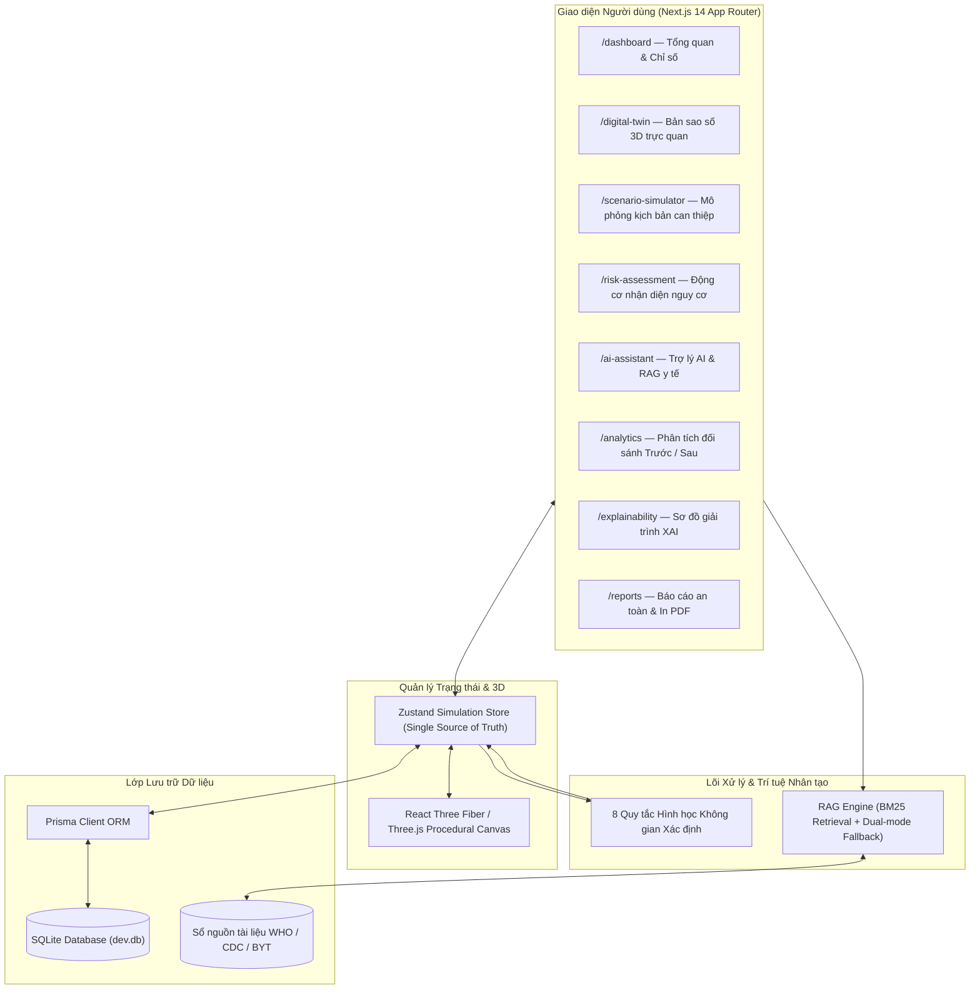

# SafeHome 3D AI — Nhà An Toàn, Tuổi Già An Tâm

> **Hệ sinh thái Digital Twin 3D kết hợp AI giải trình giúp nhận diện, giải thích và chủ động loại bỏ các nguy cơ gây té ngã trong không gian sống của người cao tuổi.**

[](https://nextjs.org/)
[](https://react.dev/)
[](https://docs.pmnd.rs/react-three-fiber)
[](https://www.prisma.io/)
[](https://vitest.dev/)
[](LICENSE)

---

## 1. Giới thiệu dự án (Project Overview)

Té ngã là nguyên nhân hàng đầu dẫn đến chấn thương nặng, gãy xương chậu và suy giảm khả năng vận động ở người cao tuổi tại Việt Nam và trên toàn cầu. Theo Tổ chức Y tế Thế giới (WHO) và CDC Hoa Kỳ, có đến **60% - 70% các vụ té ngã bắt nguồn từ các yếu tố rủi ro môi trường vật lý trong nhà** (thảm trải sàn bị xê dịch, dây điện chắn lối, thiếu ánh sáng ban đêm, sàn trơn ướt và thiếu điểm tựa trong phòng tắm).

**SafeHome 3D AI** được xây dựng nhằm giải quyết bài toán này:
- Cho phép gia đình và người chăm sóc tương tác với một **Bản sao số 3D (Digital Twin)** của căn nhà.
- Áp dụng **Động cơ phân tích hình học không gian xác định** để tự động phát hiện 8 loại nguy cơ môi trường phổ biến.
- Tích hợp **Trợ lý AI chuyên môn với cơ chế RAG có đối chứng** từ WHO, CDC STEADI và Bộ Y tế Việt Nam.
- Cung cấp **Môi trường mô phỏng kịch bản (Scenario Simulator)** để người dùng di chuyển đồ đạc, thay đổi độ sáng, bổ sung thanh vịn và đối sánh kết quả Trước / Sau can thiệp tức thì.
- Xuất bản **Báo cáo an toàn chi tiết** có thể in trực tiếp hoặc lưu file PDF.

> ⚠️ **Tuyên bố y tế quan trọng**: Ứng dụng phục vụ mục đích giáo dục cộng đồng và hoạch định cải tạo an toàn môi trường sống. Hệ thống không thay thế cho chẩn đoán y khoa, thẩm định xây dựng thực tế hoặc ý kiến của bác sĩ chuyên khoa.

---

## 2. Kiến trúc hệ thống (System Architecture)



---

## 3. Các phân hệ chức năng chính (Core Modules)

| Phân hệ | Đường dẫn | Chức năng nổi bật |
|---|---|---|
| **Module A — Tổng quan & Chỉ số** | `/dashboard` | Thống kê số lượng phòng, điểm số an toàn (0-100), biểu đồ phân loại nguy cơ (Donut Chart) và biểu đồ phân bổ nguy cơ theo phòng (Bar Chart). |
| **Module B — Bản sao số 3D** | `/digital-twin` | Không gian 3D tương tác thời gian thực: Phòng ngủ, Phòng tắm, Phòng khách. Điều khiển xoay, zoom, pan, các góc nhìn camera (Isometric, Top, Front), nhãn vật thể 3D, hành lang an toàn và kiểm tra thuộc tính vật thể. |
| **Module C — Động cơ nhận diện nguy cơ** | `/risk-assessment` | Động cơ thẩm định 8 quy tắc hình học không gian (Thảm, Dây điện, Ánh sáng, Sàn ướt, Thanh vịn, Vật cản, Đồ bừa bộn, Góc nhọn). Bấm vào từng nguy cơ để camera 3D tự động lướt đến định vị đối tượng. |
| **Module D — Trợ lý AI & RAG** | `/ai-assistant` | Hỏi đáp y tế và an toàn nhà ở với cơ chế RAG trích dẫn trực tiếp từ WHO, CDC STEADI, Bộ Y tế Việt Nam. Tự động kích hoạt cơ chế phản hồi cục bộ xác thực (Local Fallback) khi chưa có API Key. |
| **Module E — Mô phỏng kịch bản** | `/scenario-simulator` | Môi trường mô phỏng can thiệp: Tinh chỉnh vị trí đồ vật, dán thảm, luồn nẹp dây điện, tăng độ rọi Lux, lắp thêm thanh vịn. Nút **"Chạy mô phỏng"** tức thì cập nhật bảng đối sánh kịch bản. |
| **Module F — Phân tích Trước / Sau** | `/analytics` | Đối sánh chi tiết các nguy cơ đã giải quyết (Resolved), còn tồn đọng (Remaining), mới phát sinh (New) và độ cải thiện điểm số an toàn (Score Delta). |
| **Module G — Sơ đồ giải trình XAI** | `/explainability` | Sơ đồ đồ thị tương tác `@xyflow/react` thể hiện đầy đủ chuỗi logic minh bạch: *Vật thể 3D → Thuộc tính đo đạc → Quy tắc thẩm định → Nguy cơ → Căn cứ tài liệu → Khuyến nghị*. |
| **Module H — Báo cáo an toàn** | `/reports` | Xuất báo cáo chuyên nghiệp định dạng in ấn (`window.print()` / Lưu PDF) và xuất tệp JSON dữ liệu hoàn chỉnh. |

---

## 4. Công nghệ sử dụng (Tech Stack)

- **Frontend Framework**: Next.js 14 (App Router)
- **Ngôn ngữ**: TypeScript 5, React 18
- **3D Graphics Engine**: Three.js, React Three Fiber (`@react-three/fiber`), `@react-three/drei`
- **Giao diện & Thiết kế**: Tailwind CSS, Lucide Icons, Shadcn/ui conventions, Framer Motion
- **Quản lý Trạng thái**: Zustand (Zero boilerplate, đồng bộ thời gian thực)
- **Biểu đồ dữ liệu**: Recharts (PieChart, BarChart, ResponsiveContainer)
- **Sơ đồ đồ thị giải trình**: React Flow (`@xyflow/react`)
- **Cơ sở dữ liệu & ORM**: Prisma ORM v5.22, SQLite (`prisma/dev.db`)
- **Kiểm thử tự động**: Vitest v1.6 (18 unit, integration và RAG test cases)

---

## 5. Hướng dẫn cài đặt & Khởi chạy (Installation & Setup)

### Bước 1: Cài đặt các gói phụ thuộc
```bash
npm install
```

### Bước 2: Khởi tạo Cơ sở dữ liệu SQLite & Nạp dữ liệu mẫu
```bash
# Tạo Prisma Client
npm run db:generate

# Khởi tạo schema SQLite cục bộ (dev.db)
npm run db:push

# Nạp dữ liệu mẫu (Căn hộ Bác Nam 75 tuổi, các phòng và tài liệu WHO/CDC)
npm run db:seed
```

### Bước 3: Cấu hình biến môi trường (Tùy chọn)
Sao chép tệp mẫu:
```bash
cp .env.example .env
```
Nội dung tệp `.env`:
```env
DATABASE_URL="file:./dev.db"
ENABLE_EXTERNAL_LLM="false"
GEMINI_API_KEY=""
OPENAI_API_KEY=""
NODE_ENV="development"
```
*(Nếu không điền API Key, hệ thống vẫn hoạt động 100% đầy đủ chức năng thông qua cơ chế Evidence-based Local Fallback).*

### Bước 4: Khởi chạy ứng dụng
```bash
npm run dev
```
Mở trình duyệt tại: **`http://localhost:3000`**

---

## 6. Kiểm thử tự động (Testing)

Dự án được trang bị 18 ca kiểm thử tự động toàn diện kiểm tra tính toán hình học 2D, các quy tắc nhận diện nguy cơ, phân tích kịch bản và cơ chế RAG:

```bash
# Thực thi toàn bộ kiểm thử
npm test
```

Kết quả thực tế:
```text
 ✓ tests/riskEngine.test.ts   (11 tests)
 ✓ tests/integration.test.ts  (3 tests)
 ✓ tests/ragEngine.test.ts   (4 tests)

 Test Files  3 passed (3)
      Tests  18 passed (18)
```

---

## 7. Giới hạn hiện tại & Lộ trình phát triển (Roadmap)

### Giới hạn hiện tại:
1. **Quy tắc không gian**: Tập trung vào 8 quy tắc hình học cốt lõi đối với phòng ngủ, phòng tắm và phòng khách phổ biến tại Việt Nam.
2. **Điểm số an toàn**: Là chỉ số đánh giá thực nghiệm (heuristic) mang tính định hướng quy hoạch môi trường vật lý, không phải là xác suất y khoa cá nhân.

### Lộ trình phát triển:
- [ ] Tích hợp mô hình Computer Vision nhận diện vật thể và tự động tạo mô hình 3D từ ảnh chụp phòng thật của người dùng.
- [ ] Bổ sung mô phỏng hoạt cảnh người cao tuổi di chuyển bằng gậy hoặc khung tập đi (Kinematic Simulation).
- [ ] Kết nối thiết bị cảm biến IoT trong nhà (cảm biến áp suất thảm, cảm biến rơi ngã radar UWB).
- [ ] Mở rộng kho thư viện nội thất và tiêu chuẩn xây dựng nhà ở xã hội cho người cao tuổi.

---

## 8. Giấy phép & Tác giả (License)
Dự án được phát hành theo giấy phép **MIT License**.
Phát triển vì mục tiêu nâng cao chất lượng cuộc sống và sự an tâm cho người cao tuổi Việt Nam.
