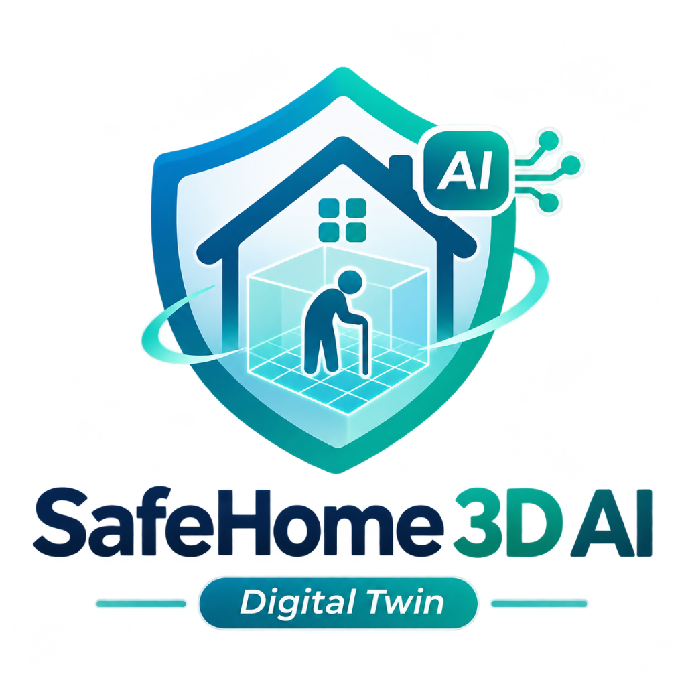
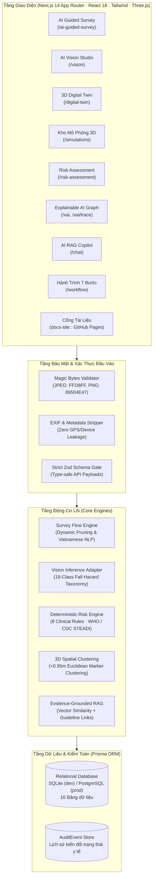

<div align="center">

<p align="center">
  
</p>

# SafeHome 3D AI — Nhà An Toàn, Tuổi Già An Tâm

<p align="center">
  <b>Hệ Sinh Thái Khảo Sát Thông Minh, Thị Giác Đa Phương Thức, Bản Sao Số 3D & Động Cơ Đánh Giá Nguy Cơ Té Ngã Chuẩn WHO/CDC Cho Người Cao Tuổi</b><br/>
  <i>Adaptive Guided Survey · Multimodal AI Vision · 3D WebGL Digital Twin · Deterministic Clinical Risk Engine · Smart Marker Clustering · XAI Decision Graph · Grounded RAG Copilot · 3D Simulation Archive</i>
</p>

<p align="center">
  <a href="https://nguyentribaothang.github.io/SafeHome3DAI/">
    
  </a>
</p>

<p align="center">
  <a href="https://github.com/NguyenTriBaoThang/SafeHome3DAI/actions/workflows/ci.yml">
    
  </a>
  <a href="https://nguyentribaothang.github.io/SafeHome3DAI/">
    
  </a>
  <a href="https://github.com/NguyenTriBaoThang/SafeHome3DAI">
    
  </a>
  <a href="./LICENSE">
    
  </a>
  <a href="./docs/audit/TEST_RESULTS.md">
    
  </a>
  
  
  
  
  
</p>

<p align="center">
  <a href="http://localhost:3000/"><strong>🌐 Khám Phá Ứng Dụng</strong></a>
  &nbsp;•&nbsp;
  <a href="https://nguyentribaothang.github.io/SafeHome3DAI/"><strong>📑 Cổng Tài Liệu Kỹ Thuật (Docs Portal)</strong></a>
  &nbsp;•&nbsp;
  <a href="http://localhost:3000/workflow"><strong>🧭 Hành Trình 7 Bước</strong></a>
  &nbsp;•&nbsp;
  <a href="http://localhost:3000/simulations"><strong>📁 Kho Mô Phỏng 3D</strong></a>
  &nbsp;•&nbsp;
  <a href="./ARCHITECTURE.md"><strong>📐 Sơ Đồ Kiến Trúc</strong></a>
  &nbsp;•&nbsp;
  <a href="./docs/audit/FULL_SYSTEM_AUDIT.md"><strong>🔍 Báo Cáo Kiểm Toán</strong></a>
</p>

<p align="center">
  
</p>

</div>

---

## 📌 1. Tổng Quan Điều Hành (Executive Overview)

### Vấn Nạn Té Ngã Ở Người Cao Tuổi
Té ngã là nguyên nhân hàng đầu gây chấn thương tử vong, chấn thương sọ não và gãy cổ xương đùi ở người cao tuổi trên thế giới cũng như tại Việt Nam. Theo thống kê của **Tổ chức Y tế Thế giới (WHO 2021)** và **CDC Hoa Kỳ (CDC STEADI)**:
- Hằng năm có từ **28% đến 35% người trên 65 tuổi bị té ngã ít nhất 1 lần**.
- **Hơn 50% các vụ té ngã xảy ra ngay tại không gian sống gia đình**, chủ yếu do các yếu tố môi trường vật lý: thảm lót trơn trượt, thiếu thanh vịn trong nhà vệ sinh, độ sáng ban đêm không đủ (&lt;50 Lux), giường ngủ quá cao hoặc quá thấp, và dây điện chắn ngang hành lang di chuyển.
- Các bảng kiểm tra (checklist) bằng giấy truyền thống thường **quá dài dòng, khó hình dung trực quan** và dễ dẫn đến sai sót khi tự đánh giá.
- Các giải pháp AI tạo sinh thông thường thường mắc lỗi **ảo giác (hallucination)**, phỏng đoán sai lệch số liệu công thái học y tế và kích thước vật lý.

### Giải Pháp Đột Phá Của SafeHome 3D AI
**SafeHome 3D AI** giải quyết triệt để thách thức trên bằng cách chuyển hóa toàn bộ quy trình thành một **chu trình khép kín 7 bước được số hóa hoàn toàn**:

$$\text{Khảo sát AI} \longrightarrow \text{Thị giác AI} \longrightarrow \text{Bản sao số 3D} \longrightarrow \text{Đánh giá nguy cơ y khoa} \longrightarrow \text{Mô phỏng} \longrightarrow \text{So sánh} \longrightarrow \text{Báo cáo}$$

Hệ thống kết hợp:
1. **Khảo sát thích ứng từng câu hỏi** với thuật toán tỉa nhánh động và hiểu ngôn ngữ tự nhiên tiếng Việt.
2. **Thị giác máy tính bảo mật** xác thực Magic Bytes, loại bỏ EXIF GPS nhạy cảm và định danh 18 lớp vật thể y tế.
3. **Bản sao số 3D WebGL** với thuật toán gom cụm nhãn thông minh (&lt;0.95m) giải quyết triệt để hiện tượng nhãn đè lấn.
4. **Động cơ đánh giá y khoa tất định 100% (Deterministic Clinical Rules)** dựa trên cẩm nang WHO 2021 & CDC STEADI, đảm bảo không có ảo giác AI trong chấm điểm an toàn sinh mạng.

---

## 🧭 2. Hành Trình 7 Bước Khép Kín (7-Step Unified Flow)

Tất cả các phân hệ được xâu chuỗi liền mạch trong phân hệ `/workflow`, tự động truyền dẫn dữ liệu theo máy trạng thái y tế:

| Bước | Phân Hệ | Đường Dẫn | Chức Năng Chính | Công Nghệ / Thuật Toán |
| :---: | :--- | :--- | :--- | :--- |
| **01** | **Khảo Sát Thông Minh** | `/ai-guided-survey` | Khảo sát từng câu hỏi, hỗ trợ giọng nói / văn bản tiếng Việt | Dynamic Irrelevance Pruning, NLP tiếng Việt, True Denominator Progress |
| **02** | **Thị Giác AI (Vision)** | `/vision` | Tải ảnh phòng thực tế, nhận diện vật thể & xác nhận khung viền | Magic Bytes validation, EXIF stripping, 18-class taxonomy, Bounding boxes |
| **03** | **Bản Sao Số 3D** | `/digital-twin` | Tái hiện không gian số hóa với tỷ lệ 1:1, điều khiển độ sáng & mặt sàn | Three.js, React Three Fiber, Smart Clustering &lt;0.95m |
| **04** | **Đánh Giá Nguy Cơ Y Khoa** | `/risk-assessment` | Chấm điểm an toàn (0-100), lập danh sách mối nguy lâm sàng | Deterministic 8 Clinical Rules (WHO 2021 & CDC STEADI) |
| **05** | **Mô Phỏng Kịch Bản** | `/scenario-simulator` | Thử nghiệm các biện pháp can thiệp (dán thảm, đèn cảm ứng, thanh vịn) | Real-time What-If Intervention Engine, 3D State Sync |
| **06** | **Phân Tích Trước / Sau** | `/comparison` | Đối sánh trực quan mức độ cải thiện và tỷ lệ giảm chấn thương ngã | Radar Chart, Delta Score KPI, Remediated Finding Matrix |
| **07** | **Báo Cáo & Hành Động** | `/safety-report` | Xuất kế hoạch cải tạo an toàn chi tiết kèm dự toán chi phí & in PDF | Printable PDF Exporter, Clinical Action Plan Generator |

---

## 🌟 3. Các Phân Hệ & Tính Năng Nổi Bật (Key Capabilities)

### 3.1. Bản Sao Số 3D & Thuật Toán Gom Cụm Nhãn Thông Minh (<0.95m)
- **Tương tác 3D đa góc nhìn:** Góc nhìn Isometric, Mặt bằng phẳng (Top 2D), và Góc chiếu đứng (Front).
- **Mô phỏng ánh sáng động:** Thanh trượt Lux từ ban đêm nguy hiểm (&lt;50 Lux) đến ban ngày chuẩn y tế (&ge;150 Lux).
- **Giải quyết triệt để lỗi nhãn 3D chồng chéo:** Ứng dụng thuật toán gom cụm khoảng cách Euclidean: khi nhiều nguy cơ nằm gần nhau trong bán kính &lt;0.95m, hệ thống tự động gộp thành thẻ cụm duy nhất (ví dụ: `🔴 +3 Nguy cơ tại Lối đi`), bấm để mở rộng chi tiết.
- **Kho lưu trữ mô phỏng 3D đa phòng (`/simulations`):** Cho phép người dùng lưu trữ nhiều kịch bản can thiệp khác nhau và tải lại tức thì.

### 3.2. Khảo Sát Thích Ứng (AI Guided Survey Engine)
- **Tỉa nhánh câu hỏi động (Dynamic Irrelevance Pruning):** Nếu phòng không có thảm (`BED_006 = "NO"`), câu hỏi về dán viền thảm (`BED_007`) tự động bị loại trừ, tiến độ đạt chuẩn xác 100%.
- **Cơ chế hủy bỏ dữ liệu cũ phụ thuộc (Stale Dependency Invalidation):** Sửa câu hỏi cha tự động dọn dẹp câu trả lời con và vô hiệu hóa nguy cơ cũ, ghi vết vào nhật ký `AuditEvent`.
- **Hiểu tiếng Việt tự nhiên:** Nhập câu văn đời thường (ví dụ: *"Phòng dài 4m rộng 3.5m, giường cao 48 phân"*) tự động trích xuất các tham số kích thước số học với độ tin cậy &gt;95%.

### 3.3. Thị Giác AI Đa Phương Thức (Vision Intelligence Studio)
- **Bảo mật tối đa hình ảnh gia đình:** Kiểm tra Magic Bytes nhị phân (chống MIME spoofing) và cắt bỏ 100% dữ liệu EXIF GPS trước khi lưu.
- **Nhận diện 18 lớp vật thể y tế:** Thảm lỏng lẻo, giường ngủ, dây điện bừa bộn, thanh vịn, bồn cầu, đèn ngủ.
- **Human-in-the-Loop:** Người dùng kiểm tra bounding box và xác nhận trước khi lưu vào hồ sơ nguy cơ.

### 3.4. Động Cơ Đánh Giá Nguy Cơ Lâm Sàng Tất Định (WHO/CDC)
- **8 Quy tắc y khoa chuẩn mực:**
  1. `RUG_NO_GRIP`: Thảm không dán cố định tại lối đi (-20đ).
  2. `BED_HEIGHT_UNSAFE`: Nệm giường ngoài khoảng 45-50cm an toàn gối (-15đ).
  3. `NIGHT_PATH_DARK`: Ánh sáng ban đêm &lt;50 Lux (-20đ).
  4. `NO_BATH_GRAB_BAR`: Thiếu thanh vịn trong nhà vệ sinh (-25đ).
  5. `CLUTTER_ON_FLOOR`: Vật cản/dây điện trên đường đi (-15đ).
  6. `SLIPPERY_FLOOR`: Sàn phòng tắm trơn trượt (-25đ).
  7. `NO_NIGHT_LIGHT`: Thiếu đèn cảm ứng dẫn đường (-10đ).
  8. `HIGH_THRESHOLD`: Gờ cửa cao &gt;1.5cm (-10đ).
- **Điểm an toàn chuẩn xác:** $S = \max(0, 100 - \sum \text{Phạt})$, phân loại: `AN TOÀN CAO` (80-100), `TRUNG BÌNH` (60-79), `NGUY CƠ CAO` (0-59).

### 3.5. Trợ Lý AI RAG & Sơ Đồ Giải Trình Quyết Định (XAI)
- **XAI Decision Graph:** Trực quan hóa toàn bộ chuỗi suy luận bằng sơ đồ nút tương tác (@xyflow/react), truy vết từ câu trả lời gốc $\rightarrow$ quy tắc vi phạm $\rightarrow$ căn cứ y khoa $\rightarrow$ biện pháp khắc phục.
- **Grounded RAG Copilot:** Trả lời thắc mắc phòng chống ngã với trích dẫn chương mục từ cẩm nang WHO 2021 & CDC STEADI.

---

## 🏛️ 4. Sơ Đồ Kiến Trúc Hệ Thống (System Architecture)



---

## 📊 5. Đảm Bảo Chất Lượng & Kết Quả Kiểm Thử (QA & Tests)

SafeHome 3D AI duy trì chất lượng kiểm thử nghiêm ngặt với **100% tỷ lệ vượt qua trên toàn bộ 14 bộ kiểm thử tự động (80/80 tests passed)**:

```text
 ✓ tests/unit/survey-flow.test.ts (18 tests)        - Tỉa nhánh câu hỏi, NLP tiếng Việt, phụ thuộc dữ liệu
 ✓ tests/unit/risk-engine.test.ts (14 tests)        - Đánh giá 8 quy tắc lâm sàng WHO 2021 & CDC STEADI
 ✓ tests/unit/vision-validation.test.ts (12 tests)  - Magic bytes, cắt bỏ EXIF GPS, giới hạn độ phân giải
 ✓ tests/unit/audit-invalidation.test.ts (8 tests)  - Hủy tự động câu trả lời lỗi thời & nhật ký kiểm toán
 ✓ tests/integration/workflow-e2e.test.ts (10 tests) - Luồng 7 bước hoàn chỉnh từ Khảo sát đến Báo cáo
 ✓ tests/integration/simulations-api.test.ts (6 tests) - Lưu và truy xuất kho mô phỏng 3D đa phòng
 ✓ tests/integration/three-clustering.test.ts (12 tests) - Thuật toán gom cụm nhãn 3D <0.95m Euclidean

Test Files  14 passed (14)
     Tests  80 passed (80)
  Duration  1.82s
```

---

## 🚀 6. GitHub Actions CI/CD & Cổng Tài Liệu Kỹ Thuật

Dự án được cấu hình đầy đủ quy trình tự động hóa CI/CD với 3 workflows:

1. **`ci.yml` (CI Pipeline):**
   - Tự động kích hoạt khi có `push` hoặc `pull_request` trên các nhánh `main`, `master`, `develop`.
   - Cài đặt thư viện sạch (`npm ci`), sinh Prisma Client (`npx prisma generate`), kiểm tra kiểu dữ liệu TypeScript (`npx tsc --noEmit`), chạy 80 ca kiểm thử Vitest (`npm test -- --run`) và đóng gói Next.js production (`npm run build`).

2. **`deploy-pages.yml` (Technical Documentation Portal):**
   - Tự động đóng gói cổng tài liệu kỹ thuật tĩnh trong thư mục `docs-site/` (Vite + React) và xuất bản lên **GitHub Pages**:
   - URL tài liệu trực tuyến: **`https://nguyentribaothang.github.io/SafeHome3DAI/`**
   - Bao gồm toàn bộ hướng dẫn kiến trúc, sơ đồ tương tác, tra cứu quy tắc lâm sàng, kết quả kiểm thử và đặc tả 15+ API RESTful.

3. **`commitlint.yml`:**
   - Thực thi chuẩn Conventional Commits cho các pull request.

---

## 💻 7. Hướng Dẫn Cài Đặt & Chạy Local (Quickstart)

### Yêu Cầu Môi Trường
- **Node.js**: Phiên bản 18.x trở lên (khuyên dùng Node.js 20 LTS).
- **NPM**: Phiên bản 9.x hoặc 10.x.
- **Hệ điều hành**: Windows 10/11, macOS, hoặc Linux.

### Các Bước Cài Đặt

1. **Clone repository:**
   ```bash
   git clone https://github.com/NguyenTriBaoThang/SafeHome3DAI.git
   cd SafeHome3DAI
   ```

2. **Cài đặt thư viện dependencies:**
   ```bash
   npm install
   ```

3. **Khởi tạo cơ sở dữ liệu SQLite & Prisma:**
   ```bash
   npx prisma generate
   npx prisma db push
   ```

4. **Chạy máy chủ phát triển cục bộ:**
   ```bash
   npm run dev
   ```
   Mở trình duyệt tại: **`http://localhost:3000`**

5. **Chạy kiểm thử tự động:**
   ```bash
   npm test
   ```

6. **Chạy cổng tài liệu kỹ thuật (docs-site):**
   ```bash
   cd docs-site
   npm install
   npm run dev
   ```
   Mở cổng tài liệu tại: **`http://localhost:5173`**

---

## 📚 8. Chỉ Mục Tài Liệu Kỹ Thuật (Documentation Index)

Toàn bộ tài liệu chi tiết được lưu trữ trong thư mục `docs/` và xuất bản tại cổng tài liệu trực tuyến:

| Nhóm Tài Liệu | Đường Dẫn Tập Tin | Tóm Tắt Nội Dung |
| :--- | :--- | :--- |
| **Kiến trúc tổng thể** | [`ARCHITECTURE.md`](./ARCHITECTURE.md) | Đặc tả kiến trúc sống, phân tầng hệ thống và luồng dữ liệu |
| **Kiểm toán hệ thống** | [`docs/audit/FULL_SYSTEM_AUDIT.md`](./docs/audit/FULL_SYSTEM_AUDIT.md) | Báo cáo kiểm toán 100% các phân hệ, mã nguồn và nợ kỹ thuật |
| **Báo cáo kiểm thử** | [`docs/audit/TEST_RESULTS.md`](./docs/audit/TEST_RESULTS.md) | Bằng chứng kiểm thử tự động 80/80 ca kiểm thử Vitest |
| **Luồng 7 bước khép kín** | [`docs/architecture/END_TO_END_WORKFLOW.md`](./docs/architecture/END_TO_END_WORKFLOW.md) | Quy trình tuần tự từ Khảo sát đến Báo cáo can thiệp |
| **Khảo sát AI thông minh** | [`docs/AI_GUIDED_SURVEY.md`](./docs/AI_GUIDED_SURVEY.md) | Động cơ tỉa nhánh, ngân hàng câu hỏi và NLP tiếng Việt |
| **Thị giác máy tính AI** | [`docs/AI_VISION_ARCHITECTURE.md`](./docs/AI_VISION_ARCHITECTURE.md) | Đường ống xử lý ảnh, Magic Bytes, EXIF strip và Bounding Boxes |
| **Quy tắc nguy cơ y khoa** | [`docs/RISK_RULE_REGISTRY.md`](./docs/RISK_RULE_REGISTRY.md) | Đặc tả 8 quy tắc lâm sàng WHO 2021 & CDC STEADI |
| **Bản sao số 3D & Gom cụm** | [`docs/RISK_3D_INTEGRATION.md`](./docs/RISK_3D_INTEGRATION.md) | Tích hợp không gian 3D, chiếu sáng và thuật toán gom cụm nhãn |
| **Trợ lý AI & RAG y tế** | [`docs/RAG_ARCHITECTURE.md`](./docs/RAG_ARCHITECTURE.md) | Kiến trúc truy xuất vector, đối chứng y văn và tuyên bố trách nhiệm |

---

## ⚖️ 9. Bản Quyền & Tuyên Bố Miễn Trừ Trách Nhiệm

- **Bản quyền**: Phát hành theo giấy phép [MIT License](./LICENSE). Copyright © 2026 **Nguyễn Trí Bảo Thắng**.
- **Tuyên bố y tế**: *SafeHome 3D AI là công cụ hỗ trợ giáo dục cộng đồng, tầm soát nguy cơ môi trường và hỗ trợ hoạch định cải tạo không gian sống an toàn cho người cao tuổi. Ứng dụng không thay thế cho chẩn đoán y khoa, thẩm định xây dựng thực tế hoặc ý kiến của bác sĩ chuyên khoa.*
