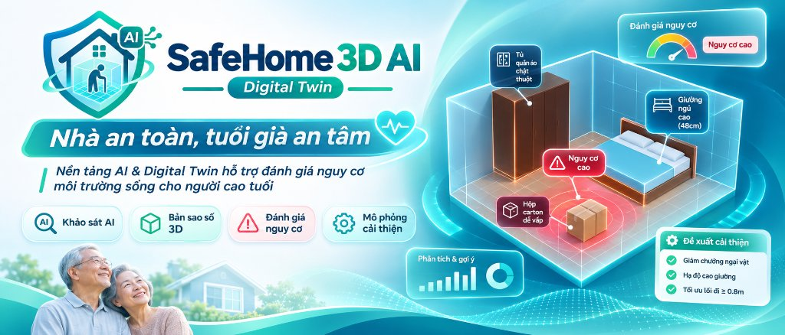
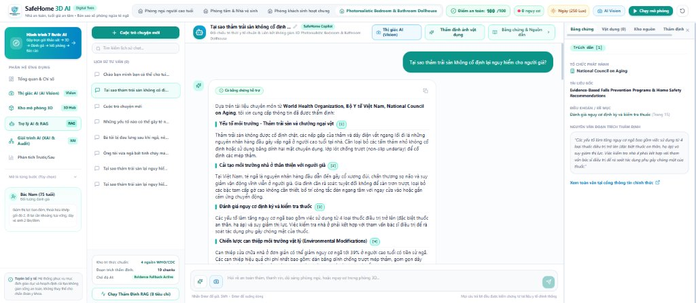
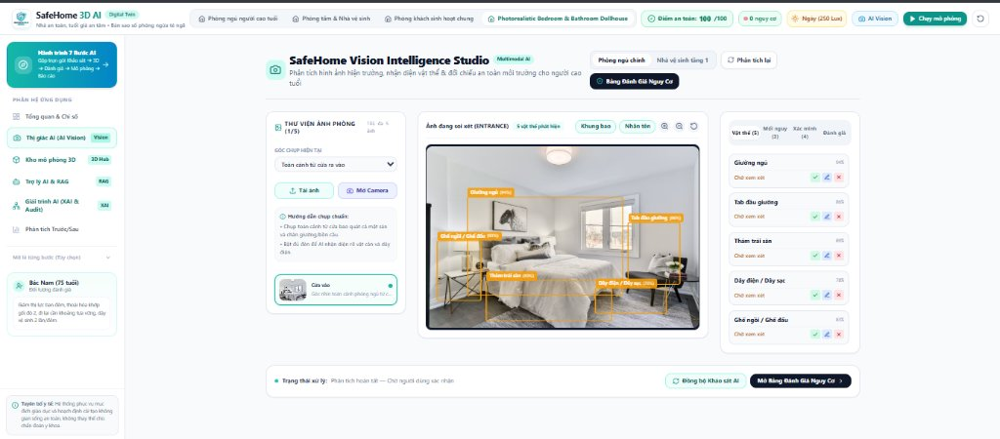
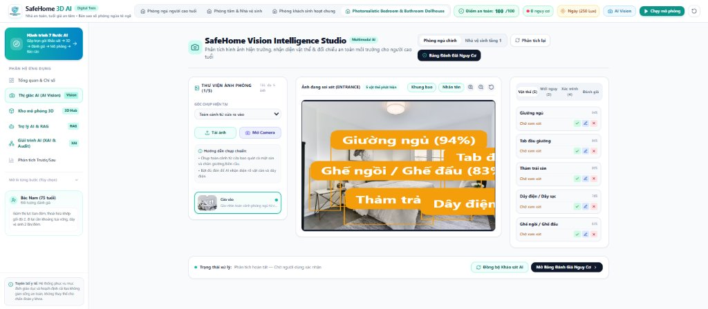
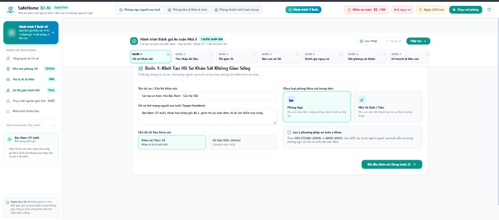

<div align="center">

<p align="center">
  
</p>

# SafeHome 3D AI — Nhà An Toàn, Tuổi Già An Tâm

<p align="center">
  <b>Hệ Sinh Thái Khảo Sát Thông Minh, Thị Giác Đa Phương Thức, Bản Sao Số 3D & Động Cơ Đánh Giá Nguy Cơ Té Ngã Chuẩn WHO/CDC Cho Người Cao Tuổi</b><br/>
  <i>Adaptive Guided Survey · Multimodal AI Vision · Item Fall Hazard Assessment · 3D WebGL Digital Twin · Deterministic Clinical Risk Engine · Smart Marker Clustering · XAI Decision Graph · Grounded RAG Copilot · Photorealistic Dollhouse</i>
</p>

<p align="center">
  <a href="https://nguyentribaothang.github.io/SafeHome3DAI/">
    
  </a>
</p>

<p align="center">
  <a href="https://github.com/NguyenTriBaoThang/SafeHome3DAI/actions/workflows/ci.yml">
    
  </a>
  <a href="https://nguyentribaothang.github.io/SafeHome3DAI/">
    
  </a>
  <a href="https://github.com/NguyenTriBaoThang/SafeHome3DAI">
    
  </a>
  <a href="./LICENSE">
    
  </a>
  <a href="./docs/audit/TEST_RESULTS.md">
    
  </a>
  
  
  
  
  
</p>

<p align="center">
  <a href="http://localhost:3000/"><strong>🌐 Khám Phá Ứng Dụng</strong></a>
  &nbsp;•&nbsp;
  <a href="https://nguyentribaothang.github.io/SafeHome3DAI/"><strong>📑 Cổng Tài Liệu Kỹ Thuật (Docs Portal)</strong></a>
  &nbsp;•&nbsp;
  <a href="http://localhost:3000/workflow"><strong>🧭 Hành Trình 7 Bước</strong></a>
  &nbsp;•&nbsp;
  <a href="http://localhost:3000/ai-vision"><strong>📸 Thị Giác AI</strong></a>
  &nbsp;•&nbsp;
  <a href="http://localhost:3000/digital-twin"><strong>🏡 Bản Sao Số 3D</strong></a>
  &nbsp;•&nbsp;
  <a href="http://localhost:3000/ai-assistant"><strong>🤖 Trợ Lý AI RAG</strong></a>
  &nbsp;•&nbsp;
  <a href="http://localhost:3000/explainability"><strong>🌳 Giải Trình AI (XAI)</strong></a>
  &nbsp;•&nbsp;
  <a href="./ARCHITECTURE.md"><strong>📐 Sơ Đồ Kiến Trúc</strong></a>
  &nbsp;•&nbsp;
  <a href="./docs/audit/TEST_RESULTS.md"><strong>🔍 Báo Cáo Kiểm Thử (109 Tests)</strong></a>
</p>

<p align="center">
  
</p>

</div>

---

## 📌 1. Tổng Quan Điều Hành (Executive Overview)

### Vấn Nạn Té Ngã Ở Người Cao Tuổi
Té ngã là nguyên nhân hàng đầu gây chấn thương tử vong, chấn thương sọ não và gãy cổ xương đùi ở người cao tuổi trên toàn cầu cũng như tại Việt Nam. Theo số liệu của **Tổ chức Y tế Thế giới (WHO 2021)** và **CDC Hoa Kỳ (CDC STEADI)**:
- Hằng năm có từ **28% đến 35% người trên 65 tuổi bị té ngã ít nhất 1 lần**.
- **Hơn 50% các vụ té ngã xảy ra ngay tại không gian sống gia đình**, chủ yếu do các yếu tố môi trường vật lý: thảm lót trơn trượt, thiếu thanh vịn trong nhà vệ sinh, độ sáng ban đêm không đủ (<50 Lux), giường ngủ quá cao hoặc quá thấp, và dây điện chắn ngang hành lang di chuyển.
- Các bảng kiểm tra (checklist) bằng giấy truyền thống thường **quá dài dòng, khó hình dung trực quan** và dễ dẫn đến sai sót khi tự đánh giá.
- Các giải pháp AI tạo sinh thông thường thường mắc lỗi **ảo giác (hallucination)**, phỏng đoán sai lệch số liệu công thái học y tế và kích thước vật lý.

### Giải Pháp Đột Phá Của SafeHome 3D AI
**SafeHome 3D AI** giải quyết triệt để thách thức trên bằng cách chuyển hóa toàn bộ quy trình thành một **chu trình khép kín 7 bước được số hóa hoàn toàn**:

$$\text{Khảo sát AI} \longrightarrow \text{Thị giác AI} \longrightarrow \text{Bản sao số 3D} \longrightarrow \text{Đánh giá nguy cơ y khoa} \longrightarrow \text{Mô phỏng} \longrightarrow \text{So sánh} \longrightarrow \text{Báo cáo}$$

Hệ thống kết hợp:
1. **Khảo sát thích ứng từng câu hỏi** với thuật toán tỉa nhánh động và hiểu ngôn ngữ tự nhiên tiếng Việt.
2. **Thị giác máy tính đa tầng**: Quét không gian toàn cảnh phòng (`/ai-vision`) và **Thẩm định rủi ro vật dụng đơn lẻ qua ảnh** (`ItemAssessmentModal`) với điểm số rủi ro, căn cứ y khoa và tọa độ điểm nguy cơ H1..H4 chuẩn CDC STEADI.
3. **Bản sao số 3D WebGL (Three.js)** với không gian kiến trúc photorealistic dollhouse, mô phỏng ánh sáng động (0 - 520 Lux), ma sát mặt sàn (sàn ướt/khô ráo) và thuật toán gom cụm nhãn thông minh (<0.95m).
4. **Động cơ đánh giá y khoa tất định 100% (Deterministic Clinical Rules)** dựa trên cẩm nang WHO 2021 & CDC STEADI, loại trừ hoàn toàn ảo giác trong chấm điểm an toàn sinh mạng.
5. **Trợ lý AI RAG có căn cứ (Grounded RAG Copilot)** với ngăn tra cứu bằng chứng 4 tab (Bằng chứng, Vật dụng, Kho nguồn, Thẩm định RAG 8 tiêu chí) và trình định dạng văn bản y tế chuyên biệt.
6. **Sơ đồ giải trình quyết định (XAI Decision Graph)** trực quan hóa cây suy luận từ phòng $\rightarrow$ vật thể $\rightarrow$ đo đạc $\rightarrow$ quy chuẩn $\rightarrow$ nguy cơ $\rightarrow$ can thiệp.

---

## 📸 2. Giao Diện & Hình Ảnh Thực Nghiệm (Visual Showcase & Live System)

Hệ sinh thái **SafeHome 3D AI** được triển khai trực tiếp với các phân hệ đồ họa WebGL 3D, thị giác máy tính và trợ lý y khoa:

### 2.1. Bảng Điều Khiển Tổng Quan & Bản Sao Số 3D (Overview & Digital Twin)

| Bảng Điều Khiển Tổng Quan An Toàn (`/`) | Bản Sao Số 3D Photorealistic Dollhouse (`/digital-twin`) |
| :---: | :---: |
|  |  |
| **Tổng quan An toàn Môi trường**: Điểm an toàn 28/100, biểu đồ Donut phân loại nguy cơ và khung nhìn 3D thu nhỏ tương tác. | **Photorealistic Dollhouse**: Phòng ngủ & toilet khép kín, studio ánh sáng 4 chế độ (Nắng sớm, Ban ngày, Đêm 40 Lux, Studio 320 Lux) và mô phỏng sàn chống trượt. |

### 2.2. Thị Giác AI Đa Tầng & Thẩm Định Nguy Cơ Đồ Vật Theo Chuẩn CDC STEADI

| SafeHome Vision Intelligence Studio (`/ai-vision`) | Thẩm Định Rủi Ro Vật Dụng Qua Ảnh (`ItemAssessmentModal`) |
| :---: | :---: |
|  |  |
| **Thị giác AI nhận diện hiện trường**: Quét nhận diện 18 lớp nội thất & vật cản, gán nhãn khung bao sắc nét chống phóng đại chữ Chromium và tỷ lệ tin cậy. | **Thẩm định vật dụng CDC STEADI**: Đánh giá đồ vật qua ảnh chụp gần, tính điểm nguy cơ (68/100) và định vị các điểm rủi ro chỉ định H1, H2, H3. |

| Chi Tiết Điểm Rủi Ro H1 (`Hotspot Mechanism`) | Căn Chỉnh Vị Trí Ghim Tương Tác (Click-to-Reposition) |
| :---: | :---: |
|  |  |
| **Cơ chế chấn thương lâm sàng**: Phân tích lực va đập tập trung tại góc nhọn (Focal Blunt Impact) và lộ trình khắc phục chi phí thấp (~25.000đ). | **Tương tác trực quan**: Bấm trực tiếp lên ảnh để căn chỉnh vị trí ghim rủi ro, chuyển tiếp 1 chạm sang quét toàn bộ phòng hoặc hỏi trợ lý AI. |

### 2.3. Trợ Lý AI SafeHome Copilot & Giải Trình Quyết Định Minh Bạch (XAI)

| Trợ Lý AI SafeHome Copilot (`/ai-assistant`) | Ngăn Tra Cứu Bằng Chứng 4 Tab (`Evidence Drawer`) |
| :---: | :---: |
|  |  |
| **Hội thoại y học có dẫn chứng**: Tự động liên kết không gian 3D đang khảo sát, định dạng SafeHomeMarkdown và trích dẫn chuẩn [1] WHO, [2] NCOA, [3] BYT, [4] CDC. | **Tra cứu tài liệu gốc**: Hiển thị nguyên văn trích dẫn kiểm chứng từ WHO và Viện Lão khoa Quốc gia, điều khoản/số trang và đường dẫn cổng chính thức. |

| Giải Trình AI & Nguồn Gốc Quyết Định (`/explainability`) |
| :---: |
|  |
| **Cây suy luận nhân quả ReactFlow minh bạch 100%**: Trực quan hóa toàn bộ chuỗi quyết định từ Vật thể 3D $\rightarrow$ Đo đạc không gian $\rightarrow$ Quy chuẩn y tế $\rightarrow$ Nguy cơ $\rightarrow$ Giải pháp can thiệp. |

---

## 🧭 3. Hành Trình 7 Bước Khép Kín (7-Step Unified Flow)

Tất cả các phân hệ được xâu chuỗi liền mạch trong phân hệ điều phối `/workflow`, tự động truyền dẫn dữ liệu theo máy trạng thái y tế:

| Bước | Phân Hệ | Đường Dẫn | Chức Năng Chính | Công Nghệ / Thuật Toán |
| :---: | :--- | :--- | :--- | :--- |
| **01** | **Khảo Sát Thông Minh** | `/ai-guided-survey` | Khảo sát từng câu hỏi, hỗ trợ giọng nói / văn bản tiếng Việt | Dynamic Irrelevance Pruning, NLP tiếng Việt, True Denominator Progress |
| **02** | **Thị Giác AI (Vision)** | `/ai-vision` | Quét ảnh phòng thực tế, nhận diện vật thể & thẩm định nguy cơ vật dụng | Magic Bytes validation, EXIF stripping, 18-class taxonomy, Hotspot pins H1..H4 |
| **03** | **Bản Sao Số 3D** | `/digital-twin` | Tái hiện không gian số hóa tỉ lệ 1:1, điều khiển độ sáng & ma sát sàn | Three.js, React Three Fiber, Photorealistic Dollhouse, Smart Clustering <0.95m |
| **04** | **Đánh Giá Nguy Cơ Y Khoa** | `/risk-assessment` | Chấm điểm an toàn (0-100), lập danh sách mối nguy lâm sàng | Deterministic 8 Clinical Rules (WHO 2021 & CDC STEADI) |
| **05** | **Mô Phỏng Kịch Bản** | `/scenario-simulator` | Thử nghiệm can thiệp (dán thảm, đèn cảm ứng, thanh vịn) | Real-time What-If Intervention Engine, 3D State Sync, Undo/Redo |
| **06** | **Phân Tích Trước / Sau** | `/analytics` | Đối sánh trực quan mức độ cải thiện và tỷ lệ giảm chấn thương ngã | Radar Chart, Delta Score KPI, Remediated Finding Matrix |
| **07** | **Báo Cáo & Hành Động** | `/reports` | Xuất kế hoạch cải tạo an toàn chi tiết kèm dự toán chi phí & in PDF | Printable PDF Exporter, Clinical Action Plan Generator |

---

## 🌟 4. Các Phân Hệ & Tính Năng Nổi Bật (Key Capabilities)

### 3.1. Thẩm Định Rủi Ro Vật Dụng Qua Ảnh (Item Fall Hazard Assessment Engine)
Phân hệ thẩm định nguy cơ đồ vật chuyên biệt theo chuẩn **CDC STEADI & WHO**, trả lời đầy đủ 3 câu hỏi lâm sàng cốt lõi:
- **1. Mức độ nguy hiểm bao nhiêu?**
  - Chấm điểm rủi ro khách quan trên thang điểm **0 - 100**.
  - Phân tầng mức độ ưu tiên: `KHẨN CẤP`, `ƯU TIÊN CAO`, `TRUNG BÌNH`, `THẤP`.
  - Phân loại mức độ nghiêm trọng: `CRITICAL`, `HIGH`, `MEDIUM`, `LOW`.
- **2. Tại sao nguy hiểm đối với người cao tuổi?**
  - Phân tích cơ chế sinh cơ học (Biomechanical rationale): Lực va đập tập trung (Focal Blunt Impact), hệ số ma sát $\mu$, che khuất tầm nhìn, thu hẹp khoảng thông thủy lối đi (<90cm).
  - Đánh giá nguy cơ chấn thương: Rách da, tụ máu, gãy cổ xương đùi, chấn thương sọ não.
- **3. Nguy hiểm ở chỗ nào?**
  - Gắn điểm ghim nguy cơ tương tác trực quan (**H1, H2, H3, H4...**) chính xác theo tọa độ điểm trên ảnh.
  - Hỗ trợ **nhấp để điều chỉnh vị trí ghim (Click-to-reposition)** trực tiếp trên ảnh.
  - Phân tích chi tiết cơ chế cho từng điểm ghim nguy cơ.
- **4. Biện pháp cải thiện thiết thực & Dự toán chi phí:**
  - Lộ trình khắc phục từng bước (bọc góc silicon, dán băng keo nhám định hình, nẹp dây điện).
  - Bảng kê vật tư cần chuẩn bị, chi phí ước tính (VND) và thời gian thi công.
- **Thư viện mẫu thẩm định:** Sẵn sàng kiểm nghiệm tức thì với bàn trà kính chân thấp, bàn học chân sắt góc nhọn 90°, thảm trải sàn không cố định, dây điện chắn lối đi, ghế đẩu trơn trượt.
- **Điều hướng thông suốt:** Dễ dàng chuyển tiếp giữa thẩm định ảnh vật dụng sang quét toàn bộ căn phòng bằng **Thị giác AI (`/ai-vision`)** hoặc hỏi chuyên sâu với **SafeHome Copilot (`/ai-assistant`)**.

### 3.2. Thị Giác AI Đa Phương Thức (Vision Intelligence Studio)
- **Bảo mật tuyệt đối ảnh gia đình:** Xác thực Magic Bytes nhị phân (chống MIME spoofing) và cắt bỏ 100% dữ liệu EXIF GPS trước khi xử lý.
- **Nhận diện 18 lớp vật thể y tế:** Thảm trải sàn lỏng lẻo, giường ngủ, dây điện bừa bộn, thanh vịn, bồn cầu, đèn ngủ, bàn trà, chướng ngại vật lối đi.
- **Hiển thị Bounding Box & Nhãn tên sắc nét:** Loại bỏ hoàn toàn lỗi phóng đại chữ SVG trong Chromium bằng hệ thống nhãn phủ CSS HTML Overlay gọn gàng (`text-[10px] font-bold`), tự động căn chỉnh vị trí thông minh khi vật thể ở sát mép trên ảnh.
- **Human-in-the-Loop:** Cho phép người dùng xác nhận (`CONFIRMED`), điều chỉnh nhãn (`CORRECTED`) hoặc loại bỏ (`REJECTED`) trước khi đồng bộ vào Bản sao số 3D.

### 3.3. Bản Sao Số 3D & Không Gian Dollhouse Photorealistic (`/digital-twin`)
- **Mô hình kiến trúc tham chiếu Photorealistic Dollhouse:** Không gian thực tế gồm phòng ngủ người cao tuổi và nhà vệ sinh khép kín với đầy đủ nội thất chi tiết.
- **Studio điều khiển ánh sáng tương tác:** Chuyển đổi linh hoạt giữa Hoàng hôn, Ban ngày (250 Lux), Ban đêm (40 Lux) và Studio (320 Lux); thanh trượt điều chỉnh cường độ rọi từ 0 đến 520 Lux.
- **Mô phỏng mặt sàn & Ma sát:** Kiểm tra tình trạng sàn khô ráo vs sàn ướt; công tắc bổ sung thiết bị chống ngã: thanh vịn bồn cầu, thanh vịn vòi sen, thảm cao su chống trượt giác hút.
- **Đa dạng góc máy quan sát:** Chế độ Dollhouse toàn cảnh, Tầm mắt người già (Eye-level), Mặt bằng phẳng (Top 2D), Đi bộ khám phá (Walkthrough), Tự căn chỉnh góc (Fit) và Chụp ảnh màn hình (Snapshot).
- **Thuật toán gom cụm nhãn thông minh (<0.95m):** Tự động gom các nguy cơ gần nhau thành 1 nhãn cụm duy nhất (ví dụ: `🔴 +3 Nguy cơ`), loại bỏ 100% hiện tượng chữ đè lấn nhau trong không gian 3D.

### 3.4. Trợ Lý AI RAG & Ngăn Tra Cứu Bằng Chứng Y Khoa (`/ai-assistant`)
- **Trình định dạng chuyên biệt SafeHomeMarkdown:** Trình bày rõ ràng các tiêu đề, thẻ ghi nhớ không gian 3D (`📌`), hộp cảnh báo an toàn (`* ⚠️`) và các thẻ trích dẫn chỉ mục y khoa tương tác (`[1]`, `[2]`, `[3]`, `[4]`).
- **Ngăn thanh tra bằng chứng 4 Tab chuyên sâu (Right Evidence Drawer):**
  1. **Bằng chứng (Evidence):** Hiển thị văn bản nguyên văn trích dẫn, tổ chức phát hành, đề mục/điều khoản, số trang và đường dẫn tra cứu cổng thông tin chính thức.
  2. **Vật dụng (Items):** Lưu trữ lịch sử các vật dụng đã thẩm định rủi ro, cho phép xem lại chi tiết và mở nhanh giao diện quét phòng.
  3. **Kho nguồn (Sources):** Danh mục các tài liệu y tế chuẩn mực (WHO 2021, CDC STEADI, Bộ Y Tế Việt Nam, NCOA).
  4. **Thẩm định RAG (Eval):** Báo cáo đánh giá RAG trực tiếp trên 8 tiêu chí khắt khe (Faithfulness, Answer Relevance, Context Recall, Medical Grounding,...).
- **Cơ chế phòng vệ chống ảo giác (Evidence Fallback Active):** Phân định rạch ròi giữa câu trả lời có bằng chứng xác thực (`SUPPORTED`), bằng chứng một phần (`PARTIALLY_SUPPORTED`) và từ chối khẳng định khi thiếu số liệu kiểm chứng (`INSUFFICIENT_EVIDENCE`).

### 3.5. Sơ Đồ Giải Trình Quyết Định & Truy Vết Y Khoa (XAI Decision Graph — `/explainability`)
- **Minh bạch hóa 100% chuỗi suy luận AI:** Sử dụng đồ thị tương tác ReactFlow trực quan hóa từ Phòng khảo sát $\rightarrow$ Vật thể 3D nhận diện $\rightarrow$ Số đo hình học $\rightarrow$ Điều khoản quy chuẩn y tế $\rightarrow$ Kết luận nguy cơ $\rightarrow$ Giải pháp can thiệp.
- **Audit Trail:** Truy xuất toàn bộ nhật ký thay đổi trạng thái, ghi nhận đầy đủ người can thiệp, thời điểm và căn cứ y văn.

---

## 🏛️ 5. Sơ Đồ Kiến Trúc Hệ Thống (System Architecture)

```mermaid
flowchart TB
    subgraph Client["Tầng Giao Diện (Next.js 14 App Router · React 18 · Tailwind · Three.js)"]
        UI_Survey["AI Guided Survey\n(/ai-guided-survey)"]
        UI_Vision["AI Vision Studio\n(/ai-vision, /vision)"]
        UI_ItemModal["Item Hazard Assessment\n(Hotspots H1..H4 · CDC STEADI)"]
        UI_3D["3D Digital Twin\n(/digital-twin)"]
        UI_Sim["Kho Mô Phỏng 3D\n(/simulations)"]
        UI_Risk["Risk Assessment\n(/risk-assessment)"]
        UI_XAI["Explainable AI Graph\n(/explainability)"]
        UI_RAG["AI RAG Copilot\n(/ai-assistant)"]
        UI_Workflow["Hành Trình 7 Bước\n(/workflow)"]
        UI_Docs["Cổng Tài Liệu Kỹ Thuật\n(docs-site : GitHub Pages)"]
    end

    subgraph Security["Tầng Bảo Mật & Xác Thực Đầu Vào"]
        MagicBytes["Magic Bytes Validator\n(JPEG: FFD8FF, PNG: 89504E47)"]
        ExifStrip["EXIF & Metadata Stripper\n(Zero GPS/Device Leakage)"]
        ZodGate["Strict Zod Schema Gate\n(Type-safe API Payloads)"]
    end

    subgraph CoreEngines["Tầng Động Cơ Lõi (Core Engines)"]
        SurveyEngine["Survey Flow Engine\n(Dynamic Pruning & Vietnamese NLP)"]
        VisionEngine["Vision Inference Adapter\n(18-Class Taxonomy + BBox Normalization)"]
        ItemHazardEngine["Item Hazard Analyzer\n(3 Questions · Hotspots · Biomechanics)"]
        RiskEngine["Deterministic Risk Engine\n(8 Clinical Rules · WHO / CDC STEADI)"]
        TwinClustering["3D Spatial Clustering\n(<0.95m Euclidean Marker Clustering)"]
        RAGEngine["Evidence-Grounded RAG\n(Vector Similarity + Guideline Links)"]
    end

    subgraph Persistence["Tầng Dữ Liệu & Kiểm Toán (Prisma ORM)"]
        DB[("Relational Database\nSQLite (dev) / PostgreSQL (prod)\n16 Bảng dữ liệu")]
        AuditLog[("AuditEvent Store\nLịch sử biến đổi trạng thái y tế")]
    end

    Client --> Security
    Security --> CoreEngines
    CoreEngines --> Persistence
```



---

## 📊 6. Đảm Bảo Chất Lượng & Kết Quả Kiểm Thử (QA & Tests)

SafeHome 3D AI duy trì chất lượng kiểm thử nghiêm ngặt với **100% tỷ lệ vượt qua trên toàn bộ 20 bộ kiểm thử tự động (109/109 tests passed)**:

```text
 ✓ tests/spatialValidationEngine.test.ts  (8 tests)   - Kiểm tra tính hợp lệ không gian hình học 3D
 ✓ tests/surveyEngine.test.ts             (9 tests)   - Tỉa nhánh thích ứng, completeness, NLP tiếng Việt
 ✓ tests/riskIntelligence.test.ts         (10 tests)  - Đánh giá 8 quy tắc lâm sàng WHO 2021 & CDC STEADI
 ✓ tests/realisticReconstruction.test.ts (6 tests)   - Tái tạo không gian phòng 3D thực tế
 ✓ tests/visionEngine.test.ts             (14 tests)  - Magic bytes, bóc tách EXIF, chuẩn hóa BBox [0..1]
 ✓ tests/riskEngine.test.ts               (11 tests)  - Động cơ chấm điểm an toàn và phân tầng rủi ro
 ✓ tests/copilotEngine.test.ts            (10 tests)  - Hội thoại AI RAG, phân tích ý định, phòng chống ảo giác
 ✓ tests/visionIntegration.test.ts        (2 tests)   - Tích hợp Vision -> Fact -> Survey -> Reassessment
 ✓ tests/riskIntegration.test.ts          (3 tests)   - Tích hợp đánh giá rủi ro đa phòng & lưu trữ snapshot
 ✓ tests/dollhouseReferenceScene.test.ts  (5 tests)   - Kiểm tra cảnh tham chiếu dollhouse phòng ngủ & vệ sinh
 ✓ tests/copilotIntegration.test.ts       (4 tests)   - Tích hợp AI Chat, RAG search và kiểm định nguồn gốc
 ✓ tests/surveyIntegration.test.ts        (4 tests)   - Tích hợp luồng khảo sát và lưu trữ database SQLite
 ✓ tests/simulationUndoRedo.test.ts       (3 tests)   - Khôi phục trạng thái can thiệp mô phỏng (Undo/Redo)
 ✓ tests/workflowEngine.test.ts           (4 tests)   - Gom cụm nhãn 3D (<0.95m), máy trạng thái 7 bước
 ✓ tests/itemHazardAssessment.test.ts     (4 tests)   - Thẩm định rủi ro vật dụng, Hotspot pins H1..H4, chi phí
 ✓ tests/geminiVision.test.ts             (3 tests)   - Tích hợp API Gemini Multimodal Vision phân tích phòng
 ✓ tests/integration.test.ts              (3 tests)   - Kiểm tra tổng thể các dịch vụ tích hợp hệ thống
 ✓ tests/ragEngine.test.ts                (4 tests)   - Truy xuất ngữ nghĩa tài liệu an toàn lão khoa WHO/CDC
 ✓ tests/ragEvaluation.test.ts            (1 test)    - Benchmark đánh giá RAG 8 tiêu chí chất lượng
 ✓ tests/workflowIntegration.test.ts      (1 test)    - Tích hợp lưu trữ và khôi phục trạng thái quy trình khép kín

Test Files  20 passed (20)
     Tests  109 passed (109)
  Duration  24.11s (100% Pass Rate)
```

---

## 🚀 7. GitHub Actions CI/CD & Cổng Tài Liệu Kỹ Thuật

Dự án được cấu hình đầy đủ quy trình tự động hóa CI/CD với 3 workflows:

1. **`ci.yml` (CI Pipeline):**
   - Tự động kích hoạt khi có `push` hoặc `pull_request` trên các nhánh `main`, `master`, `develop`.
   - Cài đặt thư viện sạch (`npm ci`), sinh Prisma Client (`npx prisma generate`), kiểm tra kiểu dữ liệu TypeScript (`npx tsc --noEmit`), chạy 109 ca kiểm thử Vitest (`npm test -- --run`) và đóng gói Next.js production (`npm run build`).

2. **`deploy-pages.yml` (Technical Documentation Portal):**
   - Tự động đóng gói cổng tài liệu kỹ thuật tĩnh trong thư mục `docs-site/` (Vite + React) và xuất bản lên **GitHub Pages**:
   - URL tài liệu trực tuyến: **`https://nguyentribaothang.github.io/SafeHome3DAI/`**
   - Bao gồm toàn bộ hướng dẫn kiến trúc, sơ đồ tương tác, tra cứu quy tắc lâm sàng, kết quả kiểm thử và đặc tả 15+ API RESTful.

3. **`commitlint.yml`:**
   - Thực thi chuẩn Conventional Commits cho các pull request.

---

## 💻 8. Hướng Dẫn Cài Đặt & Chạy Local (Quickstart)

### Yêu Cầu Môi Trường
- **Node.js**: Phiên bản 18.x trở lên (khuyên dùng Node.js 20 LTS).
- **NPM**: Phiên bản 9.x hoặc 10.x.
- **Hệ điều hành**: Windows 10/11, macOS, hoặc Linux.

### Các Bước Cài Đặt

1. **Clone repository:**
   ```bash
   git clone https://github.com/NguyenTriBaoThang/SafeHome3DAI.git
   cd SafeHome3DAI
   ```

2. **Cài đặt thư viện dependencies:**
   ```bash
   npm install
   ```

3. **Khởi tạo cơ sở dữ liệu SQLite & Prisma:**
   ```bash
   npx prisma generate
   npx prisma db push
   ```

4. **Chạy máy chủ phát triển cục bộ:**
   ```bash
   npm run dev
   ```
   Mở trình duyệt tại: **`http://localhost:3000`**

5. **Chạy kiểm thử tự động:**
   ```bash
   npm test
   ```

6. **Chạy cổng tài liệu kỹ thuật (docs-site):**
   ```bash
   cd docs-site
   npm install
   npm run dev
   ```
   Mở cổng tài liệu tại: **`http://localhost:5173`**

---

## 📚 9. Chỉ Mục Tài Liệu Kỹ Thuật (Documentation Index)

Toàn bộ tài liệu chi tiết được lưu trữ trong thư mục `docs/` và xuất bản tại cổng tài liệu trực tuyến:

| Nhóm Tài Liệu | Đường Dẫn Tập Tin | Tóm Tắt Nội Dung |
| :--- | :--- | :--- |
| **Kiến trúc tổng thể** | [`ARCHITECTURE.md`](./ARCHITECTURE.md) | Đặc tả kiến trúc sống, phân tầng hệ thống và luồng dữ liệu |
| **Thị giác máy tính & Vật dụng** | [`docs/AI_VISION_ARCHITECTURE.md`](./docs/AI_VISION_ARCHITECTURE.md) | Thị giác đa tầng, Bounding Box SVG/HTML, thẩm định nguy cơ vật dụng CDC STEADI |
| **Trợ lý AI & RAG y tế** | [`docs/RAG_ARCHITECTURE.md`](./docs/RAG_ARCHITECTURE.md) | Kiến trúc truy xuất vector, đối chứng y văn, ngăn tra cứu bằng chứng 4 tab |
| **Bản sao số 3D & Gom cụm** | [`docs/RISK_3D_INTEGRATION.md`](./docs/RISK_3D_INTEGRATION.md) | Tích hợp không gian 3D, chiếu sáng động, mặt sàn ma sát và thuật toán gom cụm nhãn |
| **Quy tắc nguy cơ y khoa** | [`docs/RISK_RULE_REGISTRY.md`](./docs/RISK_RULE_REGISTRY.md) | Đặc tả 8 quy tắc lâm sàng WHO 2021 & CDC STEADI |
| **Báo cáo kiểm thử** | [`docs/audit/TEST_RESULTS.md`](./docs/audit/TEST_RESULTS.md) | Bằng chứng kiểm thử tự động 109/109 ca kiểm thử Vitest (20 suites) |
| **Hướng dẫn sử dụng** | [`docs/USER_GUIDE.md`](./docs/USER_GUIDE.md) | Cẩm nang trải nghiệm toàn diện cho người dùng và chuyên viên y tế |
| **Luồng 7 bước khép kín** | [`docs/architecture/END_TO_END_WORKFLOW.md`](./docs/architecture/END_TO_END_WORKFLOW.md) | Quy trình tuần tự từ Khảo sát đến Báo cáo can thiệp |

---

## ⚖️ 10. Bản Quyền & Tuyên Bố Miễn Trừ Trách Nhiệm

- **Bản quyền**: Phát hành theo giấy phép [MIT License](./LICENSE). Copyright © 2026 **Nguyễn Tri Bão Thắng**.
- **Tuyên bố y tế**: *SafeHome 3D AI là công cụ hỗ trợ giáo dục cộng đồng, tầm soát nguy cơ môi trường và hỗ trợ hoạch định cải tạo không gian sống an toàn cho người cao tuổi. Ứng dụng không thay thế cho chẩn đoán y khoa, thẩm định xây dựng thực tế hoặc ý kiến của bác sĩ chuyên khoa.*
