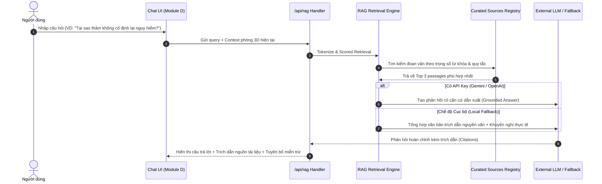

# SafeHome 3D AI — Quy Trình RAG & Khung Tri Thức (RAG Pipeline)

## 1. Mục tiêu & Nguyên lý thiết kế
Hệ thống RAG (Retrieval-Augmented Generation) của SafeHome 3D AI được phát triển nhằm mục tiêu:
1. **Tuyệt đối không bịa đặt nguồn gốc y khoa**: Không sinh nội dung y khoa sai lệch hoặc khẳng định chữa lành.
2. **Khả năng hoạt động tự chủ (Dual-Mode Architecture)**: Không phụ thuộc vào API Key bên ngoài. Khi chưa cấu hình LLM API, hệ thống kích hoạt bộ máy phản hồi cục bộ xác thực (Evidence-based Local Fallback) đối sánh đoạn trích trực tiếp.
3. **Liên kết ngữ cảnh không gian thực tế**: Kết hợp câu hỏi người dùng với hiện trạng các vật thể 3D và các điểm nguy cơ đang phát hiện trong căn phòng.

---

## 2. Quy trình RAG Pipeline

---

## 3. Danh mục nguồn tài liệu thẩm định (Curated Sources)

| Mã nguồn | Tổ chức | Tiêu đề văn bản | Năm | Trọng tâm khuyến nghị |
|---|---|---|---|---|
| `SRC_WHO_2021` | WHO | Step Safety: WHO Global Report on Falls Prevention in Older Age | 2021 | Thảm trải sàn, độ rọi chiếu sáng 150-200 Lux, ma sát sàn phòng tắm |
| `SRC_CDC_STEADI_2023` | CDC Hoa Kỳ | STEADI: Check for Safety - A Home Fall Prevention Checklist | 2023 | Thông thủy lối đi tối thiểu 85-90cm, không vắt dây điện qua lối đi |
| `SRC_BYT_VN_2020` | Bộ Y tế Việt Nam | Hướng dẫn chăm sóc sức khỏe và phòng ngừa tai nạn thương tích | 2020 | Gãy cổ xương đùi, lắp thanh tay vịn chữ L bồn cầu, công tắc đèn cảm biến |
| `SRC_NCOA_2023` | NCOA | Evidence-Based Falls Prevention Programs | 2023 | Can thiệp môi trường vật lý giúp giảm đến 39% nguy cơ ngã |

