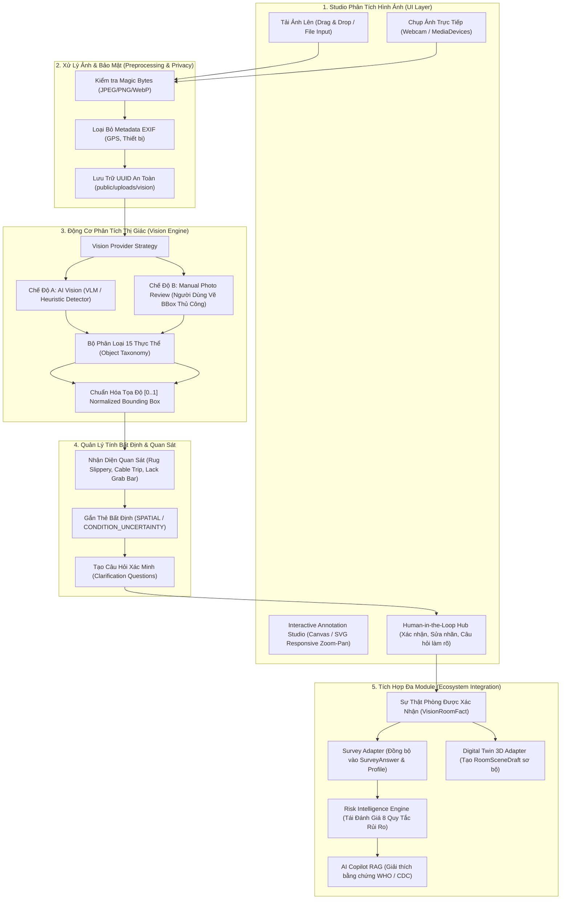

# Kiến Trúc SafeHome Vision Intelligence (AI Vision Architecture)

Module **SafeHome Vision Intelligence** là phân hệ phân tích thị giác máy tính và hình ảnh thông minh trong hệ sinh thái **SafeHome 3D AI**. Phân hệ hỗ trợ người cao tuổi và người chăm sóc tải lên hoặc chụp ảnh trực tiếp các không gian sống (phòng ngủ, phòng tắm, lối đi), tự động nhận diện các thực thể nội thất, nhận diện các quan sát vật lý tiềm ẩn nguy cơ té ngã, hướng dẫn người dùng xác minh thông tin thông qua cơ chế Human-in-the-Loop, và đồng bộ dữ liệu vào Động cơ Đánh giá Rủi ro (Risk Engine) cùng Digital Twin 3D.

---

## 1. Sơ Đồ Kiến Trúc Hệ Thống (Architecture Flowchart)

---

## 2. Các Thành Phần Cốt Lõi (Core Components)

### 2.1 Image Preprocessor & Secure Storage (`src/lib/vision/imagePreprocessor.ts`, `imageStorage.ts`)
- **Kiểm định nhị phân (Binary Magic Bytes)**:
  - JPEG: `FF D8 FF`
  - PNG: `89 50 4E 47 0D 0A 1A 0A`
  - WebP: `52 49 46 46 ... 57 45 42 50`
- **Khử bỏ EXIF Metadata**: Loại bỏ hoàn toàn vị trí GPS, thông tin nhà sản xuất, serial thiết bị máy ảnh để bảo vệ quyền riêng tư người dùng.
- **Chuẩn hóa tọa độ Bounding Box**: Chuyển đổi tọa độ pixel gốc sang hệ tỉ lệ tương đối `[0..1]` (`[ymin, xmin, ymax, xmax]`), giúp hiển thị phản hồi mượt mà trên mọi độ phân giải màn hình và mức zoom canvas.

### 2.2 Dual-Mode Vision Provider (`src/lib/vision/visionProvider.ts`)
- **Chế độ A (AI Vision)**: Phân tích đa phương thức (Multimodal VLM / Pretrained detector), tự động khoanh vùng thực thể nội thất phòng ngủ / phòng tắm, phát hiện thảm trải sàn, dây điện bừa bộn, thiếu tay vịn.
- **Chế độ B (Manual Photo Review)**: Cho phép chuyên viên y tế / người chăm sóc tự vẽ bounding box thủ công trên canvas tương tác, chọn nhãn chuẩn hóa và hoàn thiện câu hỏi làm rõ khi không có kết nối internet hoặc API ngoài.

### 2.3 Quản Lý Bất Định & Human-in-the-Loop Hub
- Phân tách rõ ràng giữa **Quan sát hình ảnh chưa kiểm chứng** (`VisionObservation`) và **Sự thật phòng đã xác nhận** (`VisionRoomFact`).
- Không bao giờ tự động suy diễn khoảng cách vật lý hay nguy cơ y khoa từ ảnh 2D tĩnh nếu chưa có sự xác nhận của con người.

### 2.4 Cầu Nối Đồng Bộ Hệ Sinh Thái (Adapters)
- **Survey Sync Adapter (`surveySyncAdapter.ts`)**: Ánh xạ câu trả lời làm rõ thị giác (`BED_006`, `BED_007`, `BED_008`, `BATH_003`, `BATH_005`) trực tiếp vào câu hỏi khảo sát tương ứng, kích hoạt tái đánh giá rủi ro tức thì.
- **Scene 3D Adapter (`sceneDraftAdapter.ts`)**: Ước tính vị trí vật thể 3D sơ bộ từ bounding box 2D với cờ minh bạch `isEstimate: true`.

