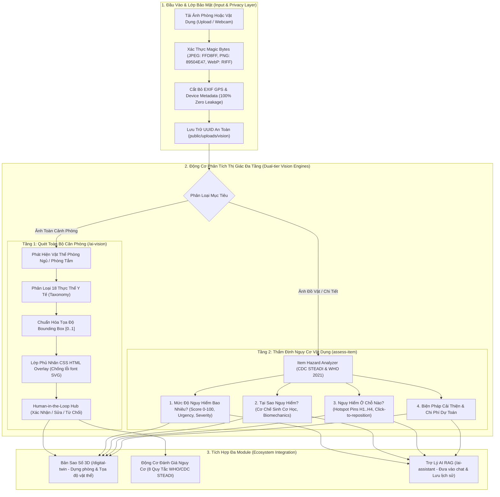

# Kiến Trúc SafeHome Vision Intelligence (AI Vision Architecture)

Module **SafeHome Vision Intelligence** là phân hệ phân tích thị giác máy tính và hình ảnh thông minh trong hệ sinh thái **SafeHome 3D AI**. Phân hệ hoạt động theo mô hình **Thị giác đa tầng (Dual-tier Multimodal Vision)**, vừa hỗ trợ quét toàn cảnh không gian phòng để dựng Bản sao số 3D, vừa hỗ trợ thẩm định rủi ro đồ vật đơn lẻ chuyên sâu theo chuẩn y khoa **CDC STEADI & WHO 2021**.

---

## 1. Sơ Đồ Kiến Trúc Hệ Thống (Architecture Flowchart)

---

## 2. Phân Hệ Thẩm Định Nguy Cơ Vật Dụng Đơn Lẻ (Tier 2: Item Fall Hazard Assessment)

### 2.1. Căn Cứ Y Khoa Chuẩn CDC STEADI & WHO 2021
Phân hệ giải quyết triệt để bài toán đánh giá rủi ro té ngã khi người nhà chụp ảnh một vật dụng cụ thể (ví dụ: bàn trà mặt kính, bàn học chân sắt góc nhọn, thảm trải sàn lụa không cố định, dây điện quạt sàn, ghế đẩu gỗ trơn trượt). Hệ thống bắt buộc trả lời **3 câu hỏi cốt lõi**:

#### Câu Hỏi 1: Mức Độ Nguy Hiểm Bao Nhiêu?
- **Thang điểm rủi ro ($0 - 100$):**
  - $\ge 80$: Mức độ nghiêm trọng `CRITICAL`, Mức ưu tiên xử lý `KHẨN CẤP` (trong 24 giờ).
  - $60 - 79$: Mức độ nghiêm trọng `HIGH`, Mức ưu tiên xử lý `ƯU TIÊN CAO` (trong 48 giờ).
  - $40 - 59$: Mức độ nghiêm trọng `MEDIUM`, Mức ưu tiên xử lý `TRUNG BÌNH`.
  - $< 40$: Mức độ nghiêm trọng `LOW`, Mức ưu tiên xử lý `THẤP`.

#### Câu Hỏi 2: Tại Sao Nguy Hiểm Đối Với Người Cao Tuổi?
- **Cơ chế sinh cơ học (Biomechanical Rationale):**
  - **Lực va chạm tập trung (Focal Blunt Impact):** Góc bàn $90^\circ$ sắc nhọn phân bổ toàn bộ lực va đập lên một diện tích tiếp xúc siêu nhỏ ($A < 0.5\text{ cm}^2$), làm tăng áp suất va đập vượt ngưỡng chịu lực của mô dưới da và xương người già bị loãng xương.
  - **Hệ số ma sát trượt thấp ($\mu < 0.4$):** Thảm lót sàn không có lớp đế cao su sần sùi hoặc băng keo cố định sẽ trượt tự do trên nền gạch bóng khi chịu lực đạp nghiêng lúc đứng dậy.
  - **Suy giảm thị lực chiều sâu (Depth Perception Deficit):** Bàn mặt kính cường lực trong suốt khiến người cao tuổi bị đục thủy tinh thể hoặc thoái hóa hoàng điểm không thể ước lượng chính xác mép bàn, dẫn đến hụt tay khi vịn tựa.
  - **Thu hẹp khoảng thông thủy di chuyển:** Vật dụng đặt chiếm lối đi khiến khoảng trống $< 90\text{ cm}$, cản trở người dùng khung tập đi hoặc gây mất thăng bằng khi xoay trở người.

#### Câu Hỏi 3: Nguy Hiểm Ở Chỗ Nào?
- **Các điểm nguy cơ trực quan (Hotspot Pins H1, H2, H3, H4...):**
  - Mỗi điểm nguy cơ được gắn một mã định danh (**H1..H4**), tọa độ chuẩn hóa $\{x\%, y\%\}$, tiêu đề, mô tả và cơ chế sinh học.
  - **Tính năng tương tác hiệu chỉnh vị trí (Click-to-reposition):** Cho phép người dùng nhấp chọn điểm H1..H4 rồi bấm trực tiếp vào ảnh để ghim lại đúng điểm nguy cơ theo ý muốn.

#### Mục 4: Biện Pháp Cải Thiện Thiết Thực & Chi Phí Dự Toán
- Liệt kê lộ trình can thiệp tuần tự (ví dụ: bọc đệm silicon góc bàn bo tròn $R \ge 2\text{ cm}$, dán băng keo nhám định hình viền thảm, gom dây điện vào nẹp luồn gắn tường).
- Chi tiết vật tư cần mua sắm, đơn giá ước tính (VND) và thời gian thực hiện.

---

## 3. Phân Hệ Quét Toàn Bộ Căn Phòng (Tier 1: Full-Room Spatial Vision Studio)

### 3.1. Danh Mục Phân Loại 18 Thực Thể Y Tế (Object Taxonomy)
Bao gồm: `bed`, `nightstand`, `loose_rug`, `power_cord`, `chair_stool`, `grab_bar`, `toilet`, `shower_floor`, `threshold`, `walker_crutch`, `floor_lamp`, `clutter`, `slippery_tile`, `table`, `sofa`, `doorway`, `staircase`, `cabinet`.

### 3.2. Khắc Phục Lỗi Phóng Đại Nhãn Trong Trình Duyệt Chromium
- **Nguyên nhân lỗi cũ:** Thẻ `<foreignObject>` đặt trong SVG có `viewBox="0 0 100 100"` bị trình duyệt Chromium/Blink áp dụng hệ số phóng đại ma trận không gian (viewport scale factor ~5x–6x) lên toàn bộ font chữ CSS, khiến nhãn `8px` bị nổ bung thành chữ khổng lồ `40px - 50px`, đè lấp toàn bộ hình ảnh căn phòng.
- **Giải pháp dứt điểm:**
  1. Giữ SVG làm lớp vẽ hình học thuần túy (vẽ `<rect>` bo góc nhẹ `rx={0.8}` với viền màu tương ứng trạng thái).
  2. Tách nhãn tên sang lớp phủ độc lập **CSS HTML Overlay** (`text-[10px] font-bold`, thẻ pill nhỏ gọn `px-1.5 py-0.5 rounded shadow-xs`).
  3. Tích hợp giải thuật định vị thông minh: Mặc định đặt nhãn phía trên mép hộp (`translateY(-100%)`); khi vật thể ở sát mép trên ảnh (`top < 7%`), nhãn sẽ tự động chuyển xuống bên trong góc trên của hộp bao để không bao giờ bị cắt xén.

---

## 4. Tích Hợp Đa Phân Hệ & Bảo Mật Dữ Liệu

1. **Bảo mật tuyệt đối (Zero Data Leakage):**
   - Kiểm tra nhị phân Magic Bytes trước khi giải mã.
   - Loại bỏ 100% EXIF GPS, ngày giờ chụp và serial thiết bị.
2. **Đồng bộ vào Trợ lý AI Copilot (`/ai-assistant`):**
   - Nút **“Đưa kết quả vào cuộc trò chuyện AI”** tự động định dạng bản thẩm định theo chuẩn y tế, xuất hiện trực tiếp trong luồng chat và lưu vào ngăn quản lý vật dụng (Items Drawer).
3. **Đồng bộ vào Bản sao số 3D (`/digital-twin`):**
   - Xuất các tọa độ vật thể thành nhãn nguy cơ trong không gian 3D, tích hợp vào thuật toán gom cụm khoảng cách Euclidean (<0.95m).
