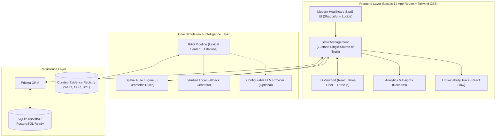

# SafeHome 3D AI — Kiến Trúc Hệ Thống (Architecture)

## 1. Tổng quan kiến trúc tổng thể

SafeHome 3D AI được thiết kế theo mô hình **AI-Assisted Digital Twin Platform**, kết hợp tính tương tác trực quan 3D theo thời gian thực (Real-time 3D Simulation) với động cơ đánh giá nguy cơ xác định (Deterministic Spatial Rule Engine) và hệ thống truy xuất tri thức y tế có đối chứng (Source-Aware RAG Engine).

---

## 2. Các phân hệ chính (Subsystems)

### 2.1. Phân hệ 3D Digital Twin (`src/components/three`)
- **Procedural 3D Geometry**: Sử dụng Three.js primitives kết hợp vật liệu đổ bóng PBR (`MeshStandardMaterial`), không phụ thuộc file GLB ngoài giúp khởi động tức thì và hoạt động hoàn toàn offline.
- **Tương tác đa điểm**: Hỗ trợ raycasting chọn vật thể, di chuyển đồ vật trong biên độ giới hạn của phòng, xoay góc Y, hiển thị nhãn nổi HTML 3D và vòng cảnh báo nguy cơ.
- **Visual Overlays**: Hành lang thông thủy (`WalkingZone`), lưới tọa độ mặt sàn, chế độ tường trong suốt (Architectural Cutaway), mô phỏng ánh sáng ngày / đêm (40 Lux vs 250 Lux).

### 2.2. Động cơ nhận diện nguy cơ môi trường (`src/features/risk-engine`)
- **8 quy tắc hình học không gian xác định**:
  1. `RULE_RUG_01`: Thảm trải sàn không cố định mép nằm trong/sát hành lang di chuyển.
  2. `RULE_CABLE_02`: Dây điện vắt ngang lối đi.
  3. `RULE_LIGHT_03`: Cường độ ánh sáng không đạt ngưỡng tối thiểu (100-150 Lux).
  4. `RULE_BATH_WET_04`: Bề mặt sàn ướt thiếu giải pháp chống trượt.
  5. `RULE_BATH_GRAB_05`: Thiếu thanh tay vịn an toàn trong nhà vệ sinh.
  6. `RULE_PATH_OBST_06`: Vật cản lấn chiếm thông thủy lối đi (< 0.85m).
  7. `RULE_ROUTE_CLUTTER_07`: Đồ đạc lộn xộn bừa bộn xung quanh tuyến đi lại.
  8. `RULE_DANGEROUS_OBJECT_08`: Bố trí vật sắc nhọn/bàn kính góc cạnh sát giường ngủ.
- **Tính toán toán học**: Khoảng cách vuông góc từ điểm/hộp đến đoạn thẳng di chuyển (`pointToSegmentDistance`), kiểm tra giao cắt bao đóng (Bounding Box Intersection).
- **Chỉ số an toàn Heuristic**: Thang điểm 0 - 100 minh bạch, phân cấp mức ưu tiên (Cao, Trung bình, Thấp).

### 2.3. Hệ thống Trợ lý RAG & Cơ sở Tri thức (`src/lib/rag`)
- **Kiến trúc hai chế độ (Dual-Mode)**:
  - *Chế độ Cục bộ (Local Fallback)*: Hoạt động không cần API Key bên ngoài. Sử dụng thuật toán phân tích token và đối sánh từ khóa chuyên ngành, trích xuất nguyên văn đoạn dẫn chứng từ sổ đăng ký nguồn.
  - *Chế độ LLM Nâng cao (External LLM)*: Khi được cấu hình biến môi trường (`GEMINI_API_KEY` hoặc `OPENAI_API_KEY`), tổng hợp câu trả lời dựa trên bằng chứng ngữ cảnh.
- **Sổ nguồn chuẩn mực**: Tài liệu chính thức từ Tổ chức Y tế Thế giới (WHO), CDC Hoa Kỳ (Chương trình STEADI), và Cục Quản lý Khám chữa bệnh - Bộ Y tế Việt Nam.

### 2.4. Tính giải trình & Minh bạch (Traceability & XAI)
- **Chuỗi nhân quả liên tục**:
  `Vật thể 3D → Thuộc tính đo đạc → Quy tắc thẩm định → Kết luận nguy cơ → Khuyến nghị cải tạo → Tái đánh giá`
- Trực quan hóa trực tiếp bằng thư viện đồ thị `@xyflow/react`.

