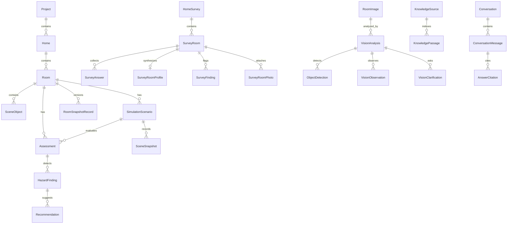

# SafeHome 3D AI — Lược Đồ Cơ Sở Dữ Liệu (Database Schema)

## 1. Kiến Trúc Lưu Trữ Thực Tế

- **ORM:** Prisma Client `5.22.0` (`prisma/schema.prisma`)
- **Lưu trữ Đa Hộ Gia Đình Cô Lập (Multi-Tenant Household SQLite):**
  - Kho tài khoản trung tâm `.private/accounts.db` gồm 3 bảng quản lý định danh (`Account`, `Session`, `RequestLimit`), lưu mật khẩu băm có salt và kiểm soát quota/phiên.
  - Mỗi tài khoản gia đình khi đăng ký qua `/sign-in` được cấp **một database SQLite riêng** dưới `SAFEHOME_PRIVATE_DIR/families/<accountId>/` áp dụng schema gồm **`31` Prisma models** bên dưới.
  - File `prisma/dev.db` chỉ dùng làm baseline / kiểm thử cấu trúc; dữ liệu mẫu không tự gán cho tài khoản mới.

---

## 2. Sơ Đồ Quan Hệ Cốt Lõi (Core ER Overview)

---

## 3. Danh Mục Đầy Đủ `31` Prisma Models (`prisma/schema.prisma`)

### 3.1. Không Gian Nhà Ở, 3D Scene & Snapshots (`7` models)
1. `Project`: Dự án/hồ sơ khảo sát nhà ở.
2. `Home`: Thông tin căn hộ/ngôi nhà (`targetResidentProfile`, `address`).
3. `Room`: Phòng chức năng (`BEDROOM`, `BATHROOM`, `LIVING_ROOM`, kích thước, sàn, `lightingLevel`, `isWet`, `isSlipResistant`, `grabBarsCount`).
4. `SceneObject`: Đồ vật 3D (`category`, `modelType`, tọa độ `positionX/Y/Z`, góc xoay `rotationX/Y/Z`, kích thước, cờ an toàn `isLoose`, `isSlippery`, `isFixed`, `isWalkwayObstacle`, `provenanceJson`).
5. `SimulationScenario`: Kịch bản mô phỏng can thiệp What-If (`isBaseline`).
6. `SceneSnapshot`: Snapshot trạng thái JSON của kịch bản 3D.
7. `RoomSnapshotRecord`: Kho snapshot bất biến (`BASELINE`, `PROPOSED_SCENARIO`, `VERIFIED_POST_INTERVENTION`) phục vụ API `/api/v1/snapshots*` & đối chiếu Before/After.

### 3.2. Đánh Giá Nguy Cơ, Khuyến Nghị & Kiểm Toán (`4` models)
8. `Assessment`: Phiên đánh giá (`totalHazards`, `resolvedHazards`, `remainingHazards`, `safetyScore`, `dataPartition`: `REAL`/`DEMO`, `persistenceStatus`, `idempotencyKey`).
9. `HazardFinding`: Mối nguy kích hoạt theo `RISK-001..RISK-008` (`detectionRuleId`, `severityCategory`, `evidence`, `status`).
10. `Recommendation`: Giải pháp khắc phục & chi phí/độ khó ước tính.
11. `PersistenceAuditEvent`: Nhật ký giao dịch bền vững, khóa idempotency và truy vết lỗi/IDOR.

### 3.3. Khảo Sát Thích Ứng & NLP (`7` models)
12. `HomeSurvey`: Hồ sơ khảo sát chính thức của gia đình.
13. `SurveyRoom`: Phòng tham gia khảo sát (trạng thái tiến độ, `roomProfile` liên kết).
14. `SurveyAnswer`: Câu trả lời có cấu trúc hoặc từ NLP (`uncertainty`, `confidence`, nguồn chứng cứ).
15. `SurveyRoomProfile`: Hồ sơ chuẩn hóa các thuộc tính đo/xác nhận của phòng dùng cho bộ luật.
16. `SurveyFinding`: Nguy cơ suy ra trong phiên khảo sát.
17. `SurveyRoomPhoto`: Ảnh hiện trường liên kết vào phòng khảo sát (chỉ đọc `ObjectDetection` thật đã `CONFIRMED`/`CORRECTED` khi gắn `visionAnalysisId`).
18. `SurveyAuditEvent`: Nhật ký thay đổi câu trả lời và hủy nhánh phụ thuộc cũ (Stale Dependency Invalidation).

### 3.4. Thị Giác Máy Tính & Human-in-the-Loop (`7` models)
19. `RoomImage`: Siêu dữ liệu ảnh riêng tư của hộ (`storagePath` nằm trong `SAFEHOME_PRIVATE_DIR`, SHA-256, mimeType).
20. `VisionAnalysis`: Phiên phân tích AI (`provider`, `modelId`, `recipeSha256`, trạng thái hoàn tất/lỗi).
21. `ObjectDetection`: Vật thể phát hiện (`category` trong 18 lớp, `bbox`, `confidence`, `verificationStatus`: `PENDING_REVIEW`/`CONFIRMED`/`CORRECTED`/`REJECTED`, `userLabel`).
22. `VisionObservation`: Quan sát tiềm ẩn bất định cần con người xác nhận.
23. `VisionClarification`: Câu hỏi làm rõ gắn `surveyQuestionId` ánh xạ về question bank chuẩn.
24. `VisionRoomFact`: Sự thật không gian do con người xác nhận (hỗ trợ thu hồi nguyên tử khi xóa ảnh hoặc đổi thành `unknown`).
25. `VisionAuditEvent`: Nhật ký thay đổi xác nhận, chỉnh nhãn và xóa ảnh.

### 3.5. RAG Tri Thức Y Khoa, Hội Thoại & Đồng Ý Dữ Liệu (`6` models)
26. `KnowledgeSource`: Nguồn tài liệu chính thống (WHO 2021, CDC STEADI, Bộ Y Tế VN, NCOA).
27. `KnowledgePassage`: Đoạn trích dẫn có chỉ mục section/trang/từ khóa.
28. `Conversation`: Phiên hội thoại với SafeHome Copilot.
29. `ConversationMessage`: Nội dung hỏi đáp (`role`, `isFallback`, metadata 3D context).
30. `AnswerCitation`: Liên kết trích dẫn `[1]..[n]` từ câu trả lời tới `KnowledgePassage`.
31. `ConsentRecord`: Hồ sơ đồng ý xử lý dữ liệu theo phiên bản (`allowImageStorage`, `allowThirdPartyAI`, hỗ trợ thu hồi `revokedAt` và chặn mặc định `default-deny`).
