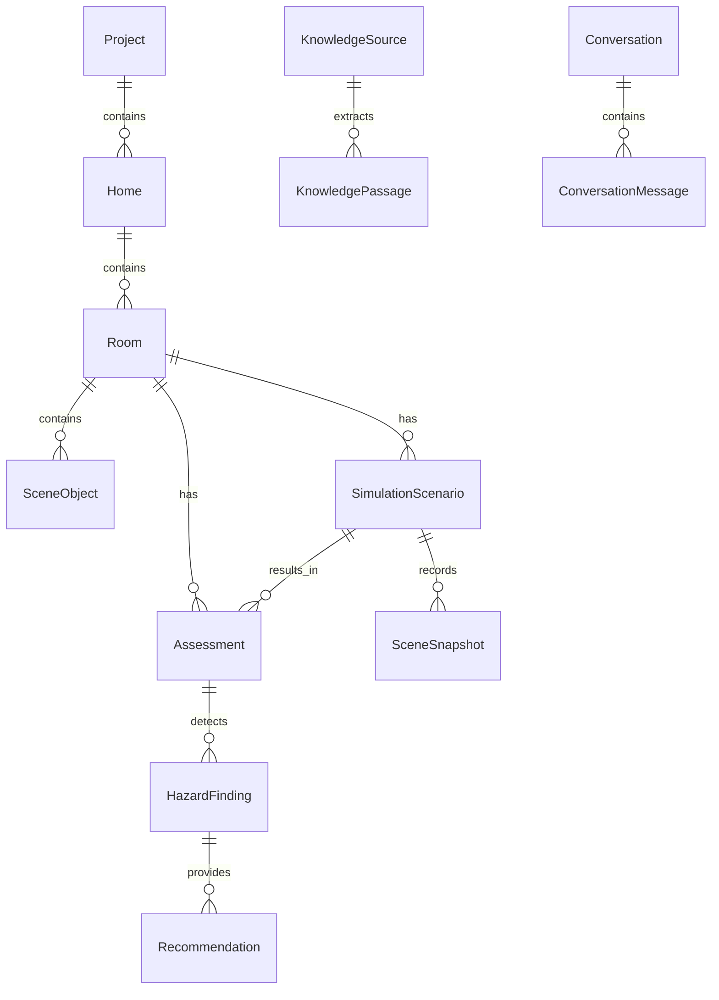

# SafeHome 3D AI — Lược Đồ Cơ Sở Dữ Liệu (Database Schema)

## 1. Công nghệ cơ sở dữ liệu
- **ORM**: Prisma Client v5.22.0
- **Database cục bộ**: SQLite (`prisma/dev.db`) — Zero-configuration, sẵn sàng chạy ngay.
- **Khả năng mở rộng**: Sẵn sàng chuyển đổi sang PostgreSQL thông qua việc đổi `provider = "postgresql"` trong `prisma/schema.prisma`.

---

## 2. Mô hình thực thể (Entities & Relations)

### 2.1. Bảng `Project` & `Home`
- `Project`: Quản lý chương trình khảo sát (`id`, `name`, `description`, `createdAt`, `updatedAt`).
- `Home`: Căn hộ hoặc nhà ở cụ thể, lưu hồ sơ người cao tuổi cư trú (`targetResidentProfile`, `address`).

### 2.2. Bảng `Room` & `SceneObject`
- `Room`: Không gian phòng (`roomType`: BEDROOM / BATHROOM / LIVING_ROOM, `width`, `length`, `height`, `floorMaterial`, `lightingLevel`, `isWet`, `isSlipResistant`, `grabBarsCount`).
- `SceneObject`: Đồ nội thất và thiết bị 3D (`category`, `modelType`, tọa độ `positionX/Y/Z`, góc xoay `rotationX/Y/Z`, kích thước `width/length/height`, cờ an toàn `isLoose`, `isFixed`, `isWalkwayObstacle`).

### 2.3. Bảng `Assessment` & `HazardFinding`
- `Assessment`: Phiên thẩm định an toàn (`totalHazards`, `resolvedHazards`, `remainingHazards`, `newHazards`, `safetyScore`, `notes`).
- `HazardFinding`: Điểm nguy cơ cụ thể (`hazardType`, `title`, `description`, `severityCategory`, `detectionRuleId`, `evidence`, `recommendationText`, `targetObjectId`, `status`).

### 2.4. Bảng `KnowledgeSource` & `KnowledgePassage`
- `KnowledgeSource`: Tài liệu chuẩn (`title`, `organization`, `url`, `publicationDate`, `sourceStatus`).
- `KnowledgePassage`: Đoạn văn trích dẫn y khoa (`section`, `passageText`, `keywords`, `relatedRules`).

### 2.5. Bảng `Conversation` & `ConversationMessage`
- `Conversation`: Phiên hỏi đáp với Trợ lý AI (`title`, `createdAt`).
- `ConversationMessage`: Tin nhắn hỏi đáp (`role`, `content`, `retrievedPassageIds`, `citations`, `isFallback`).

