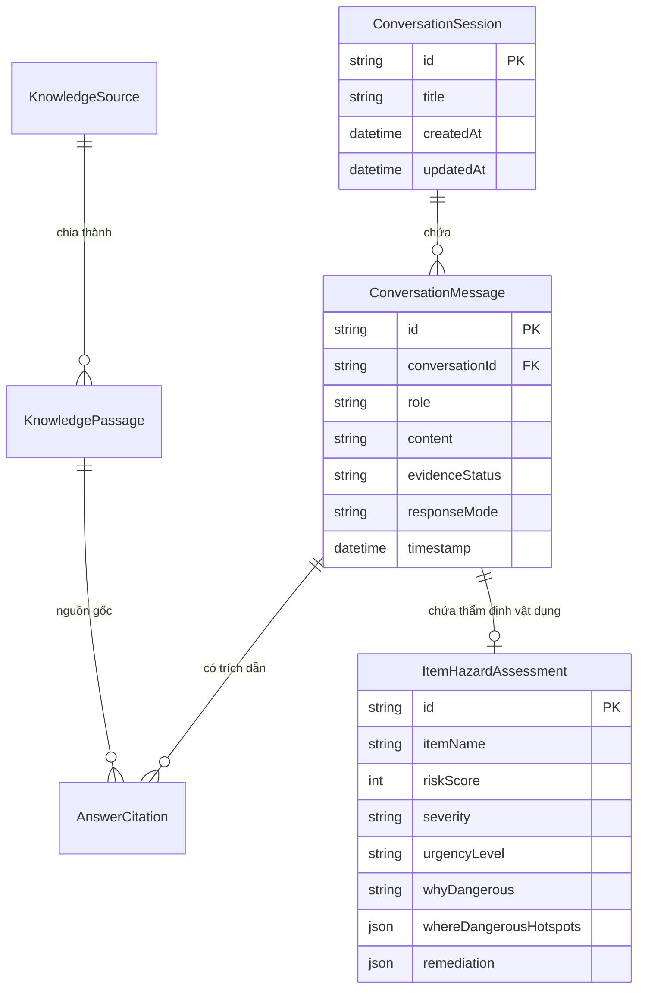

# Kiến Trúc Hệ Thống RAG — SafeHome Copilot

Tài liệu này mô tả chi tiết kiến trúc xử lý từ đầu đến cuối (End-to-End Pipeline) của module AI Chat + Trustworthy RAG trong ứng dụng **SafeHome 3D AI**.

---

## 1. Sơ Đồ Quy Trình Tổng Thể (End-to-End Pipeline)

```mermaid
flowchart TD
    User([Người dùng gửi câu hỏi tiếng Việt / Yêu cầu thẩm định]) --> QA[Query Analysis & Intent Classifier]
    
    QA --> CheckEmergency{Phát hiện cấp cứu?}
    CheckEmergency -- Có --> EmergencyResp[Emergency Escalation: Hướng dẫn gọi 115 & sơ cứu]
    
    CheckEmergency -- Không --> CheckScope{Ngoài phạm vi y khoa?}
    CheckScope -- Có --> ScopeRefusal[Refusal Engine: Từ chối chẩn đoán/kê đơn an toàn]
    
    CheckScope -- Không --> QueryRewrite[Viết lại truy vấn & Lọc Stop Words tiếng Việt]
    QueryRewrite --> Retrieval[Hybrid Retrieval Engine: Field-Boosted TF-IDF]
    
    KnowledgeBase[(Kho tri thức chuẩn hóa: WHO, CDC, Bộ Y tế, NCOA)] --> Retrieval
    
    Retrieval --> EvidenceEval[Evidence Sufficiency Evaluator]
    EvidenceEval --> EvalDecision{Đánh giá chứng cứ}
    
    EvalDecision -- Không đủ / Số liệu mạo nhận --> InsufficientResp[Từ chối khẳng định thiếu chứng cứ]
    EvalDecision -- Đầy đủ / Một phần --> GenEngine[Grounded Generator: Local / External LLM Provider]
    
    GenEngine --> CitationVerifier[Citation Verifier & Anti-Hallucination Filter]
    CitationVerifier --> UIFormat[Đóng gói phản hồi: SafeHomeMarkdown + Thẻ Trích Dẫn [1][2][3]]
    
    EmergencyResp --> Out([Giao diện 3-Panel: Lịch sử · Chat Stream · Ngăn Tra Cứu 4-Tab])
    ScopeRefusal --> Out
    InsufficientResp --> Out
    UIFormat --> Out
```

---

## 2. Các Thành Phần Cốt Lõi

### 2.1 Bộ Phân Tích Truy Vấn & Ý Định (`queryAnalysis.ts`)
- **Phân loại ý định (`UserIntent`)**:
  - `EMERGENCY`: Cấp cứu chấn thương cấp tính (ngã bất tỉnh, gãy xương, co giật).
  - `OUT_OF_SCOPE_MEDICAL`: Chẩn đoán bệnh, yêu cầu kê đơn, liều lượng thuốc.
  - `EVIDENCE_REQUEST`: Hỏi về số liệu, nghiên cứu thực nghiệm, hiệu quả phòng ngừa.
  - `EXPLANATION_REQUEST`: Giải thích nguyên nhân tại sao một vật thể nguy hiểm.
  - `RECOMMENDATION_REQUEST`: Hỏi giải pháp, kích thước chuẩn, cách khắc phục.
  - `FOLLOW_UP`: Câu hỏi tiếp nối sử dụng đại từ hoặc câu tỉnh lược.
  - `GENERAL_SAFETY`: Tư vấn an toàn chung.
- **Phát hiện tấn công Prompt Injection**: Nhận diện các mẫu câu phá vỡ chỉ dẫn hệ thống ("ignore previous instructions", "act as DAN",...) và trung hòa ngay lập tức.
- **Viết lại câu hỏi đa lượt (Multi-turn Query Rewriting)**: Ghép chủ ngữ từ lượt hội thoại trước để truy xuất chính xác khi người dùng hỏi các câu ngắn như "Vậy nên đặt ở đâu?".

### 2.2 Động Cơ Truy Xuất Lai (`retrieval.ts`)
- **Bộ lọc Stop Words tiếng Việt**: Tách và loại bỏ các từ phụ trợ giao tiếp ("những gì", "trong", "của", "tôi", "cho", "cần",...) để bảo toàn các danh từ và tính từ kỹ thuật then chốt ("thảm", "phòng ngủ", "thanh vịn", "chống trượt").
- **Field-Boosted Lexical Scoring**:
  - Trùng tiêu đề phân đoạn (`sectionTitle`): nhân trọng số **x5.0**.
  - Trùng từ khóa định danh (`keywords`): nhân trọng số **x4.0**.
  - Trọng số tần suất xuất hiện trong nội dung đoạn văn.
  - Tỉ lệ bao phủ từ khóa truy vấn (`coverageRatio`).
- **Sequential Indexing**: Đánh số chỉ mục trích dẫn tuần tự `[1]`, `[2]`, `[3]` ngay trong kết quả truy xuất để chuẩn hóa việc hiển thị.

### 2.3 Bộ Đánh Giá Tính Đầy Đủ Của Bằng Chứng (`evidenceSufficiency.ts`)
- Ngăn chặn triệt để hiện tượng mô hình tự bịa số liệu khi không có bằng chứng.
- Nếu câu hỏi chứa số liệu khẳng định (ví dụ: "giảm chính xác 80% nguy cơ té ngã") nhưng không có tài liệu nào chứa con số đó, hệ thống lập tức gắn nhãn `INSUFFICIENT_EVIDENCE` và từ chối xác nhận con số.
- Phân loại rõ ràng 5 mức độ:
  - `SUPPORTED`: Bằng chứng trực tiếp, điểm khớp cao.
  - `PARTIALLY_SUPPORTED`: Bằng chứng mang tính nguyên tắc chung, khuyến nghị khảo sát hiện trường thực tế.
  - `INSUFFICIENT_EVIDENCE`: Thiếu tài liệu căn cứ.
  - `CONFLICTING_EVIDENCE`: Tài liệu có hướng dẫn khác nhau theo từng điều kiện cụ thể.
  - `OUT_OF_SCOPE`: Ngoài phạm vi an toàn không gian sống.

### 2.4 Trình Định Dạng Chuyên Biệt `SafeHomeMarkdown.tsx`
- Tối ưu hóa hiển thị văn bản y khoa:
  - Tiêu đề cấp 2, cấp 3 (`##`, `###`) với khoảng cách và typography sắc nét.
  - In đậm và danh sách gạch đầu dòng rõ ràng.
  - Hộp cảnh báo an toàn (`* ⚠️`) với nền vàng nhẹ, đường viền và biểu tượng nổi bật.
  - Thẻ thông tin đối chiếu không gian 3D (`📌`) làm nổi bật phòng và số nguy cơ tiềm ẩn.
  - Thẻ trích dẫn y khoa tương tác (`[1]`, `[2]`, `[3]`, `[4]`): Nhấp vào tự động mở ngăn tra cứu bên phải và cuộn đến đúng đoạn bằng chứng tương ứng.

### 2.5 Ngăn Tra Cứu Bằng Chứng 4 Tab (Right Evidence Drawer)
1. **Tab 1 — Bằng chứng (Evidence):**
   - Tên tài liệu gốc, tổ chức phát hành (WHO, CDC STEADI, Bộ Y Tế, NCOA).
   - Điều khoản, tiêu đề phân đoạn, số trang gốc.
   - Nguyên văn đoạn trích thẩm định y khoa.
   - Đường dẫn liên kết trực tiếp tới cổng thông tin chính thức của tổ chức.
2. **Tab 2 — Vật dụng (Items Vault):**
   - Danh sách và lịch sử các đồ vật đã thẩm định rủi ro qua ảnh.
   - Thẻ tóm tắt mức độ nguy hiểm, số điểm nguy cơ H1..H4.
   - Nút liên kết chuyển nhanh tới phân hệ **Thị giác AI (AI Vision)**.
3. **Tab 3 — Kho nguồn (Sources Whitelist):**
   - Danh bạ các tài liệu chuyên môn được cho phép lưu trữ trong cơ sở tri thức cục bộ.
4. **Tab 4 — Thẩm định RAG (Live RAG Benchmark):**
   - Bảng đánh giá chất lượng câu trả lời theo 8 tiêu chí kiểm thử tự động.

---

## 3. Kiến Trúc Lưu Trữ Hội Thoại (Conversational Memory)


