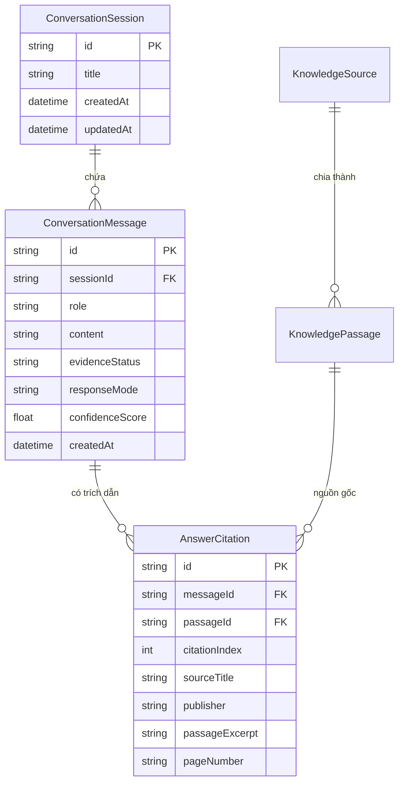

# Kiến Trúc Hệ Thống RAG — SafeHome Copilot

Tài liệu này mô tả chi tiết kiến trúc xử lý từ đầu đến cuối (End-to-End Pipeline) của module AI Chat + Trustworthy RAG trong ứng dụng **SafeHome 3D AI**.

---

## 1. Sơ Đồ Quy Trình Tổng Thể (End-to-End Pipeline)

```mermaid
flowchart TD
    User([Người dùng gửi câu hỏi tiếng Việt]) --> QA[Query Analysis & Intent Classifier]
    
    QA --> CheckEmergency{Phát hiện cấp cứu?}
    CheckEmergency -- Có --> EmergencyResp[Emergency Escalation: Hướng dẫn gọi 115 & sơ cứu]
    
    CheckEmergency -- Không --> CheckScope{Ngoài phạm vi y khoa?}
    CheckScope -- Có --> ScopeRefusal[Refusal Engine: Từ chối chẩn đoán/kê đơn an toàn]
    
    CheckScope -- Không --> QueryRewrite[Viết lại truy vấn & Lọc Stop Words tiếng Việt]
    QueryRewrite --> Retrieval[Hybrid Retrieval Engine: Field-Boosted TF-IDF]
    
    KnowledgeBase[(Kho tri thức chuẩn hóa: WHO, CDC, Bộ Y tế)] --> Retrieval
    
    Retrieval --> EvidenceEval[Evidence Sufficiency Evaluator]
    EvidenceEval --> EvalDecision{Đánh giá chứng cứ}
    
    EvalDecision -- Không đủ / Số liệu mạo nhận --> InsufficientResp[Từ chối khẳng định thiếu chứng cứ]
    EvalDecision -- Đầy đủ / Một phần --> GenEngine[Grounded Generator: Local / LLM Provider]
    
    GenEngine --> CitationVerifier[Citation Verifier & Anti-Hallucination Filter]
    CitationVerifier --> UIFormat[Đóng gói phản hồi: Markdown + Clickable [1][2] + Follow-up]
    
    EmergencyResp --> Out([Hiển thị trên giao diện 3-Panel & Lưu SQLite])
    ScopeRefusal --> Out
    InsufficientResp --> Out
    UIFormat --> Out
```

---

## 2. Các Thành Phần Cốt Lõi

### 2.1 Bộ Phân Tích Truy Vấn & Ý Định (`queryAnalysis.ts`)
- **Phân loại ý định (`UserIntent`)**:
  - `EMERGENCY`: Cấp cứu chấn thương cấp tính (ngã bất tỉnh, gãy xương, co giật).
  - `OUT_OF_SCOPE_MEDICAL`: Chẩn đoán bệnh, yêu cầu kê đơn, liều lượng thuốc.
  - `EVIDENCE_REQUEST`: Hỏi về số liệu, nghiên cứu thực nghiệm, hiệu quả phòng ngừa.
  - `EXPLANATION_REQUEST`: Giải thích nguyên nhân tại sao một vật thể nguy hiểm.
  - `RECOMMENDATION_REQUEST`: Hỏi giải pháp, kích thước chuẩn, cách khắc phục.
  - `FOLLOW_UP`: Câu hỏi tiếp nối sử dụng đại từ hoặc câu tỉnh lược.
  - `GENERAL_SAFETY`: Tư vấn an toàn chung.
- **Phát hiện tấn công Prompt Injection**: Nhận diện các mẫu câu phá vỡ chỉ dẫn hệ thống ("ignore previous instructions", "act as DAN",...) và trung hòa ngay lập tức.
- **Viết lại câu hỏi đa lượt (Multi-turn Query Rewriting)**: Ghép chủ ngữ từ lượt hội thoại trước để truy xuất chính xác khi người dùng hỏi các câu ngắn như "Vậy nên đặt ở đâu?".

### 2.2 Động Cơ Truy Xuất Lai (`retrieval.ts`)
- **Bộ lọc Stop Words tiếng Việt**: Tách và loại bỏ các từ phụ trợ giao tiếp ("những gì", "trong", "của", "tôi", "cho", "cần",...) để bảo toàn các danh từ và tính từ kỹ thuật then chốt ("thảm", "phòng ngủ", "thanh vịn", "chống trượt").
- **Field-Boosted Lexical Scoring**:
  - Trùng tiêu đề phân đoạn (`sectionTitle`): nhân trọng số **x5.0**.
  - Trùng từ khóa định danh (`keywords`): nhân trọng số **x4.0**.
  - Trọng số tần suất xuất hiện trong nội dung đoạn văn.
  - Tỉ lệ bao phủ từ khóa truy vấn (`coverageRatio`).
- **Sequential Indexing**: Đánh số chỉ mục trích dẫn tuần tự `[1]`, `[2]`, `[3]` ngay trong kết quả truy xuất để chuẩn hóa việc hiển thị.

### 2.3 Bộ Đánh Giá Tính Đầy Đủ Của Bằng Chứng (`evidenceSufficiency.ts`)
- Ngăn chặn triệt để hiện tượng mô hình tự bịa số liệu khi không có bằng chứng.
- Nếu câu hỏi chứa số liệu khẳng định (ví dụ: "giảm chính xác 80% nguy cơ té ngã") nhưng không có tài liệu nào chứa con số đó, hệ thống lập tức gắn nhãn `INSUFFICIENT_EVIDENCE` và từ chối xác nhận con số.
- Phân loại rõ ràng 5 mức độ:
  - `SUPPORTED`: Bằng chứng trực tiếp, điểm khớp cao.
  - `PARTIALLY_SUPPORTED`: Bằng chứng mang tính nguyên tắc chung, khuyến nghị khảo sát hiện trường thực tế.
  - `INSUFFICIENT_EVIDENCE`: Thiếu tài liệu căn cứ.
  - `CONFLICTING_EVIDENCE`: Tài liệu có hướng dẫn khác nhau theo từng điều kiện cụ thể.
  - `OUT_OF_SCOPE`: Ngoài phạm vi an toàn không gian sống.

### 2.4 Bộ Xác Thực Trích Dẫn Chống Bịa Đặt (`citationVerifier.ts`)
- Quét toàn bộ văn bản phản hồi tìm các ký hiệu `[k]`.
- Đối chiếu `k` với danh sách phân đoạn bằng chứng đã truy xuất.
- **Loại bỏ tự động**: Mọi số trích dẫn không tồn tại trong danh sách bằng chứng thực tế sẽ bị bóc tách khỏi câu trả lời.
- Gắn kèm metadata trích dẫn có cấu trúc: Tên văn bản, tổ chức công bố, số trang, offset đoạn văn bản và mã kiểm tra SHA-256.

### 2.5 Bộ Sinh Lời Thoại Đối Chiếu (`groundedGenerator.ts`)
- **Chế độ Ngoại biên (External LLM Provider)**: Hỗ trợ cấu hình Google Gemini (`gemini-1.5-pro`) hoặc OpenAI (`gpt-4o`) qua biến môi trường.
- **Chế độ Cục bộ Chuẩn xác (Local Grounded Fallback)**: Hoạt động 100% offline, không phụ thuộc internet hay API key bên thứ ba, tổng hợp câu trả lời dựa trên chính xác các câu từ trong phân đoạn được duyệt.
- Tự động bổ sung lời nhắc y tế tiêu chuẩn và 2-3 câu hỏi gợi ý liên quan theo ngữ cảnh.

---

## 3. Kiến Trúc Lưu Trữ Hội Thoại (Conversational Memory)



