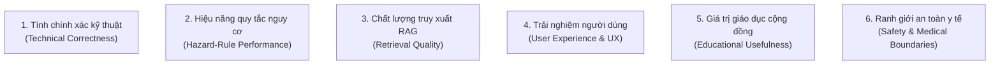

# SafeHome 3D AI — Khung Đánh Giá Nghiên Cứu (Research & Evaluation Framework)

## 1. Mục đích của tài liệu
Tài liệu này xác định phương pháp luận khoa học và các tiêu chí đo lường định tính/định lượng nhằm đánh giá hệ thống **SafeHome 3D AI**. Nhằm đảm bảo tính trung thực khoa học, tài liệu này tách bạch giữa các tiêu chuẩn đo lường kỹ thuật, cơ chế xác thực quy tắc, chất lượng truy xuất tri thức và giới hạn an toàn thực tế.

---

## 2. Khung đánh giá đa chiều (Evaluation Dimensions)

### 2.1. Tính chính xác kỹ thuật (Technical Correctness)
- **Tiêu chí**:
  - Không có lỗi type và lỗi biên dịch production (`npx tsc --noEmit` và `npm run build` hoàn thành với mã thoát 0).
  - Tỷ lệ vượt qua của kiểm thử tự động (Unit, Integration) đạt 100% (18/18 tests passed).
  - Sự đồng bộ trạng thái: Thay đổi trong 3D Viewport phản ánh tức thời và chính xác vào Zustand store, các biểu đồ phân tích và báo cáo xuất bản.

### 2.2. Hiệu năng quy tắc nhận diện nguy cơ (Hazard-Rule Performance)
- **Tiêu chí**:
  - **Độ nhạy (Sensitivity / Recall)**: Khả năng phát hiện đúng tất cả chướng ngại vật xâm phạm hành lang đi lại định trước.
  - **Độ đặc hiệu (Specificity)**: Không báo động giả khi vật thể đã được cố định hoặc nằm ngoài phạm vi lối đi an toàn (thông thủy >= 0.85m).
  - **Khả năng giải trình**: Mỗi kết luận nguy cơ đều xuất ra đầy đủ bằng chứng số học (khoảng cách cm, độ rọi Lux) và quy chuẩn đối chiếu.

### 2.3. Chất lượng truy xuất tri thức (RAG Quality)
- **Tiêu chí**:
  - **Độ chính xác nguồn dẫn (Source Faithfulness)**: 100% câu trả lời của AI và hệ thống phản hồi cục bộ phải trích dẫn đúng ID tài liệu, điều khoản và tổ chức ban hành (WHO, CDC, Bộ Y tế Việt Nam).
  - **Khả năng tự chủ (Offline Autonomy)**: Đảm bảo người dùng luôn nhận được tư vấn chuẩn xác ngay cả khi ngắt kết nối mạng hoặc không có API Key thương mại.
  - **Không phát sinh ảo giác (Zero Hallucination)**: Tuyệt đối không tự suy diễn các con số phần trăm giảm nguy cơ ngã mang tính lâm sàng nếu chưa được công bố trong tài liệu gốc.

### 2.4. Trải nghiệm người dùng (User Experience)
- **Tiêu chí**:
  - Thời gian khởi động không gian 3D: Dưới 1.5 giây (nhờ sử dụng Procedural Geometries thay vì tải các file mô hình GLB dung lượng lớn qua mạng).
  - Khả năng điều khiển camera trực quan: Tự động lướt và lấy nét vào đối tượng khi người dùng nhấp vào thẻ nguy cơ.
  - Hỗ trợ đầy đủ ngôn ngữ tiếng Việt tự nhiên và chuẩn mực cho toàn bộ giao diện người dùng.

### 2.5. Giá trị giáo dục cộng đồng (Educational Usefulness)
- Nâng cao nhận thức của gia đình và người chăm sóc về các mối nguy vô hình trong nhà (như mép thảm, dây điện, độ sáng ban đêm, thiếu điểm tựa trong WC).
- Cung cấp đề xuất giải pháp có chi phí thấp và dễ thực hiện (dán băng dính 2 mặt, nẹp bảo vệ dây, bổ sung đèn ngủ cảm ứng).

### 2.6. Ranh giới an toàn & Tuyên bố giới hạn y tế (Safety & Medical Limitations)
- Hệ thống **không** chẩn đoán hay điều trị y khoa.
- Điểm số an toàn (Safety Score) là chỉ số đánh giá thực nghiệm (heuristic index) phục vụ quy hoạch môi trường vật lý, **không** phải là cam kết cá nhân sẽ không bao giờ bị ngã.

