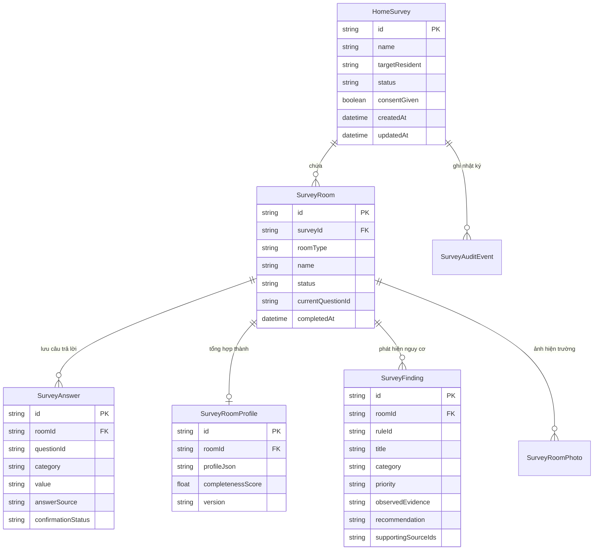

# Lược Đồ Dữ Liệu Khảo Sát — Survey Data Schema

Tài liệu này định nghĩa cấu trúc dữ liệu cơ sở dữ liệu (Prisma Schema) và lược đồ chuẩn hóa của Hồ sơ phòng (`RoomProfile`) trong SafeHome AI Guided Survey.

---

## 1. Lược Đồ Quan Hệ Cơ Sở Dữ Liệu (ERD)



---

## 2. Cấu Trúc JSON Chuẩn Của `RoomProfile`

Khi khảo sát được tiến hành, toàn bộ câu trả lời hợp lệ được bộ tổng hợp `src/lib/survey/profileBuilder.ts` chuyển đổi thành một đối tượng `RoomProfile` JSON chuẩn mực:

```json
{
  "id": "profile-room-12345",
  "surveyId": "survey-abcde",
  "roomId": "room-12345",
  "roomType": "BEDROOM",
  "roomName": "Phòng ngủ chính",
  "status": "COMPLETED",
  "surveyVersion": "1.0.0",
  "dimensions": {
    "lengthM": 4.5,
    "widthM": 3.8,
    "heightM": 2.8,
    "measurementSource": "USER_ESTIMATED",
    "measurementConfidenceType": "ESTIMATED"
  },
  "floor": {
    "material": "Sàn gỗ / Gạch men",
    "isWetReported": false,
    "isSlipperyReported": false,
    "levelDifferenceReported": false,
    "levelDifferenceCm": 0
  },
  "lighting": {
    "adequateAtNight": false,
    "nightLightPresent": false,
    "generalLightingAdequate": null,
    "sourceQuestionIds": ["BED_004", "BED_005"]
  },
  "rugs": {
    "present": true,
    "secured": false,
    "locations": ["Cạnh giường", "Cửa phòng"],
    "sourceQuestionIds": ["BED_006", "BED_007"]
  },
  "electricalCables": {
    "onWalkway": true,
    "sourceQuestionIds": ["BED_008"]
  },
  "obstacles": {
    "present": false,
    "types": [],
    "descriptions": "",
    "sourceQuestionIds": ["BED_009"]
  },
  "grabBars": {
    "present": null,
    "locations": [],
    "inspected": null,
    "sourceQuestionIds": []
  },
  "accessibilityObservations": {
    "bedMobilityDifficulty": false,
    "bathMobilityDifficulty": null,
    "reachingDifficulty": false
  },
  "reportedConcerns": [
    "Thảm chưa cố định chắc chắn",
    "Dây điện vắt ngang lối đi",
    "Ánh sáng ban đêm chưa đầy đủ"
  ],
  "completenessScore": 100,
  "updatedAt": "2026-11-14T15:45:00.000Z"
}
```

---

## 3. Nguồn Gốc Dữ Liệu (Data Provenance)

Mỗi trường dữ liệu được gán nhãn xuất xứ rõ ràng để đảm bảo tính minh bạch:
- `USER_SELECTED`: Người dùng bấm chọn trực tiếp trên giao diện câu hỏi.
- `USER_FREE_TEXT`: Người dùng nhập ghi chú tự do.
- `USER_ESTIMATED`: Kích thước do người dùng ước lượng.
- `NLP_EXTRACTED`: Do AI trích xuất từ câu văn tự nhiên và người dùng đã xác nhận.
- `VISION_SUGGESTED`: Do mô hình AI Vision gợi ý từ ảnh chụp (được gắn nhãn chờ xác nhận).
- `IMPORTED_MEASUREMENT`: Kích thước tham chiếu mặc định (Demo Fallback).

