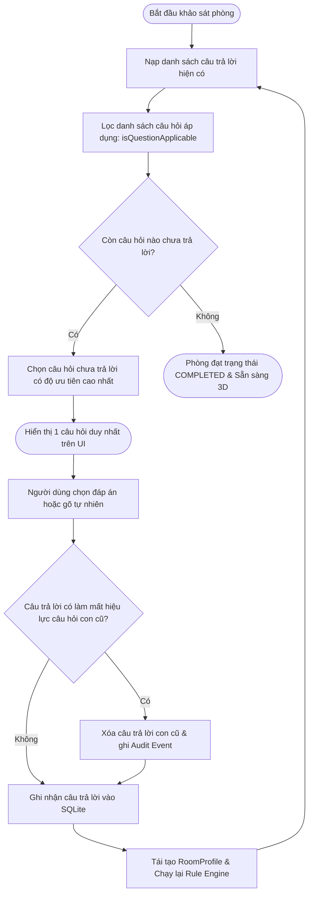

# Động Cơ Điều Phối Khảo Sát Thích Ứng — Survey Flow Engine

Tài liệu này trình bày nguyên lý hoạt động của động cơ điều phối câu hỏi thích ứng (`src/lib/survey/flowEngine.ts`).

---

## 1. Nguyên Tắc Cốt Lõi (Core Principles)

1. **Deterministic & Auditable (Xác định & Có thể kiểm toán)**: Động cơ câu hỏi tuân thủ các quy tắc logic toán học tường minh, không để mô hình AI tự tiện thay đổi thứ tự câu hỏi lâm sàng hoặc bỏ sót các câu hỏi an toàn thiết yếu.
2. **Loại trừ nhánh không liên quan (Dynamic Irrelevance Pruning)**: Không bao giờ hiển thị câu hỏi hỏi về việc cố định thảm nếu người dùng đã trả lời rằng phòng không có thảm.
3. **Tính tiến độ chính xác theo mẫu số thực tế (True Denominator Progress)**:
   - Các bảng câu hỏi kém thường chia số câu đã trả lời cho tổng số câu trong ngân hàng, dẫn đến tiến độ không bao giờ đạt 100% nếu có câu bị bỏ qua theo nhánh.
   - SafeHome tính toán tiến độ dựa trên **Mẫu số câu hỏi thực sự áp dụng tại thời điểm hiện tại**:
     $$\text{Progress} = \frac{\text{Số câu áp dụng đã trả lời}}{\text{Tổng số câu hiện đang áp dụng}} \times 100\%$$
4. **Hủy bỏ câu trả lời cũ phụ thuộc (Stale Dependency Invalidation)**:
   Khi một câu hỏi cha thay đổi giá trị (Ví dụ: từ `Có thảm` sang `Không có thảm`), toàn bộ các câu hỏi con phụ thuộc vào điều kiện `Có thảm` (như `BED_007: Thảm có cố định không`) lập tức bị vô hiệu hóa và xóa khỏi cơ sở dữ liệu để tránh dữ liệu mâu thuẫn.

---

## 2. Sơ Đồ Thuật Toán Điều Phối (Flow Algorithm)



---

## 3. Quy Tắc Đánh Giá Điều Kiện Phụ Thuộc (Conditional Rules)

Mỗi câu hỏi có thể mang thuộc tính `conditionalRules`:

```typescript
export interface ConditionalRule {
  dependsOnQuestionId: string;
  operator: "EQUALS" | "NOT_EQUALS" | "IN" | "NOT_IN" | "EXISTS";
  expectedValue: any;
}
```

Ví dụ câu hỏi `BED_007`:
```typescript
conditionalRules: [
  {
    dependsOnQuestionId: "BED_006",
    operator: "EQUALS",
    expectedValue: "YES",
  }
]
```
Nếu `BED_006` có giá trị là `"NO"` hoặc chưa được trả lời, `isQuestionApplicable("BED_007")` sẽ trả về `false`, loại trừ câu hỏi này khỏi danh sách câu hỏi cần hỏi và loại trừ khỏi mẫu số tiến độ.

