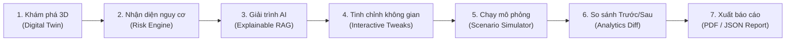

# SafeHome 3D AI — Hướng Dẫn Sử Dụng (User Guide)

## 1. Giới thiệu tổng quan
**SafeHome 3D AI — Nhà an toàn, tuổi già an tâm** là nền tảng Bản sao số (Digital Twin) 3D kết hợp AI hỗ trợ nhận diện, giải trình và chủ động loại bỏ các nguy cơ gây té ngã trong không gian sống của người cao tuổi.

---

## 2. Quy trình trải nghiệm toàn diện (End-to-End Workflow)

### Bước 1: Khám phá không gian 3D (`/digital-twin`)
- Bấm chọn phòng: **Phòng ngủ (Ban đêm)**, **Phòng tắm**, **Phòng khách**.
- Sử dụng chuột trái để xoay camera 3D, chuột phải để pan (di chuyển ngang), con lăn để zoom phóng to/thu nhỏ.
- Chuyển đổi các góc nhìn nhanh: **Isometric**, **Mặt bằng (Top)**, **Chính diện (Front)**.
- Bật/tắt các lớp hiển thị: Nhãn vật thể, Đánh dấu nguy cơ, Hành lang đi lại, Tường trong suốt.

### Bước 2: Nhận diện và thẩm định nguy cơ (`/risk-assessment`)
- Quan sát danh sách các nguy cơ được phát hiện tự động.
- Bấm vào từng thẻ nguy cơ để máy ảnh 3D tự động lướt đến vị trí chướng ngại vật tương ứng.
- Đọc thông số đo đạc cụ thể (khoảng cách cm, cường độ Lux, độ ướt của sàn).

### Bước 3: Tra cứu kiến thức với Trợ lý AI (`/ai-assistant`)
- Đặt câu hỏi trực tiếp cho AI về các biện pháp cải tạo nhà cửa phòng ngừa té ngã.
- Xem đoạn trích dẫn nguyên văn từ các hướng dẫn của **WHO**, **CDC STEADI**, và **Bộ Y tế Việt Nam**.

### Bước 4: Can thiệp và tinh chỉnh môi trường (`/scenario-simulator`)
- Nhấp chọn vật thể trong 3D:
  - Dùng thanh trượt điều chỉnh tọa độ X, Z hoặc góc xoay để di chuyển bàn trà, chướng ngại vật ra khỏi hành lang.
  - Bấm nút **"Dán băng dính & lót cao su chống trượt"** trên thảm trải sàn.
  - Bấm nút **"Luồn nẹp bảo vệ sát tường"** đối với dây điện quạt sàn.
- Tại bảng điều khiển môi trường phòng:
  - Bật/tắt trạng thái sàn ướt hoặc lớp phủ nano chống trơn.
  - Bấm **"Thêm thanh vịn bồn cầu"**, **"Thêm thanh vịn buồng tắm"**, hoặc **"Thêm đèn ngủ cảm biến"**.

### Bước 5: Chạy mô phỏng & Đánh giá kết quả
- Bấm nút **"Chạy mô phỏng"** (nút màu xanh ngọc có hiệu ứng phát sáng).
- Hệ thống sẽ tức thì:
  1. Quét lại toàn bộ hình học 3D.
  2. Xác định các nguy cơ đã được giải quyết (Resolved) và còn tồn đọng (Remaining).
  3. Cập nhật lại chỉ số an toàn (Safety Score).
  4. Hiển thị bảng đối sánh chi tiết.

### Bước 6: Xem sơ đồ giải trình quyết định (`/explainability`)
- Khám phá sơ đồ đồ thị minh bạch chuỗi nhân quả: Vật thể → Thuộc tính đo đạc → Quy chuẩn → Nguy cơ → Khuyến nghị.

### Bước 7: Xuất báo cáo an toàn (`/reports`)
- Xem bản tóm tắt hoàn chỉnh kèm bảng số liệu chi tiết và chi phí dự toán.
- Bấm **"In / Lưu PDF"** để in trực tiếp hoặc lưu file PDF gửi cho gia đình/thợ thi công.
- Bấm **"Xuất JSON"** để lưu trữ dữ liệu thẩm định.

