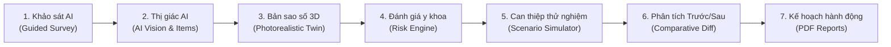
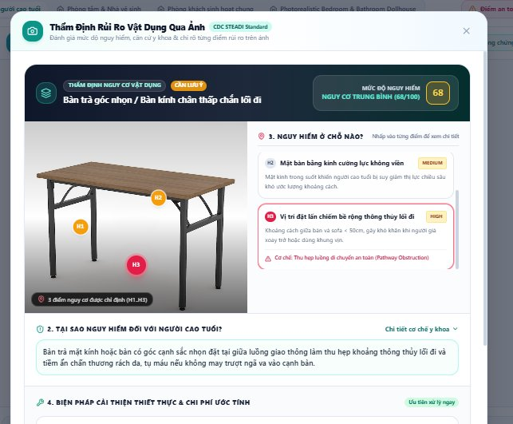
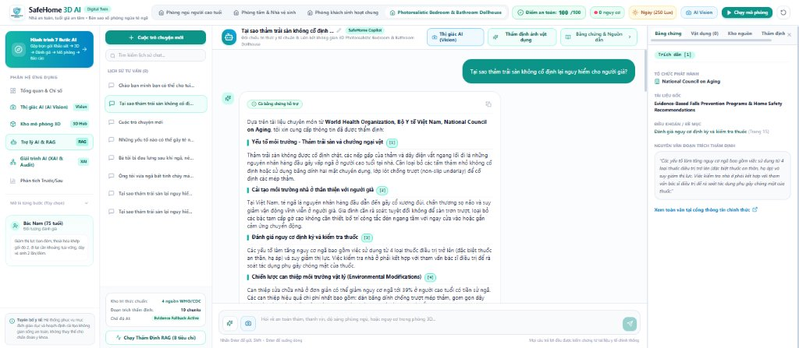
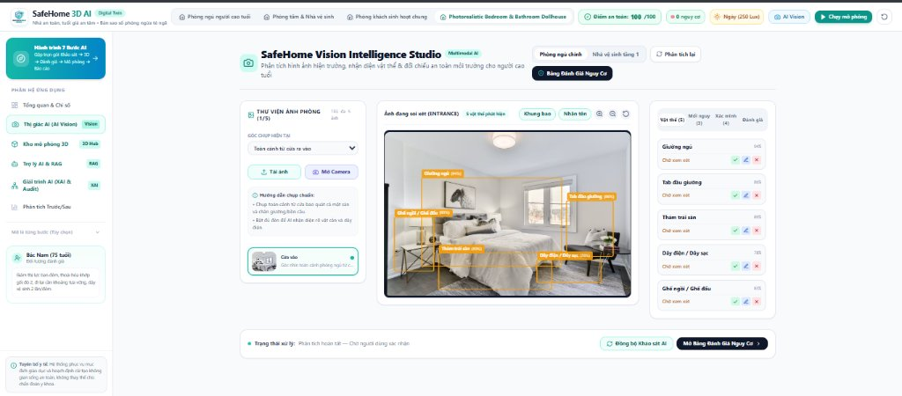
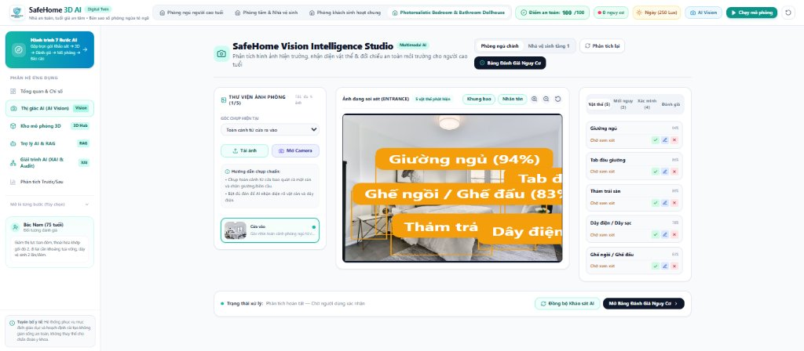
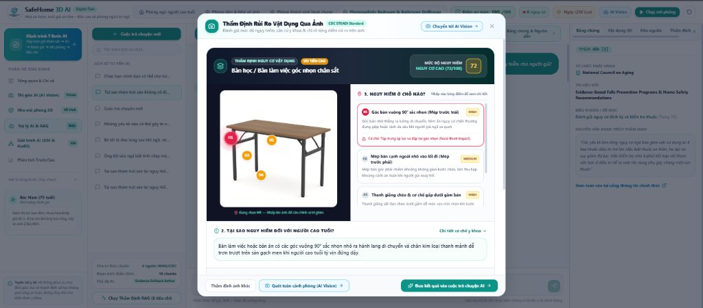
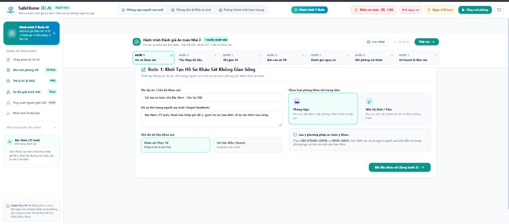
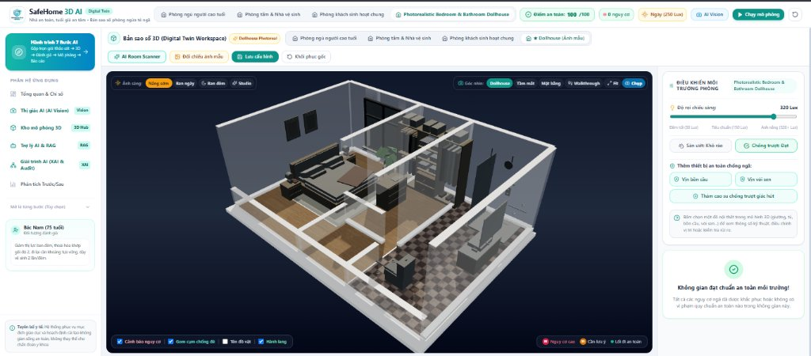
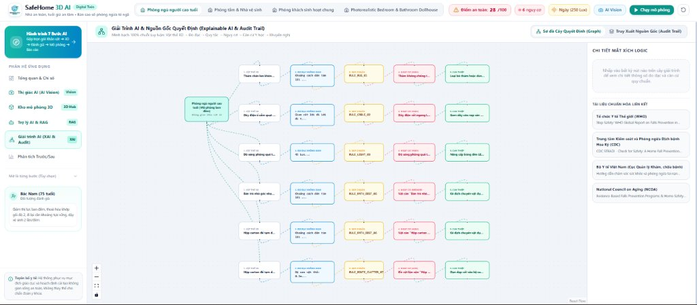

# SafeHome 3D AI — Hướng Dẫn Sử Dụng Toàn Diện (Comprehensive User Guide)

**SafeHome 3D AI — Nhà an toàn, tuổi già an tâm** là hệ sinh thái Bản sao số (Digital Twin) 3D kết hợp Thị giác AI đa tầng và Động cơ đánh giá rủi ro y khoa tất định, hỗ trợ người cao tuổi và gia đình nhận diện, giải trình và chủ động loại bỏ các nguy cơ gây té ngã trong không gian sống.

---

## 1. Bản Đồ Điều Hướng & Quy Trình Khép Kín

Hệ sinh thái SafeHome 3D AI cung cấp 2 chế độ tiếp cận:
1. **Hành trình 7 Bước Khép Kín (`/workflow`):** Dẫn dắt người dùng qua từng công đoạn một cách tuần tự từ Khảo sát $\rightarrow$ Thị giác $\rightarrow$ 3D $\rightarrow$ Đánh giá $\rightarrow$ Can thiệp $\rightarrow$ So sánh $\rightarrow$ Báo cáo.
2. **Các Phân Hệ Độc Lập (Main Navigation):** Truy cập trực tiếp qua thanh bên (Sidebar) để làm việc chuyên sâu với từng công cụ.

---

## 2. Hướng Dẫn Chi Tiết Từng Phân Hệ

### 2.1. Phân Hệ Tổng Quan & Chỉ Số (`/dashboard`)
- **Mục đích:** Theo dõi tổng quan tình trạng an toàn của toàn bộ ngôi nhà.
- **Thành phần chính:**
  - **Chỉ số an toàn tổng hợp (Safety Score 0 - 100):** Đánh giá mức độ an toàn hiện tại của không gian sống.
  - **Thẻ thống kê nhanh:** Số lượng phòng đã khảo sát, tổng số điểm nguy cơ tiềm ẩn (phân loại mức độ ưu tiên cao).
  - **Mô phỏng 3D Digital Twin trực quan thu nhỏ:** Tương tác xoay, zoom và xem các điểm nguy cơ được ghim trong không gian.
  - **Biểu đồ phân loại nguy cơ:** Thảm trượt, Dây điện chắn lối, Thiếu ánh sáng, Vật cản lối đi, Đồ đạc bừa bộn.
  - **Mật độ nguy cơ theo từng phòng:** So sánh mức độ rủi ro giữa phòng ngủ, phòng tắm và phòng khách.

  
   <em>Giao diện Bảng điều khiển tổng quan: Điểm an toàn 28/100, biểu đồ rủi ro Donut Chart và 3D viewport thu nhỏ.</em>

---

### 2.2. Phân Hệ Thị Giác AI & Quét Phòng (`/ai-vision`)
- **Mục đích:** Phân tích hình ảnh hiện trường thực tế, tự động nhận diện vật thể và trích xuất số đo không gian.
- **Cách sử dụng:**
  1. Chọn góc chụp hiện tại (Toàn cảnh từ cửa ra vào, Góc giường ngủ, Cửa nhà vệ sinh).
  2. Bấm **"Tải ảnh"** hoặc **"Mở Camera"** để nạp ảnh phòng thực tế.
  3. Hệ thống tự động xác thực Magic Bytes, loại bỏ thông tin EXIF nhạy cảm và nhận diện 18 lớp vật thể y tế.
  4. Quan sát các khung bao Bounding Box sắc nét kèm nhãn tên và độ tin cậy phần trăm (%).
  5. Sử dụng thanh công cụ để phóng to/thu nhỏ, bật/tắt **"Khung bao"** và **"Nhãn tên"**.
  6. Tại bảng danh sách vật thể bên phải: Bấm xác nhận (`✓`), sửa nhãn (`✎`) hoặc loại bỏ (`✕`).
  7. Bấm **"Mở Bảng Đánh Giá Nguy Cơ"** để liên kết sang bước tiếp theo.

  
   <em>Giao diện Thị giác AI (AI Vision): Quét nhận diện vật thể nội thất, khung bao sắc nét chống phóng đại chữ Chromium và nhãn độ tin cậy.</em>

---

### 2.3. Thẩm Định Rủi Ro Vật Dụng Đơn Lẻ Qua Ảnh (`ItemAssessmentModal`)
- **Mục đích:** Khi người dùng chụp ảnh một đồ vật cụ thể (ví dụ: chiếc bàn, tấm thảm, đoạn dây điện) và cần biết chính xác mức độ nguy hại đối với người cao tuổi theo chuẩn **CDC STEADI**.
- **Cách mở:** Bấm nút **"Thẩm định ảnh vật dụng"** (biểu tượng Camera / Sparkles) trên thanh công cụ của Trợ lý AI (`/ai-assistant`).
- **Nội dung kết quả thẩm định:**
  - **1. Mức độ nguy hiểm bao nhiêu?** Chấm điểm rủi ro khách quan (0 - 100) và xếp hạng ưu tiên (`KHẨN CẤP`, `ƯU TIÊN CAO`, `TRUNG BÌNH`, `THẤP`).
  - **2. Tại sao nguy hiểm đối với người già?** Giải thích cơ chế sinh cơ học (lực va đập góc nhọn, hệ số ma sát trượt thấp, mất nhận thức chiều sâu qua mặt kính, thu hẹp lối đi <90cm).
  - **3. Nguy hiểm ở chỗ nào?** Hiển thị các điểm ghim nguy cơ (**H1, H2, H3, H4...**) ngay trên ảnh vật dụng.
  - **Tính năng điều chỉnh ghim (Click-to-reposition):** Chọn điểm H1..H4 rồi bấm trực tiếp vào bức ảnh để dịch chuyển ghim đến vị trí chính xác mong muốn.
  - **4. Biện pháp cải thiện thiết thực & Chi phí dự toán:** Hướng dẫn từng bước khắc phục, vật tư cần chuẩn bị và ước tính chi phí (VND).
- **Hành động tiếp theo:**
  - Bấm **"Đưa kết quả vào cuộc trò chuyện AI"** để thảo luận chuyên sâu với SafeHome Copilot.
  - Bấm **"Quét toàn cảnh phòng (AI Vision)"** để chuyển tiếp sang mô phỏng không gian phòng tổng thể.

  
   <em>Giao diện Thẩm định rủi ro vật dụng qua ảnh (CDC STEADI): Điểm nguy cơ 68/100, hotspots H1..H3 và cơ chế y khoa.</em>

  
   <em>Chi tiết điểm nguy cơ H1: Cơ chế Focal Blunt Impact tại góc nhọn 90° và tính năng kéo thả căn chỉnh tọa độ ghim.</em>

---

### 2.4. Bản Sao Số 3D & Không Gian Dollhouse Photorealistic (`/digital-twin`)
- **Mục đích:** Tương tác trực tiếp với mô hình 3D thực tế của ngôi nhà, quan sát các điểm nguy cơ và tinh chỉnh môi trường vật lý.
- **Thao tác chuột:**
  - **Chuột trái:** Xoay camera 3D (Orbit).
  - **Chuột phải:** Di chuyển tịnh tiến camera (Pan).
  - **Con lăn chuột:** Phóng to / Thu nhỏ (Zoom).
- **Studio điều khiển ánh sáng:**
  - Bấm chọn các chế độ thiết lập sẵn: **Hoàng hôn**, **Ban ngày (250 Lux)**, **Ban đêm (40 Lux)**, **Studio (320 Lux)**.
  - Kéo thanh trượt **Độ rọi chiếu sáng** để kiểm tra mức độ tối của căn phòng (dưới 50 Lux là ngưỡng nguy cơ cao theo WHO).
- **Điều khiển bề mặt sàn & Thiết bị chống ngã:**
  - Bật/tắt trạng thái sàn: **Khô ráo** vs **Sàn ướt**.
  - Bổ sung tức thì thiết bị trợ giúp: **Thanh vịn bồn cầu**, **Thanh vịn vòi sen**, **Thảm cao su chống trượt giác hút**.
- **Chế độ góc nhìn linh hoạt:**
  - **Dollhouse:** Góc nhìn toàn cảnh từ trên cao kiểu nhà búp bê cắt trần.
  - **Tầm mắt:** Đặt camera ngang tầm mắt người cao tuổi khi đứng trong phòng.
  - **Mặt bằng (Top 2D):** Góc nhìn bản vẽ kiến trúc 2D từ trên đỉnh xuống.
  - **Walkthrough:** Chế độ góc nhìn thứ nhất để đi dạo trong không gian.
  - **Fit:** Tự động căn chỉnh mô hình vừa vặn khung hình.
  - **Chụp:** Xuất ảnh chụp màn hình 3D chất lượng cao.
- **Thuật toán gom cụm nhãn (<0.95m):** Khi có nhiều nguy cơ nằm sát nhau, hệ thống tự động gộp thành thẻ cụm `🔴 +3 Nguy cơ`, bấm vào để mở rộng danh sách chi tiết mà không lo bị đè chữ.

  
   <em>Bản sao số 3D Photorealistic Dollhouse: Mô phỏng không gian phòng ngủ và nhà vệ sinh khép kín với ánh sáng Studio 320 Lux.</em>

---

### 2.5. Đánh Giá Nguy Cơ Y Khoa Tất Định (`/risk-assessment`)
- **Mục đích:** Chấm điểm an toàn lâm sàng dựa trên 8 quy tắc xác định của WHO 2021 & CDC STEADI.
- **Nội dung hiển thị:**
  - Điểm an toàn tổng hợp: $S = \max(0, 100 - \sum \text{Phạt})$.
  - Bảng liệt kê các vi phạm kèm điểm trừ, trích dẫn quy chuẩn y tế và mức độ ưu tiên xử lý.
  - Bấm vào bất kỳ thẻ nguy cơ nào, camera 3D sẽ tự động lướt đến đúng vị trí vật thể tương ứng.

---

### 2.6. Mô Phỏng Kịch Bản Can Thiệp Thử Nghiệm (`/scenario-simulator`)
- **Mục đích:** Thử nghiệm trước các phương án sửa đổi không gian (What-If Analysis) để xem điểm an toàn sẽ tăng lên bao nhiêu trước khi tiến hành mua sắm hoặc thi công thật.
- **Các hành động can thiệp:**
  - Dán keo chống trượt cho thảm lót sàn.
  - Nẹp luồn dây điện sát chân tường.
  - Nâng cấp bóng đèn LED cảm ứng đạt $\ge 150\text{ Lux}$.
  - Lắp đặt thanh vịn tiêu chuẩn y tế (đường kính $3.2 - 4.0\text{ cm}$, chịu lực $\ge 110\text{ kg}$).
  - Bo tròn các góc bàn sắc nhọn ($R \ge 2\text{ cm}$).
- **Hỗ trợ Hoàn tác (Undo/Redo):** Cho phép hoàn tác hoặc làm lại các bước can thiệp tùy thích.
- Bấm **"Chạy mô phỏng"** để cập nhật lại toàn bộ điểm số an toàn ngay lập tức.

---

### 2.7. Phân Tích Trước / Sau Cải Tạo (`/analytics`)
- **Mục đích:** Đánh giá định lượng hiệu quả của các biện pháp can thiệp.
- **Nội dung:**
  - Biểu đồ mạng nhện (Radar Chart) so sánh 5 khía cạnh an toàn: Chiếu sáng, Thông thủy lối đi, Ma sát mặt sàn, Điểm tựa vững chắc, Chướng ngại vật.
  - Chỉ số Delta Score: Mức tăng điểm an toàn và phần trăm giảm thiểu rủi ro té ngã ước tính.

---

### 2.8. Sơ Đồ Giải Trình AI & Nhật Ký Quyết Định (`/explainability`)
- **Mục đích:** Minh bạch hóa 100% nguyên nhân AI đưa ra cảnh báo, không có "hộp đen".
- **Sơ đồ cây quyết định (ReactFlow Graph):**
  - Trực quan hóa đường liên kết từ:  
    $\text{Phòng} \longrightarrow \text{Vật thể 3D} \longrightarrow \text{Số đo không gian} \longrightarrow \text{Quy tắc y tế} \longrightarrow \text{Nguy cơ kết luận} \longrightarrow \text{Giải pháp đề xuất}$.
  - Nhấp vào từng nút để xem nguyên văn tài liệu căn cứ của WHO, CDC STEADI và Bộ Y Tế.
- **Nhật ký truy vết (Audit Trail):** Ghi nhận lịch sử chi tiết thời gian, đối tượng và người can thiệp.

  
   <em>Cây phả hệ suy luận ReactFlow minh bạch 100%: Từ vật thể nhận diện đến điều khoản quy chuẩn y tế và can thiệp cải tạo.</em>

---

### 2.9. Trợ Lý AI RAG & Ngăn Tra Cứu Bằng Chứng (`/ai-assistant`)
- **Mục đích:** Đặt câu hỏi và nhận tư vấn chuyên môn về an toàn nhà ở cho người cao tuổi.
- **Đặc điểm nổi bật:**
  - Định dạng văn bản SafeHomeMarkdown đẹp mắt, rõ ràng.
  - Mọi khẳng định chuyên môn đều có thẻ trích dẫn chỉ mục y khoa `[1]`, `[2]`, `[3]`. Nhấp vào số trích dẫn để mở ngay đoạn trích nguyên văn tại **Ngăn tra cứu bằng chứng bên phải**.
  - **4 Tab thanh tra:**
    1. **Bằng chứng:** Xem nguyên văn văn bản, số trang và link tra cứu chính thức.
    2. **Vật dụng:** Xem lại lịch sử các đồ vật đã tải ảnh lên thẩm định.
    3. **Kho nguồn:** Danh mục các tổ chức y tế uy tín được kiểm duyệt.
    4. **Thẩm định RAG:** Chạy kiểm tra trực tiếp 8 tiêu chí chất lượng câu trả lời.
  - Phím tắt chuyển nhanh: Nút **"Thị giác AI (Vision)"** trên header và composer giúp chuyển tiếp sang quét phòng bất cứ lúc nào.

  
   <em>Hội thoại thông minh SafeHome Copilot: Tự động đối chiếu thông số phòng 3D và dẫn nguồn y khoa [1] WHO, [2] NCOA, [3] BYT, [4] CDC.</em>

  
   <em>Ngăn tra cứu bằng chứng RAG 4 Tab: Trích xuất nguyên văn văn bản y khoa chính thống và liên kết kiểm chứng trực tuyến.</em>

---

### 2.10. Kế Hoạch Cải Tạo & Xuất Báo Cáo (`/reports`)
- **Mục đích:** Đóng gói toàn bộ kết quả thành tài liệu hành động thiết thực.
- **Tính năng:**
  - Danh mục công việc cải tạo cần làm theo thứ tự ưu tiên (24h, 48h, 1 tuần).
  - Dự toán tổng chi phí vật tư và nhân công ước tính (VND).
  - Bấm **"In / Xuất PDF"** để in trực tiếp hoặc lưu file PDF gửi cho thợ thi công hoặc người thân trong gia đình.
  - Bấm **"Xuất JSON"** để tích hợp hệ thống hoặc lưu trữ hồ sơ y tế điện tử.

---

## 3. Tuyên Bố Miễn Trừ Trách Nhiệm Y Tế

*SafeHome 3D AI là nền tảng số hóa hỗ trợ giáo dục cộng đồng, tầm soát nguy cơ môi trường và hoạch định cải tạo không gian sống an toàn cho người cao tuổi. Nền tảng không thay thế cho chẩn đoán y khoa, thẩm định xây dựng tại hiện trường hoặc chỉ định của bác sĩ chuyên khoa.*
