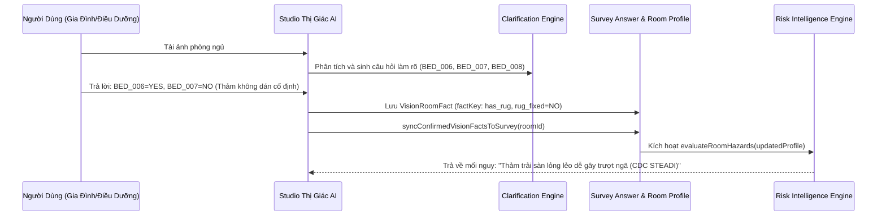

# Tích Hợp Thị Giác Và Khảo Sát AI (Vision & Guided Survey Integration)

Tài liệu này hướng dẫn cách dữ liệu trích xuất từ hình ảnh kết nối trực tiếp với phân hệ **SafeHome AI Guided Survey**.

---

## 1. Cơ Chế Ánh Xạ Câu Hỏi Làm Rõ (Clarification Question Mapping)

Khi AI Vision phân tích ảnh phòng ngủ hoặc phòng tắm, nó tự động đối chiếu với ngân hàng câu hỏi khảo sát:

| Mã Câu Hỏi Khảo Sát | Tên Mục Khảo Sát | Kích Hoạt Bởi Phát Hiện Thị Giác | Giá Trị Gợi Ý Từ Thị Giác |
|---|---|---|---|
| `BED_006` | Có thảm trải sàn trong phòng ngủ không? | Phát hiện `rug` trong ảnh phòng ngủ | `"YES"` |
| `BED_007` | Thảm có được dán chống trượt hoặc cố định không? | Phát hiện `rug` trong ảnh | Cần người dùng trả lời `"YES"` hoặc `"NO"` |
| `BED_008` | Có dây điện, cáp sạc chạy ngang lối đi không? | Phát hiện `electrical_cable` trên sàn | `"YES"` (Cảnh báo cao) |
| `BED_004` | Giường có độ cao phù hợp khi ngồi không? | Phát hiện `bed` (ước lượng trực quan) | Gợi ý kiểm tra chiều cao chân |
| `BATH_005` | Có thanh tay vịn chuyên dụng gần bồn cầu/vòi sen không? | Phân tích phòng tắm không thấy `grab_bar` | Gợi ý `"NO"` (Thiếu tay vịn) |
| `BATH_003` | Sàn nhà tắm có lót thảm chống trượt không? | Phát hiện sàn gạch trơn không có thảm cao su | Gợi ý `"NO"` |

---

## 2. Quy Trình Đồng Bộ Hóa (Synchronization Pipeline)

---

## 3. Quản Lý Nguồn Gốc Thông Tin (Data Provenance)
Mọi câu trả lời được đồng bộ vào khảo sát từ ảnh đều được đánh dấu cờ nguồn gốc rõ ràng:
- `answerSource`: `"VISION_SUGGESTED"`
- `confirmationStatus`: `"CONFIRMED"`
Điều này đảm bảo tính minh bạch, giúp bác sĩ hoặc chuyên viên an toàn biết rõ thông tin nào đến từ ảnh chụp và thông tin nào do người nhà tự khai báo.

