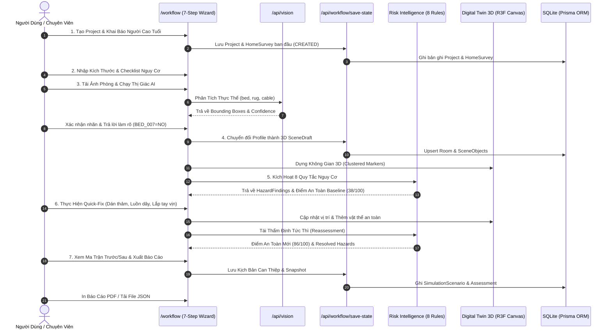

# LUỒNG DỮ LIỆU TOÀN HỆ THỐNG (DATA FLOW ARCHITECTURE)
### SafeHome 3D AI — Đồng Bộ Hóa Xuyên Suốt Từ Khảo Sát Tới Digital Twin & Báo Cáo

Tài liệu này định nghĩa hợp đồng dữ liệu (Data Contracts), mô hình quan hệ cơ sở dữ liệu và cơ chế chuyển tiếp trạng thái giữa các phân hệ:

```text
Project
  └── Home
        └── Room (BEDROOM / BATHROOM)
              ├── SceneObjects (Vị trí 3D, kích thước, thuộc tính an toàn)
              ├── Assessment (Chỉ số an toàn, 8 Quy tắc, HazardFindings)
              └── SimulationScenario (Kịch bản can thiệp, SceneSnapshots)
```

Song song với chuỗi lưu trữ khảo sát:

```text
HomeSurvey
  └── SurveyRoom
        ├── SurveyAnswer (Câu trả lời từng mã câu hỏi BED_001..008)
        ├── SurveyRoomProfile (Hồ sơ phòng chuẩn hóa)
        ├── SurveyFinding (Sàng lọc nguy cơ ban đầu)
        └── RoomImage (Ảnh phòng, VisionAnalysis, ObjectDetection, VisionRoomFact)
```

---

## 1. Sơ Đồ Chuyển Tiếp Dữ Liệu Xuyên Suốt (End-to-End Data Pipeline)



---

## 2. Các Hợp Đồng Dữ Liệu Chính (Key Data Contracts)

### 2.1 Trạng Thái Đối Tượng Không Gian 3D (`SceneObjectState`)
```typescript
export interface SceneObjectState {
  id: string;
  roomId: string;
  name: string;
  category: "FURNITURE" | "RUG" | "CABLE" | "LIGHTING" | "SAFETY_DEVICE" | "OBSTACLE";
  modelType: string;
  position: [number, number, number];
  rotation: [number, number, number];
  scale: [number, number, number];
  dimensions: { width: number; length: number; height: number };
  isWalkwayObstacle?: boolean;
  isFixed?: boolean;
  isLoose?: boolean;
  isSlippery?: boolean;
}
```

### 2.2 Kết Quả Đánh Giá Rủi Ro (`AssessmentResult`)
```typescript
export interface AssessmentResult {
  id: string;
  roomId: string;
  timestamp: string;
  totalHazards: number;
  resolvedHazards: number;
  remainingHazards: number;
  newHazards: number;
  safetyScore: number; // Thang đo heuristic nội bộ 0-100
  findings: HazardFindingResult[];
  notes?: string;
}
```

### 2.3 So Sánh Kịch Bản Trước/Sau (`ScenarioComparison`)
```typescript
export interface ScenarioComparison {
  baselineScenarioId: string;
  currentScenarioId: string;
  resolved: HazardFindingResult[];
  remaining: HazardFindingResult[];
  newlyIntroduced: HazardFindingResult[];
  baselineScore: number;
  currentScore: number;
  scoreDelta: number;
}
```
Mọi thông số so sánh đều được tính toán động dựa trên trạng thái thực tế của không gian 3D, đảm bảo không có bất kỳ con số hardcoded nào được sinh ra.

