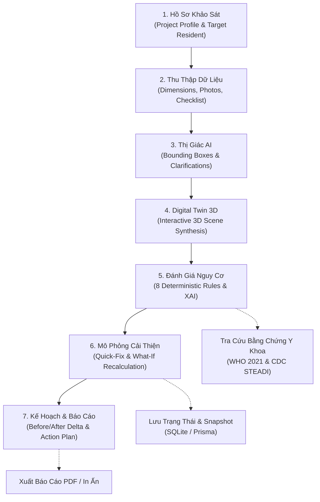

# QUY TRÌNH HOẠT ĐỘNG XUYÊN SUỐT (END-TO-END WORKFLOW)
### SafeHome 3D AI — 7 Bước Khép Kín Từ Khảo Sát Đến Báo Cáo Can Thiệp

Tài liệu này mô tả chi tiết hành trình trải nghiệm người dùng tích hợp (End-to-End User Journey) kết nối toàn bộ các công nghệ AI, Thị giác, 3D Digital Twin và RAG Y khoa thành một luồng duy nhất:

**Khảo sát nhà ở → Thu thập dữ liệu → Dựng Digital Twin 3D → Đánh giá nguy cơ → Mô phỏng cải thiện → So sánh kết quả → Kế hoạch hành động & Báo cáo.**

---

## 1. Sơ Đồ Quy Trình 7 Bước (Workflow Diagram)



---

## 2. Máy Trạng Thái Quy Trình (Workflow State Machine)

Trạng thái của hồ sơ khảo sát chuyển đổi tuần tự theo các pha:

```text
CREATED
  │
  ▼ (Người dùng nhập thông tin phòng & thể trạng người cao tuổi)
SURVEY_IN_PROGRESS
  │
  ▼ (Thu thập kích thước, ảnh chụp và checklist nguy cơ)
SURVEY_COMPLETED
  │
  ▼ (AI Vision phân tích và người dùng xác nhận nhãn)
SCENE_READY
  │
  ▼ (Tạo bản sao 3D và chạy động cơ 8 quy tắc rủi ro)
ASSESSED
  │
  ▼ (Người dùng thử nghiệm di chuyển đồ đạc, dán thảm, thêm tay vịn)
SIMULATION_IN_PROGRESS
  │
  ▼ (Tính toán lại điểm an toàn và so sánh Before/After)
REASSESSED
  │
  ▼ (Tổng hợp ma trận cải tạo và khuyến nghị can thiệp)
REPORT_READY
```

---

## 3. Chi Tiết Từng Bước Trong Hành Trình

### Bước 1: Khởi Tạo Hồ Sơ Khảo Sát
- Người dùng tạo dự án mới hoặc chọn dự án đã lưu.
- Khai báo hồ sơ thể trạng người cao tuổi (ví dụ: tuổi, tiền sử té ngã, thoái hóa khớp, thị lực kém).
- Lựa chọn phòng khảo sát trọng tâm (`BEDROOM` hoặc `BATHROOM`).
- Chọn chế độ: Khảo sát thực tế (Real) hoặc Dữ liệu mẫu thực nghiệm (Demo).
- Hệ thống tự sinh `Project ID` và `Survey ID`, lưu vào cơ sở dữ liệu.

### Bước 2: Thu Thập Dữ Liệu Không Gian Sống
- Khai báo kích thước thực tế: Chiều dài, chiều rộng, chiều cao (kèm các gợi ý chuẩn: 3.5×4.5m, 4.0×5.0m, 2.5×2.5m).
- Tải ảnh phòng hoặc chụp trực tiếp từ webcam (tự động loại bỏ siêu dữ liệu định vị GPS EXIF).
- Trả lời checklist nhanh 5 yếu tố nguy cơ hàng đầu theo khuyến cáo y tế: Sàn ướt, thảm lỏng lẻo, dây điện vắt ngang, đèn đêm mờ, thiếu tay vịn.

### Bước 3: Thị Giác AI & Xác Minh Con Người (Human-in-the-Loop)
- AI Vision quét ảnh và khoanh vùng các thực thể nội thất (`bed`, `nightstand`, `rug`, `cable`, `toilet`, `grab_bar`).
- Hiển thị độ tin cậy mô hình minh bạch (ví dụ: Giường 94%, Thảm 88%, Dây điện 82%).
- Người dùng có thể xác nhận, đổi nhãn hoặc bác bỏ nếu phát hiện nhầm lẫn.
- Trả lời câu hỏi làm rõ quan trọng (`BED_006`, `BED_007`, `BED_008`, `BATH_005`) để chuyển hóa quan sát thành sự thật phòng được xác nhận (`VisionRoomFact`).

### Bước 4: Bản Sao Số 3D (Digital Twin 3D Workspace)
- Tự động dựng mô hình phòng 3D trực quan từ số đo và đồ vật đã xác nhận.
- Áp dụng cơ chế **Gom cụm cảnh báo (Marker Clustering)** chống đè nhãn triệt để.
- Cho phép người dùng xoay góc nhìn (Isometric, Top-down, Front-view), dịch chuyển đồ đạc, thêm thanh tay vịn Inox hoặc thảm cao su chống trượt.

### Bước 5: Đánh Giá Nguy Cơ & Tiêu Điểm 3D (Risk Intelligence & XAI)
- Động cơ 8 Quy Tắc (Deterministic Rules) tính toán chỉ số an toàn và danh sách nguy cơ.
- Khi người dùng nhấp vào một mối nguy trong danh sách, camera 3D lập tức lướt mượt mà tới tâm của vật cản.
- Cung cấp nút **"Giải thích Y khoa (RAG)"** trích dẫn bằng chứng khoa học chuẩn từ WHO (2021) và CDC STEADI (2019).

### Bước 6: Mô Phỏng Cải Thiện Môi Trường (What-If Simulation)
- Cung cấp các nút can thiệp nhanh 1 chạm:
  1. *Dán cố định thảm sàn* (Băng dính 2 mặt chống trượt).
  2. *Nẹp luồn dây điện sát vách tường*.
  3. *Lắp thanh tay vịn trợ lực Inox 304* (chịu tải 250 lbs).
  4. *Lắp đèn ngủ cảm ứng chân tường* (>80 Lux).
- Hệ thống tính toán lại điểm an toàn theo thời gian thực (ví dụ: tăng từ 38/100 lên 86/100), cập nhật số lượng nguy cơ đã giải quyết.

### Bước 7: Kế Hoạch Hành Động Thực Tế & Xuất Báo Cáo
- Hiển thị bảng so sánh Trước/Sau (Baseline vs Modified).
- Lập bảng kế hoạch hành động phân chia rõ ràng theo chi phí và thời gian thực hiện ngoài đời:
  - *Việc làm ngay (&lt;50.000 VNĐ, 15 phút)*: Dán thảm, cuộn dây sạc.
  - *Việc cần mua sắm (100.000 - 450.000 VNĐ)*: Đèn cảm biến, thanh tay vịn Inox.
- Cho phép xuất file JSON hoặc in trực tiếp ra file PDF chuyên nghiệp để chia sẻ cho bác sĩ và gia đình.

