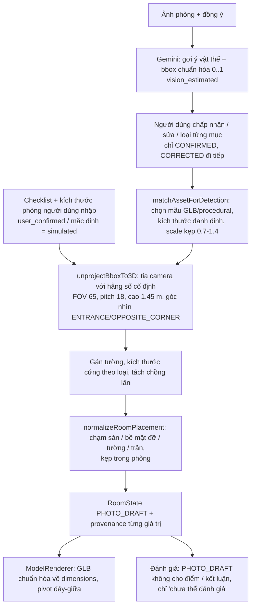

# B06 — Kiểm toán phương pháp 3D: nguồn gốc số liệu, quy ước tọa độ, giới hạn

Phạm vi: `src/lib/reconstruction/**`, `src/components/three/**`, `src/lib/assets/**`, `/workflow` bước 3-4. Số dòng (`file:line`) là của nhánh `feature/b-07-3d-provenance-placement`.

**Kết luận ngắn:** cảnh 3D là **Mô hình phòng gần đúng** (xem `CONTEXT.md`): bố cục dựng từ gợi ý vật thể trong ảnh, kích thước danh định của mẫu và chỉnh sửa của người dùng. **Sai số chưa được đo.** Không có con số "±x%" nào được phép trích dẫn cho đến khi có đo đối chiếu trên phòng thật (mục 6).

## 1. Pipeline thực tế

Đường checklist (không ảnh) không đi qua B-G: cảnh là phòng mẫu trong `src/data/mockRooms.ts`, được gắn nhãn mẫu/mô phỏng.

## 2. Phần tử cảnh đến từ đâu

| Phần tử | Nguồn thực sự | `sourceType` gắn |
| :-- | :-- | :-- |
| Kích thước phòng khi người dùng không nhập | Mặc định 4.5×5.0 (ngủ) / 3.2×3.6 (tắm), cao 2.8 (`spatialReconstructor.ts:88-90`) | `simulated` |
| Kích thước phòng người dùng nhập ở bước 2 | Số nhập tay (từng trục; trục chưa gõ vẫn là mặc định) | `user_confirmed` / `simulated` theo trục |
| Vị trí x,z của vật thể từ ảnh | Bbox → phép chiếu heuristic (mục 3) | `vision_estimated` |
| Kích thước vật thể khớp mẫu GLB, scale ≈ 1 | Kích thước danh định `ASSET_REGISTRY` | `simulated` |
| Kích thước vật thể bị co/giãn theo ước lượng từ bbox | `nominal × scale kẹp 0.7-1.4` | `vision_estimated` |
| Kích thước cứng theo loại (công tắc, tranh, quạt, điều hòa, vách lam, đôn) | Hằng số trong code (`spatialReconstructor.ts:243-267`) | `simulated` |
| Chiều cao mặt nệm giường | Tỉ lệ mẫu 0.545 × tổng cao, hoặc số người dùng nhập | `simulated` / `user_confirmed` |
| Vị trí sau khi người dùng kéo trong 3D | Thao tác mô phỏng | `simulated` |
| Kích thước người dùng sửa trong store | Nhập tay | `user_confirmed` (từng trục đổi) |
| Phòng mẫu (`mockRooms.ts`) | Dữ liệu mẫu | `simulated` (thiếu `provenance` = `simulated`) |
| Giá trị `measured` | Chưa có đường nhập số đo dụng cụ vào cảnh 3D | không có |

Đối tượng khi hiển thị: nhãn "Mô hình phòng (mô phỏng gần đúng)" xuất hiện trừ khi **kích thước phòng và mọi giá trị của mọi vật thể** đều `measured`/`user_confirmed` (`sceneProvenance.ts: isApproximateRoomModel`). Bảng thông tin vật thể hiện nhãn nguồn cho từng giá trị.

## 3. Hằng số mã cứng (giả định chưa kiểm chứng)

| Giả định | Vị trí | Ghi chú |
| :-- | :-- | :-- |
| FOV dọc 65° | `spatialReconstructor.ts:35`, `:119` | Điện thoại góc rộng/ảnh crop sẽ lệch |
| Pitch camera 18° | `:34` | Không đọc từ EXIF/cảm biến |
| Camera cao 1.45 m | `:46` | Người chụp khác nhau |
| Camera đặt cách tường trước 0.35 m | `:50`, `:53`, `:120`, `:219` | Giả định vị trí đứng |
| Phòng mặc định 4.5×5.0 / 3.2×3.6, cao 2.8 | `:88-90` | Dùng khi người dùng không nhập |
| Hệ số chiều cao ×0.9 | `:123` | Heuristic thực nghiệm, không hiệu chỉnh |
| Ngưỡng bbox xác định tường 0.28 / 0.72 | `:133-134`, `:177-178` | Gán tường theo vị trí trong ảnh |
| Lề kẹp 0.15 m | `:190` | |
| Độ cao lắp cố định: công tắc 1.15, tranh 1.55, quạt trần cao-0.28, điều hòa cao-0.42 | `:245`, `:250`, `:255`, `:260` | Sau B07 còn bị kẹp dưới trần và đặt lại bởi `scenePlacement.ts` |
| Kích thước cố định sofa/bàn/ghế/đôn | `:262-290` | |
| Kẹp scale mẫu 0.7-1.4 | `assetMatcher.ts:170-172` | Vật thể thật ngoài khoảng này bị méo về mẫu |
| Kẹp procedural 0.7-1.45 | `assetMatcher.ts:225` | |
| `isSlipResistant: !isBathroom`, độ rọi 120/180 lux | `spatialReconstructor.ts:438`, `:441` | **Giá trị sàn/ánh sáng suy từ loại phòng, không phải quan sát.** Với `PHOTO_DRAFT` bị bỏ qua khi đánh giá, nhưng còn nằm trong `RoomState`. Cần A xem xét (mục 7) |
| Dung sai chạm sàn 3.5 cm, tường 6 cm | `spatialValidationEngine.ts:137-138` | |
| Chiều cao thanh vịn chuẩn 0.85 m | `scenePlacement.ts` (`WALL_MOUNT_BOTTOM_M`) | Đặt khi vật chưa có độ cao |

## 4. Quy ước tọa độ và pivot (đã xác minh trong mã)

- Đơn vị cảnh: **mét**. Đơn vị nhỏ (chiều cao mặt nệm, gờ ngưỡng) theo hợp đồng V1: **cm** trong `Measurement`/rule input; trong `SceneObjectState` mọi thứ là mét, `bedSurfaceHeightCm`/`totalBedHeightCm` là cm.
- Trục: **x phải, y lên, z hướng về phía lối vào/camera**; tường sau ở `z = -length/2`. Gốc = tâm sàn phòng. `width` chạy theo x, `length` theo z (`sceneGraphTypes.ts`, `spatialReconstructor.ts:46-53`).
- **Pivot đối tượng = tâm đáy**: `position[1]` là **đáy** vật thể (không phải tâm). Bằng chứng: `normalizeModel` đưa GLB về đáy-giữa (`modelPlacement.ts`; test `modelPlacement.test.ts` kiểm `min.y = 0`), `ArchitecturalBed` dựng từ y=0, `ModelRenderer` đặt khung chọn ở `height*0.5` bên trong group (nên **nghi vấn #1 của B01 là sai**: không có lệch nửa chiều cao do quy ước y).
- `rotation[1] = 0`: mặt trước vật hướng +z. Vật gắn tường quay vào phòng: tường trái `+π/2`, phải `-π/2`, sau `0`, trước `π`. Với xoay 90°, kích thước chiếm theo x là `length` (độ sâu), nên `width` luôn là bề mặt trước.
- `dimensions` = kích thước **cuối cùng** theo mét. `scale` của instance luôn `[1,1,1]`. Trước B07 bộ dựng gán `scale` bằng tỉ lệ mẫu→ước lượng **và** `dimensions` đã nhân tỉ lệ đó, nên GLB bị nhân đôi (nghi vấn #2 của B01 là đúng theo hướng khác: GLB có chuẩn hóa, nhưng scale bị áp hai lần). Đã sửa.
- Hỗ trợ (`parentObjectId`): đèn bàn/cây/hộp nhỏ nằm trên tủ đầu giường/bàn/kệ mà tâm của nó nằm trong; dây điện nằm trên thảm nó cắt. Đáy = đỉnh vật đỡ. Kéo vật đỡ trong store thì vật con đi theo. Chưa hỗ trợ: xếp chồng nhiều tầng, vật đỡ bị xoay lệch (AABB dùng cho kiểm tra), đổi chiều cao vật đỡ sau khi đặt.
- Thảm: `y = 0.005` (tránh z-fighting), dây điện trên thảm: `y = 0.02`.

## 5. Mã định danh

`obj-<loại>-<hậu tố của det>` (Hợp đồng V1 §2.1) với `makeObjectId`. Chuỗi liên kết: `det-*` (gợi ý AI) → `SceneObjectState.detectionId` / `customProperties.sourceDetectionId` → `finding.targetObjectId` (= `obj.id`) → hotspot `H1..` trong `RoomCanvas` (`hazardMap` theo `targetObjectId`). Chọn một phát hiện ở bước 5 gọi `selectObject(targetObjectId)` nên đúng vật thể được làm nổi bật.

Chưa làm: lưu `det → obj` trong snapshot A11 (cần A).

## 6. Cách đo sai số trên phòng thử nghiệm (chưa thực hiện)

1. Chọn ≥ 10 phòng pilot có consent. Mỗi phòng: đo bằng thước laser/thước dây **rộng × dài × cao**, và tâm + kích thước của ≥ 5 vật (giường, tủ, bàn đầu giường, bồn cầu, bồn rửa), so với một mốc cố định (góc cửa chính). Ghi mỗi số thành một `Measurement` `measured` với `m-<field>-<id>`, `method` ("laser_meter"), `uncertainty` của dụng cụ.
2. Chụp ảnh theo hướng dẫn cố định (đứng ở cửa, cao 1.45 m, ngang), ghi thiết bị.
3. Chạy pipeline với kích thước phòng **không nhập** và **có nhập** (hai điều kiện riêng).
4. Sai số: `|giá trị dựng - giá trị đo|` theo từng trục, theo từng loại vật; báo trung vị, phân vị 90 và số ca vượt dung sai 10/20 cm. Báo cáo theo hộ gia đình, không gộp tuần tự.
5. Chỉ sau khi có bảng này mới được ghi con số sai số, kèm điều kiện chụp. Khi đó có thể hiệu chỉnh FOV/pitch/chiều cao camera trên tập huấn luyện và chấm trên tập giữ riêng (không tái dùng tập khóa).

## 7. Việc chưa giải quyết và yêu cầu cho A

- Rule input hiện **chưa có trường chiều cao giường** trong `src/lib/risk/types.ts`; `bedHeightRuleInput(bed)` (`sceneProvenance.ts`) trả `ProvenanceRecord<number>` cm đúng nguồn, luôn lấy chiều cao mặt nệm. A cần nối vào `bedSurfaceHeightCm` của rule khi có.
- `RoomState.floorProperties` (`isSlipResistant`, độ rọi) trong bộ dựng là suy từ loại phòng; đề nghị A cho phép `unknown` thay cho boolean.
- Đường nhập `measured` (dụng cụ) cho từng vật/phòng trong UI chưa có.
- Chưa có kiểm tra va chạm giữa vật thể với nhau ngoài tách chồng lấn heuristic; vật xoay không vuông góc dùng AABB nên kiểm tra hơi rộng.
- Chiều cao đèn bàn không có parent (không có nơi đỡ) đặt xuống sàn.
